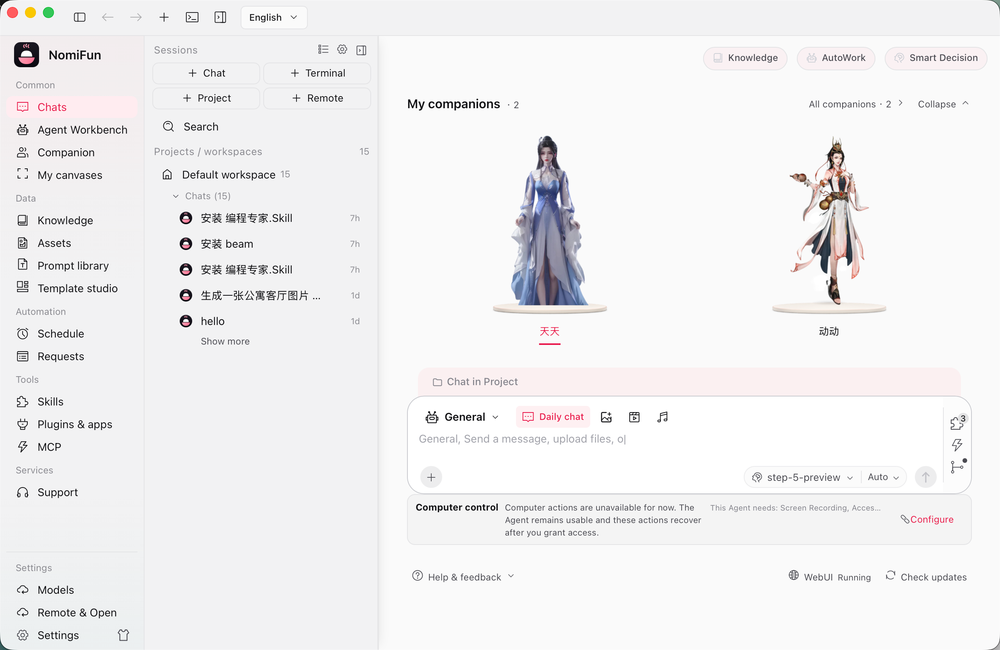
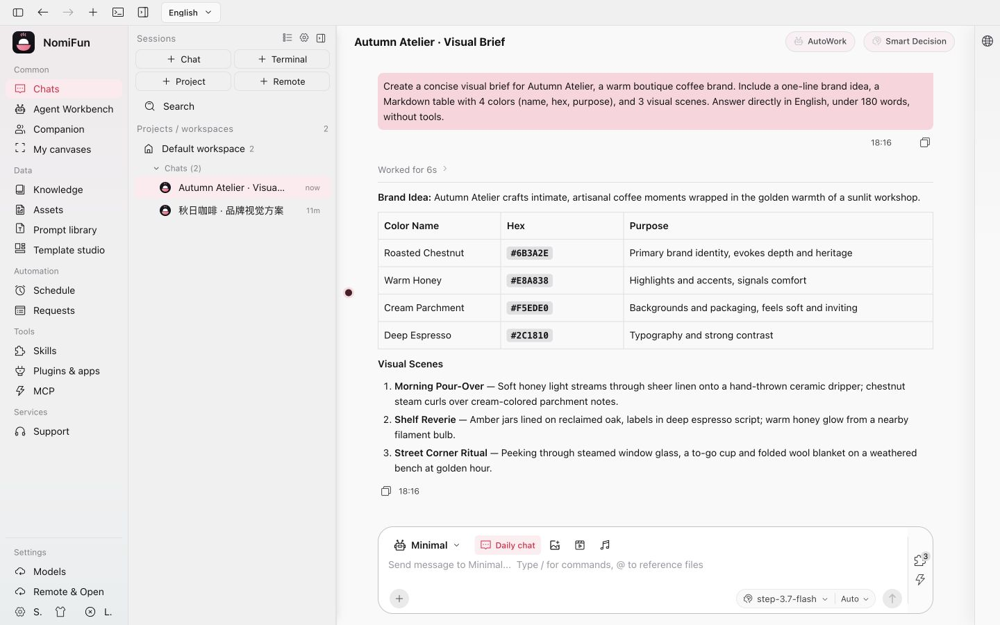
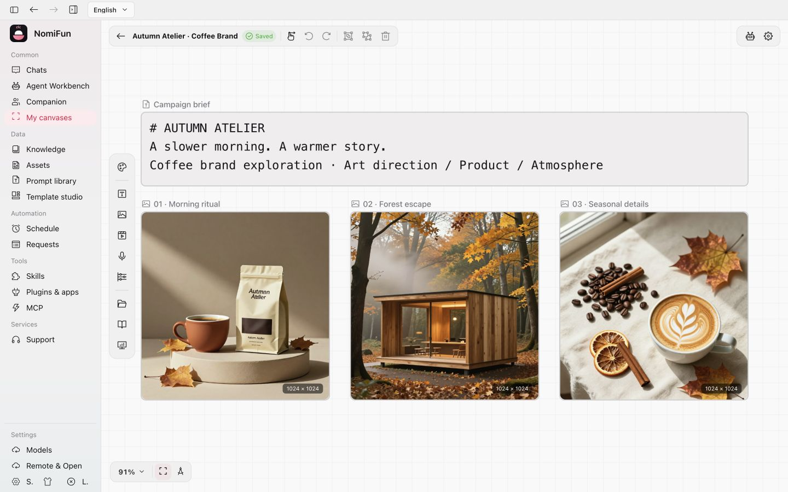
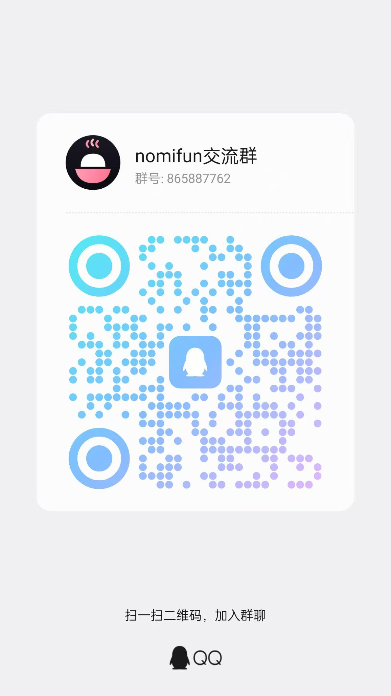

<a name="top"></a>

<div align="center">

<a href="https://www.nomifun.com">
  
</a>

<h3>A no-holds-barred, fully open-source, <em>local-first</em> super AI workstation.</h3>

<p>
  Rich, inventive capabilities and serious productivity gains —<br/>
  with <b>all your data staying on your own machine</b>. Safe for individuals and enterprises, free to commercialize, open to audit.
</p>

<p>
  <a href="LICENSE"></a>
  
  
  <a href="https://www.nomifun.com"></a>
</p>

<p>
  
  
  
  <a href="https://github.com/nomifun/nomifun-desktop/stargazers"></a>
</p>

<p>
  <b>English</b>&nbsp;·&nbsp;<a href="README.zh-CN.md">简体中文</a>
</p>

<p>
  <a href="https://www.nomifun.com">🌐 Website</a>&nbsp;·&nbsp;
  <a href="https://www.nomifun.com/docs/">📖 Docs</a>&nbsp;·&nbsp;
  <a href="#-getting-started">🚀 Get started</a>&nbsp;·&nbsp;
  <a href="https://github.com/nomifun/nomifun-desktop/releases">📦 Releases</a>&nbsp;·&nbsp;
  <a href="https://gitee.com/nomifun/nomifun-desktop">🇨🇳 Gitee source</a>&nbsp;·&nbsp;
  <a href="https://www.nomifun.com/download">Official download</a>&nbsp;·&nbsp;
  <a href="./RELEASING.zh-CN.md">发版手册</a>&nbsp;·&nbsp;
  <a href="#-contact--community">💬 Community</a>
</p>

</div>

---

> [!IMPORTANT]
> **Public-interest open-source and data-risk notice**: NomiFun is a public-interest open-source project. The maintainers do not assume responsibility for user data loss, corruption, or unrecoverable damage during iteration. Back up your data before upgrades, migrations, experimental features, or real production use.

---

**NomiFun** is everything you imagine an AI workstation to be — and it runs on your terms. One React frontend and one Rust backend give you an evolving desktop companion, an unattended automation platform, a unified knowledge base, native computer- and browser-use, and an open capability bus that any agent can drive. No NomiFun cloud account. No telemetry. No subscription. Your workspace data stays local; requests go to the model services **you** configure, including model invocation, model catalogs, and quota queries.

> The product name is **NomiFun**. Lowercase `nomifun` is used only for code identifiers, crate names, environment variables, and repository paths.

---

## What you can do

NomiFun Desktop is a local AI workstation with one Rust backend shared by a Tauri desktop
app and a desktop-class WebUI. Configure your own model providers and keep application data
in storage you control. Model calls and enabled network integrations contact the services
you choose; see the [network and privacy FAQ](docs/reference/faq.md).

| Workflow | Guide |
| --- | --- |
| Chat with configured providers, local models and task-aware routing | [Models and routing](docs/guides/model-routing.md), [Agents and presets](docs/guides/presets.md) |
| Delegate work, schedule tasks and supervise automation | [Requirements / AutoWork](docs/guides/autowork-requirements.md), [IDMM](docs/guides/intelligent-decision.md), [Scheduled tasks](docs/guides/scheduled-tasks.md) |
| Create on persistent canvases, organize assets and reuse templates | [Creative Studio](docs/guides/creative-studio.md) |
| Run your own source or packaged applications | [Application hosting](docs/guides/app-hosting.md) |
| Use companions, connect a robot or receive IM messages | [Companions](docs/guides/companions.md), [XiaoZhi](docs/guides/xiaozhi-robot.md), [Channels](docs/guides/channels.md) |
| Extend tools and knowledge, automate the desktop and browse | [MCP and Skills](docs/guides/mcp-and-skills.md), [Computer / Browser Use](docs/guides/computer-browser-use.md) |
| Use real terminals, third-party agent CLIs and SSH | [Terminal](docs/guides/terminal.md), [SSH sessions](docs/guides/ssh-sessions.md) |
| Connect remotely or expose governed APIs | [Remote access](docs/guides/webui-remote-access.md), [Remote capability API](docs/guides/remote-capability-api.md) |

### Product family

| Project | Role |
| --- | --- |
| [Desktop](https://github.com/nomifun/nomifun-desktop) | Local data, models, Agent sessions, tools, execution and WebUI; this repository |
| [Mobile](https://github.com/nomifun/nomifun-mobile) | Separate mobile client connected to Desktop |
| [NomiRelay](https://github.com/nomifun/nomifun-net-infra) | Optional remote connectivity infrastructure |
| [Portal](https://github.com/nomifun/nomifun-protal) | Published product site and documentation mirror |

Read the [product ecosystem architecture](docs/architecture/product-ecosystem.md) for the
connection and trust boundaries. The shared Desktop renderer supports desktop browsers and
Tauri windows with a minimum viewport of **880×600**. Native browser capabilities vary by
platform; see the [capability matrix](docs/architecture/browser-platform.md).

### Screenshots




These are example captures, not a live feature inventory. Capture dates, provenance and the
refresh procedure are recorded in the [screenshot manifest](docs/images/SCREENSHOTS.md).

## 🚀 Getting started

Install from [GitHub Releases](https://github.com/nomifun/nomifun-desktop/releases).
You can also download installers from the [official website](https://www.nomifun.com/download).
Follow [Installation](docs/getting-started/installation.md), then
[Quick start](docs/getting-started/quick-start.md).

For source development, install the Rust toolchain, Bun and your platform's Tauri prerequisites
as described in [Development](docs/contributing/development.md):

```bash
git clone https://github.com/nomifun/nomifun-desktop.git
cd nomifun-desktop
bun install
bun run dev
```

For self-hosting, use the [Web server deployment guide](docs/guides/web-server-deployment.md)
for Docker, authentication, persistent storage and HTTPS. The Web host serves the shared API,
WebSocket and built SPA on one port. Native desktop automation requires the desktop host.

## 🛠️ Development

```bash
bun run help       # current script catalog
bun run dev:web    # Web host + Vite
bun run build:ui   # build the SPA
```

Start with [CONTRIBUTING](CONTRIBUTING.md) and the [project map](docs/contributing/project-structure.md).
Choose the smallest checks that cover the change; see [Development](docs/contributing/development.md).
Build native packages on their matching OS using [Building and packaging](docs/contributing/building-and-packaging.md).
Release operators should follow [RELEASING](RELEASING.md).

<details>
<summary>Complete script catalog (generated from scripts/scripts.json)</summary>

<!-- BEGIN GENERATED SCRIPTS (bun run help --readme) -->

| 脚本 | 说明 |
| --- | --- |
| **开发（热重载）** | |
| `bun run dev` | 启动桌面应用开发（tauri dev，热重载） |
| `bun run dev:web` | 启动 Web 全栈开发（后端 API + 前端 vite） |
| `bun run dev:ui` | 仅启动前端开发服务器（纯 vite，无后端） |
| **构建（出制品）** | |
| `bun run build` | 为当前操作系统打桌面安装包 |
| `bun run build:fast` | 快速构建 debug；macOS 输出原生 WKWebView .app，其余平台输出二进制 |
| `bun run build:win` | 打 Windows 安装包（NSIS），汇总到 dist/desktop/ |
| `bun run build:mac` | 构建 macOS App 和 DMG（默认 arm64，可选 Intel），并汇总到 dist/desktop/ |
| `bun run build:linux` | 打 Linux 安装包（.deb/.AppImage/.rpm），汇总到 dist/desktop/ |
| `bun run build:signed` | 构建完整 macOS App，签名并执行已配置的公证 |
| `bun run build:updater` | 构建自更新包与 .sig；macOS 从最终签名 App 生成更新包 |
| `bun run make:latest` | 扫描本机更新产物，生成/合并自动更新清单 latest.json |
| `bun run release:mac` | 一键 macOS 发版：自动判定追加/首发；首发用 -Version 打版本号 + -NotesFile/-Notes 建 Release；-DryRun 只预检 |
| `bun run release:win` | 一键 Windows 发版：自动判定追加/首发；首发用 -Version 打版本号 + -NotesFile/-Notes 建 Release；-DryRun 只预检 |
| `bun run release:win:signed-rc` | 串行构建并验收 Windows x64 签名 RC，绑定 immutable release lock 与 Unified Plugin 边界检查 |
| `bun run release:linux` | 一键 Linux 发版：自动判定追加/首发；首发用 -Version 打版本号 + -NotesFile/-Notes 建 Release；-DryRun 只预检 |
| `bun run release:cloud` | 管理 CrabNebula Cloud 发布草稿、分平台上传、发布与更新端点验证 |
| `bun run build:ui` | 前端生产构建 → ui/dist |
| `bun run docker:prebuilt` | 用已有 ui/dist + nomifun-web release 二进制快速构建 Docker 运行时镜像 |
| **运行（组装好的应用）** | |
| `bun run serve:web` | 启动 Web 服务器，托管已构建的前端 |
| **测试** | |
| `bun run test` | 运行全部 Rust 测试（含 doctest） |
| `bun run test:fast` | 用 nextest 快速跑 Rust 测试（日常） |
| `bun run test:crate` | 运行单个 Rust crate：bun run test:crate <crate> [cargo 参数] |
| `bun run test:core` | 运行不含 desktop-only feature 的 Rust workspace |
| `bun run test:desktop` | 运行桌面壳测试，不监听或打包 ui/dist 资源 |
| `bun run test:upgrade` | 运行启动、数据集兼容与升级定向 Rust 测试 |
| `bun run test:browser` | 运行 browser-use 门控的 Rust 测试（browser-platform 全量 + gateway/ai-agent/app 开启 --features browser-use；crate/core 车道会静默跳过这些） |
| `bun run test:ui` | 运行前端单元测试（bun test，收集 ui/src 下全部 *.test.ts/tsx） |
| `bun run test:nomi-core-live-provider` | Run the credential-isolated canonical AgentSession selected-model smoke against StepFun Coding Plan. |
| `bun run demo:idmm` | 用 StepFun Coding Plan 验收智能决策后台触发、规则、旁路、安全停止和恢复，生成隔离 dev 报告 |
| `bun run test:agent-reliability-report` | 验证 Agent 可靠性统计门禁：精确置信区间、样本去重、独立验收与缺失场景检查 |
| `bun run test:voice-smoke-runner` | 测试有界Mobile语音无头观测脚本，不作为真机体验证据 |
| `bun run test:mobile-voice-live` | 显式参数和凭据授权下观测Mobile语音relay媒体与原工作回执，不启动GUI |
| **静态检查** | |
| `bun run check:docs` | 检查现役文档的本地链接、Markdown 锚点与图片路径 |
| `bun run check:windows-installer` | 校验 Windows NSIS 程序/数据目录分离、锁定模板、第三方归属与安全卸载合同 |
| `bun run check:creative-studio-retirement` | 扫描 tracked 源码，阻止旧创作页面、路由、API、翻译与 Gateway 标记回流 |
| `bun run check:creative-studio-retirement:dist` | 在 UI production build 后扫描 ui/dist，阻止旧创作标记进入发布产物 |
| `bun run check:process-runtime-boundary` | Enforce the supervised process runtime boundary and exact hand-off allowlist. |
| `bun run check:browser-platform-boundary` | Enforce native conversation Browser ownership, isolated background-browser boundaries, and retirement of legacy browser paths. |
| `bun run check:desktop-ui-boundary` | 校验 Renderer 仅支持 880x600 及以上桌面窗口，阻止手机分支、低宽度断点和移动浏览器兼容代码回流 |
| `bun run check:uarc-boundary` | 校验单一Runtime、canonical Agent Store、Module/Resource边界；退役生产引用预算为零 |
| `bun run check:nomi-core-live-provider` | Compile the credential-isolated canonical AgentSession live Provider smoke without making a live request. |
| `bun run check:agent-vocabulary` | Enforce AgentExecution as the only active collaboration aggregate and permit only exact migration fences. |
| `bun run check:agent-reliability` | 读取独立评测 evidence.json 验证三项 99% 统计下界（--input 路径）；样本不足不会通过 |
| `bun run check` | 聚合类型、桌面UI、资源规范、canonical Agent Session、Runtime/Plugin边界及脚本登记检查 |
| `bun run typecheck` | 前端 TypeScript 类型检查（tsc --noEmit） |
| `bun run check:i18n` | 校验 i18n 类型与 locale 键是否一致 |
| `bun run check:theme` | 校验预设 CSS 主题契约 |
| `bun run check:icons` | 校验 @icon-park/react 导入禁别名/禁命名空间（别名会被图标包装插件改写成非法代码，tsc 抓不到） |
| `bun run check:dead-css` | 死 CSS 工具类禁令：拦住 <任意颜色前缀>-[rgb(var(--RAMP-N))] / border-border-* / border-b-base / border-b-light / {bg,text,border}-RAMP-N/NN（存量已清零，无基线，出现一处即失败） |
| `bun run gate:agent-v2` | 校验当前canonical Agent合同与生成物完整性 |
| `bun run check:agent-session-boundary` | 校验canonical事件上下文、单native字段、单数据库基线及旧代码和文档物理删除 |
| `bun run check:voice-boundary` | 校验可选Mobile语音的独立合同、核心port和供应商wire隔离 |
| `bun run check:voice-contracts` | 校验独立Voice JSON schema与同级Mobile生成合同，不改主Agent合同 |
| `bun run check:app-hosting-boundary` | 校验应用托管单进程 owner、旧插件领域汰换与 canonical 历史保护 |
| `bun run check:external-tools` | 校验受管组件来源、版本、制品和镜像摘要、许可证、旧预览链路退役及内置技能一致性 |
| **代码生成** | |
| `bun run gen:i18n` | 由 locale 重新生成 i18n 类型声明 |
| `bun run gen:voice-contracts` | 生成独立Voice JSON schema与同级Mobile TypeScript合同 |
| **维护 / 工具** | |
| `bun run clean` | 深度回收构建空间（debug 产物 + flycheck + 旧安装包） |
| `bun run bump` | 统一改版本号：根 Cargo.toml(真源) + package.json + ui + Cargo.lock，可选 --tag 提交并打 tag |
| `bun run help` | 打印脚本目录（--check 校验登记 / --readme 生成 README 表） |

<!-- END GENERATED SCRIPTS -->

</details>

## 📖 Documentation

The [documentation index](docs/README.md) organizes current user guides, architecture,
reference, development and validation. [简体中文](docs/README.zh.md) is maintained alongside it.
Product guides live in this repository and are mirrored on [NomiFun Portal](https://www.nomifun.com/docs/).
Superseded plans and implementation reports remain in Git history.

---

## 🤝 Contributing & community

NomiFun very much needs your help to grow — code contributions, community building, and evangelism are all hugely welcome. If you have passion for this project, please [reach out](#-contact--community) and build the NomiFun ecosystem with us.

- Read [`CONTRIBUTING.md`](CONTRIBUTING.md) to get set up and learn the check ladder. Simplified Chinese: [`CONTRIBUTING.zh-CN.md`](CONTRIBUTING.zh-CN.md).
- Be excellent to each other — see [`CODE_OF_CONDUCT.md`](CODE_OF_CONDUCT.md).
- Found a vulnerability? Follow [`SECURITY.md`](SECURITY.md).
- Browse [open issues](https://github.com/nomifun/nomifun-desktop/issues) for a place to start.

---

## 💛 A note from the author

> This is a part-time effort with limited bandwidth, and many delightful features are still on the way. If this resonates with you, join in any way you like — a line of code, a suggestion, a reshare all mean a lot.

NomiFun is **completely open source, with nothing held back**. Individuals and enterprises are free to build on it and use it commercially.

- **Forks & commercial use are welcome.** They're also at your own risk — the author and contributors assume no liability for downstream use. Apache-2.0 requires no permission from us.
- **A friendly heads-up is appreciated, not required.** If you fork or commercialize NomiFun, we'd love a note — *not* as a license condition, simply because knowing the project is valued is the kind of recognition that keeps it going.
- **Some features were intentionally left out of the open-source release** to keep the local-data promise airtight — without the people and funding to guarantee everyone's data security, removing them was the responsible choice. As time and resources allow, we hope to bring more of them to you.

Thank you for being here. 🙏

---

## 🔗 Friendly links

Projects and products we appreciate:

| Product | What it does |
|---|---|
| [Saytive](http://saytive.ai/) | **Be Creative, Be Saytive.** A voice input method for creative workers, using strong models and thoughtful product design to sense your work context and deliver fast, accurate, scene-aware transcription. |
| [Fast](https://fast.saien.pro) | **Search, one tap away.** Type, click, and jump straight to search results across RED, Douyin, Meituan, and dozens of mainstream apps. No feed distraction, just search. |
| [AionUi](https://github.com/iOfficeAI/AionUi) | AionUi ships with a complete AI agent engine. Unlike tools that require separate CLI-agent installs, AionUi works the moment you install it. |

---

## 📬 Contact & community

The following contact information is shared across the NomiFun open-source
product family. For reproducible bugs and feature requests, GitHub Issues is the
preferred channel.

| Channel | Where |
|---|---|
| 🌐 **Website** | [www.nomifun.com](https://www.nomifun.com) |
| 🐙 **Issues** | [github.com/nomifun/nomifun-desktop/issues](https://github.com/nomifun/nomifun-desktop/issues) |
| 📮 **Contact** | [www.nomifun.com/contact](https://www.nomifun.com/contact) |
| 📕 **小红书 / RED** | [NomiFun](https://xhslink.com/m/4x6ti8n6cA1) |
| 📺 **Bilibili** | [NomiFun](https://b23.tv/0UhgKDh) · [demo video](https://www.bilibili.com/video/BV1kwKZ6UE5X/) |
| 🎵 **抖音 / Douyin** | [NomiFun](https://v.douyin.com/MDT5QVdYaJk/) |
| ▶️ **YouTube** | [@NomiFun-o2y](https://www.youtube.com/@NomiFun-o2y) · [demo video](https://youtu.be/AsEToBDFR9s) |
| 𝕏 **X (Twitter)** | [@colir0](https://x.com/colir0) |
| 🎬 **TikTok** | [@colir0luo](https://www.tiktok.com/@colir0luo) |

**Join the chat groups** — scan to join:

<div align="center">
<table>
  <tr>
    <td align="center"><br/><sub><b>NomiFun WeChat group 0 / NomiFun 微信交流群 0</b></sub></td>
    <td align="center"><br/><sub><b>QQ group / QQ 群</b></sub></td>
  </tr>
</table>
</div>

---

## ⚖️ License

[Apache-2.0](LICENSE) © 2025–2026 NomiFun.

See [`NOTICE`](NOTICE) for third-party attributions.

<div align="center">
<br/>
<sub>Built with 💛 for people who want AI on their own terms.</sub>
<br/><br/>
<a href="#top">⬆ Back to top</a>
</div>
