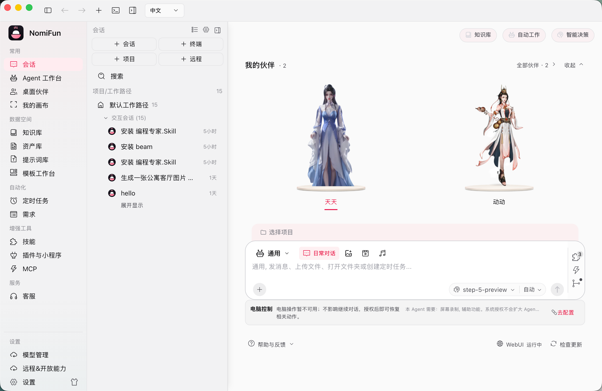
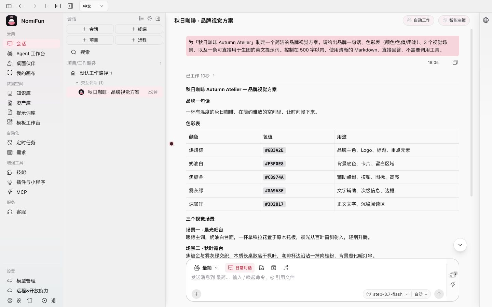
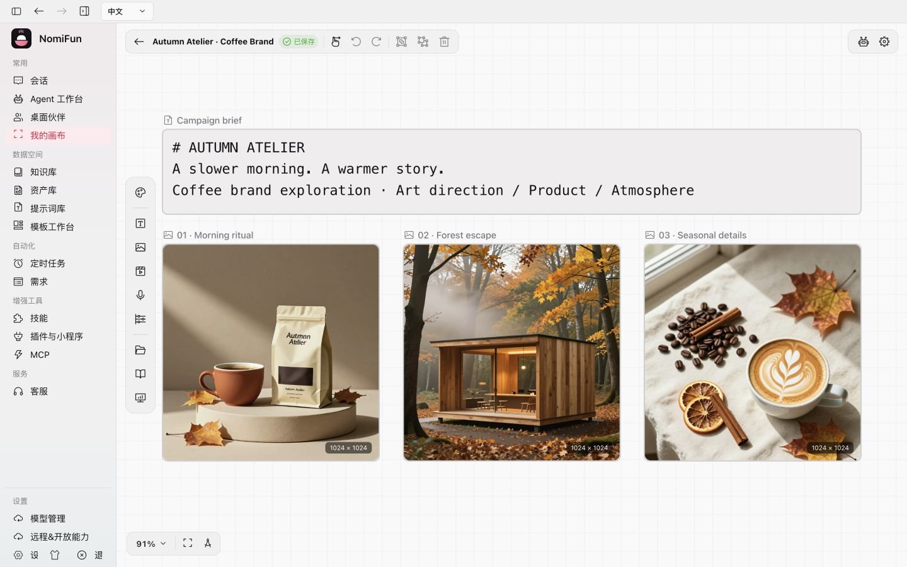

<a name="top"></a>

<div align="center">

<a href="https://www.nomifun.com">
  
</a>

<h3>一项毫无保留、<em>本地优先</em>的超级 AI 工作站。</h3>

<p>
  丰富的创新能力，极高的生产提效 ——<br/>
  而你的<b>数据始终留在自己的电脑上</b>。个人与企业都能放心使用、自由商用、接受审计。
</p>

<p>
  <a href="LICENSE"></a>
  
  
  <a href="https://www.nomifun.com"></a>
</p>

<p>
  
  
  
  <a href="https://github.com/nomifun/nomifun-desktop/stargazers"></a>
</p>

<p>
  <a href="README.md">English</a>&nbsp;·&nbsp;<b>简体中文</b>
</p>

<p>
  <a href="https://www.nomifun.com">🌐 官网</a>&nbsp;·&nbsp;
  <a href="https://www.nomifun.com/zh/docs/">📖 文档</a>&nbsp;·&nbsp;
  <a href="#-快速开始">🚀 快速开始</a>&nbsp;·&nbsp;
  <a href="https://github.com/nomifun/nomifun-desktop/releases">📦 下载</a>&nbsp;·&nbsp;
  <a href="https://gitee.com/nomifun/nomifun-desktop">🇨🇳 Gitee 源码</a>&nbsp;·&nbsp;
  <a href="https://pan.baidu.com/s/5GPonoJNrwJ7GciBSDgXLaA">百度网盘</a>&nbsp;·&nbsp;
  <a href="#-联系我们--社区">💬 社区</a>
</p>

</div>

---

> [!IMPORTANT]
> **公益开源与数据风险声明**：这是一个公益开源项目，不承担迭代过程中用户数据丢失损坏的责任。NomiFun 仍处于快速迭代阶段，请在升级、迁移、体验实验功能或接入真实工作数据前自行做好备份。

---

**NomiFun** 满足你对 AI 工作站的全部想象 —— 而且一切由你做主。一套 React 前端 + 一套 Rust 后端，为你带来会成长的桌面伙伴、无人值守的自动化平台、统一知识库、原生的 computer / browser use，以及任何智能体都能驱动的开放能力总线。无需 NomiFun 云账号、无遥测、无订阅。工作空间数据保存在本机；发往你自己配置的模型服务的请求（包括模型调用、模型目录和额度查询）由你选择的服务处理。

> 产品名是 **NomiFun**；小写 `nomifun` 仅用于代码标识符、crate 名、环境变量与仓库路径。

---

## 可以用 NomiFun 做什么

NomiFun Desktop 是本地 AI 工作站，同一套 Rust 后端由 Tauri 桌面应用与桌面级 WebUI
共享。模型供应商由你配置，应用数据保存在自己控制的存储中；模型调用与启用的网络接入
会访问你选择的服务，详见[网络与隐私 FAQ](docs/reference/faq.zh.md)。

| 工作场景 | 使用指南 |
| --- | --- |
| 使用供应商、本地模型与按任务路由 | [模型与路由](docs/guides/model-routing.zh.md)、[Agent 与预设](docs/guides/presets.zh.md) |
| 委派工作、定时执行与监督自动化 | [需求 / AutoWork](docs/guides/autowork-requirements.zh.md)、[IDMM](docs/guides/intelligent-decision.zh.md)、[定时任务](docs/guides/scheduled-tasks.zh.md) |
| 在持久画布创作、管理素材并复用模板 | [创意工坊](docs/guides/creative-studio.zh.md) |
| 运行自己的源码或打包应用 | [应用托管](docs/guides/app-hosting.zh.md) |
| 使用伙伴、连接机器人或接收 IM 消息 | [伙伴](docs/guides/companions.zh.md)、[小智](docs/guides/xiaozhi-robot.zh.md)、[渠道](docs/guides/channels.zh.md) |
| 扩展工具与知识、自动操作桌面和浏览器 | [MCP 与技能](docs/guides/mcp-and-skills.zh.md)、[Computer / Browser Use](docs/guides/computer-browser-use.zh.md) |
| 使用真实终端、第三方 Agent CLI 与 SSH | [终端](docs/guides/terminal.zh.md)、[SSH 会话](docs/guides/ssh-sessions.zh.md) |
| 远程连接或开放受管 API | [远程访问](docs/guides/webui-remote-access.zh.md)、[远程能力 API](docs/guides/remote-capability-api.zh.md) |

### 开源产品家族

| 项目 | 职责 |
| --- | --- |
| [Desktop](https://github.com/nomifun/nomifun-desktop) | 本地数据、模型、Agent 会话、工具、执行与 WebUI；即本仓库 |
| [Mobile](https://github.com/nomifun/nomifun-mobile) | 连接 Desktop 的独立移动客户端 |
| [NomiRelay](https://github.com/nomifun/nomifun-net-infra) | 可选的远程连接基础设施 |
| [Portal](https://github.com/nomifun/nomifun-protal) | 产品网站与发布文档镜像 |

连接方式与信任边界见[产品生态架构](docs/architecture/product-ecosystem.zh.md)。共享 Desktop
renderer 支持桌面浏览器和 Tauri 窗口，最小视口为 **880×600**。原生浏览器能力因平台而异，
详见[平台能力矩阵](docs/architecture/browser-platform.zh.md)。

### 产品截图




截图用于展示示例，不代表实时功能清单。拍摄日期、来源与更新步骤见[截图清单](docs/images/SCREENSHOTS.md)。

## 🚀 快速开始

从 [GitHub Releases](https://github.com/nomifun/nomifun-desktop/releases) 下载安装包。
国内用户也可使用[百度网盘镜像](https://pan.baidu.com/s/5GPonoJNrwJ7GciBSDgXLaA)（分享名 `nomifun`）。
先阅读[安装](docs/getting-started/installation.zh.md)，再按[快速开始](docs/getting-started/quick-start.zh.md) 配置。

从源码开发需要 Rust 工具链、Bun 与对应平台的 Tauri 依赖，前提见[开发指南](docs/contributing/development.zh.md)：

```bash
git clone https://github.com/nomifun/nomifun-desktop.git
cd nomifun-desktop
bun install
bun run dev
```

自托管请使用 [Web 服务器部署指南](docs/guides/web-server-deployment.zh.md)，统一查看 Docker、
认证、持久化与 HTTPS 配置。Web 宿主在同一端口提供共享 API、WebSocket 和已构建 SPA；
原生桌面自动化需要桌面宿主。

## 🛠️ 开发

```bash
bun run help       # 当前脚本目录
bun run dev:web    # Web 宿主 + Vite
bun run build:ui   # 构建 SPA
```

从[贡献指南](CONTRIBUTING.zh-CN.md)和[项目地图](docs/contributing/project-structure.zh.md)进入。
按[开发指南](docs/contributing/development.zh.md)选择直接覆盖改动的最小检查。
原生包在对应操作系统上构建，见[构建与打包](docs/contributing/building-and-packaging.zh.md)；
发布操作见[发版手册](RELEASING.zh-CN.md)。

<details>
<summary>完整脚本目录（由 scripts/scripts.json 生成）</summary>

<!-- BEGIN GENERATED SCRIPTS (bun run help --readme) -->

| 脚本 | 说明 |
| --- | --- |
| **开发（热重载）** | |
| `bun run dev` | 启动桌面应用开发（tauri dev，热重载） |
| `bun run dev:web` | 启动 Web 全栈开发（后端 API + 前端 vite） |
| `bun run dev:ui` | 仅启动前端开发服务器（纯 vite，无后端） |
| **构建（出制品）** | |
| `bun run build` | 为当前操作系统打桌面安装包 |
| `bun run build:fast` | 快速构建 debug；macOS 输出原生 WKWebView .app，其余平台输出二进制 |
| `bun run build:win` | 打 Windows 安装包（NSIS），汇总到 dist/desktop/ |
| `bun run build:mac` | 构建 macOS App 和 DMG（默认 arm64，可选 Intel），并汇总到 dist/desktop/ |
| `bun run build:linux` | 打 Linux 安装包（.deb/.AppImage/.rpm），汇总到 dist/desktop/ |
| `bun run build:signed` | 构建完整 macOS App，签名并执行已配置的公证 |
| `bun run build:updater` | 构建自更新包与 .sig；macOS 从最终签名 App 生成更新包 |
| `bun run make:latest` | 扫描本机更新产物，生成/合并自动更新清单 latest.json |
| `bun run release:mac` | 一键 macOS 发版：自动判定追加/首发；首发用 -Version 打版本号 + -NotesFile/-Notes 建 Release；-DryRun 只预检 |
| `bun run release:win` | 一键 Windows 发版：自动判定追加/首发；首发用 -Version 打版本号 + -NotesFile/-Notes 建 Release；-DryRun 只预检 |
| `bun run release:win:signed-rc` | 串行构建并验收 Windows x64 签名 RC，绑定 immutable release lock 与 Unified Plugin 边界检查 |
| `bun run release:linux` | 一键 Linux 发版：自动判定追加/首发；首发用 -Version 打版本号 + -NotesFile/-Notes 建 Release；-DryRun 只预检 |
| `bun run release:cloud` | 管理 CrabNebula Cloud 发布草稿、分平台上传、发布与更新端点验证 |
| `bun run build:ui` | 前端生产构建 → ui/dist |
| `bun run docker:prebuilt` | 用已有 ui/dist + nomifun-web release 二进制快速构建 Docker 运行时镜像 |
| **运行（组装好的应用）** | |
| `bun run serve:web` | 启动 Web 服务器，托管已构建的前端 |
| **测试** | |
| `bun run test` | 运行全部 Rust 测试（含 doctest） |
| `bun run test:fast` | 用 nextest 快速跑 Rust 测试（日常） |
| `bun run test:crate` | 运行单个 Rust crate：bun run test:crate <crate> [cargo 参数] |
| `bun run test:core` | 运行不含 desktop-only feature 的 Rust workspace |
| `bun run test:desktop` | 运行桌面壳测试，不监听或打包 ui/dist 资源 |
| `bun run test:upgrade` | 运行启动、数据集兼容与升级定向 Rust 测试 |
| `bun run test:browser` | 运行 browser-use 门控的 Rust 测试（browser-platform 全量 + gateway/ai-agent/app 开启 --features browser-use；crate/core 车道会静默跳过这些） |
| `bun run test:ui` | 运行前端单元测试（bun test，收集 ui/src 下全部 *.test.ts/tsx） |
| `bun run test:nomi-core-live-provider` | Run the credential-isolated canonical AgentSession selected-model smoke against StepFun Coding Plan. |
| `bun run demo:idmm` | 用 StepFun Coding Plan 验收智能决策后台触发、规则、旁路、安全停止和恢复，生成隔离 dev 报告 |
| `bun run test:agent-reliability-report` | 验证 Agent 可靠性统计门禁：精确置信区间、样本去重、独立验收与缺失场景检查 |
| `bun run test:voice-smoke-runner` | 测试有界Mobile语音无头观测脚本，不作为真机体验证据 |
| `bun run test:mobile-voice-live` | 显式参数和凭据授权下观测Mobile语音relay媒体与原工作回执，不启动GUI |
| **静态检查** | |
| `bun run check:docs` | 检查现役文档的本地链接、Markdown 锚点与图片路径 |
| `bun run check:windows-installer` | 校验 Windows NSIS 程序/数据目录分离、锁定模板、第三方归属与安全卸载合同 |
| `bun run check:creative-studio-retirement` | 扫描 tracked 源码，阻止旧创作页面、路由、API、翻译与 Gateway 标记回流 |
| `bun run check:creative-studio-retirement:dist` | 在 UI production build 后扫描 ui/dist，阻止旧创作标记进入发布产物 |
| `bun run check:process-runtime-boundary` | Enforce the supervised process runtime boundary and exact hand-off allowlist. |
| `bun run check:browser-platform-boundary` | Enforce native conversation Browser ownership, isolated background-browser boundaries, and retirement of legacy browser paths. |
| `bun run check:desktop-ui-boundary` | 校验 Renderer 仅支持 880x600 及以上桌面窗口，阻止手机分支、低宽度断点和移动浏览器兼容代码回流 |
| `bun run check:uarc-boundary` | 校验单一Runtime、canonical Agent Store、Module/Resource边界；退役生产引用预算为零 |
| `bun run check:nomi-core-live-provider` | Compile the credential-isolated canonical AgentSession live Provider smoke without making a live request. |
| `bun run check:agent-vocabulary` | Enforce AgentExecution as the only active collaboration aggregate and permit only exact migration fences. |
| `bun run check:agent-reliability` | 读取独立评测 evidence.json 验证三项 99% 统计下界（--input 路径）；样本不足不会通过 |
| `bun run check` | 聚合类型、桌面UI、资源规范、canonical Agent Session、Runtime/Plugin边界及脚本登记检查 |
| `bun run typecheck` | 前端 TypeScript 类型检查（tsc --noEmit） |
| `bun run check:i18n` | 校验 i18n 类型与 locale 键是否一致 |
| `bun run check:theme` | 校验预设 CSS 主题契约 |
| `bun run check:icons` | 校验 @icon-park/react 导入禁别名/禁命名空间（别名会被图标包装插件改写成非法代码，tsc 抓不到） |
| `bun run check:dead-css` | 死 CSS 工具类禁令：拦住 <任意颜色前缀>-[rgb(var(--RAMP-N))] / border-border-* / border-b-base / border-b-light / {bg,text,border}-RAMP-N/NN（存量已清零，无基线，出现一处即失败） |
| `bun run gate:agent-v2` | 校验当前canonical Agent合同与生成物完整性 |
| `bun run check:agent-session-boundary` | 校验canonical事件上下文、单native字段、单数据库基线及旧代码和文档物理删除 |
| `bun run check:voice-boundary` | 校验可选Mobile语音的独立合同、核心port和供应商wire隔离 |
| `bun run check:voice-contracts` | 校验独立Voice JSON schema与同级Mobile生成合同，不改主Agent合同 |
| `bun run check:app-hosting-boundary` | 校验应用托管单进程 owner、旧插件领域汰换与 canonical 历史保护 |
| `bun run check:external-tools` | 校验受管组件来源、版本、制品和镜像摘要、许可证、旧预览链路退役及内置技能一致性 |
| **代码生成** | |
| `bun run gen:i18n` | 由 locale 重新生成 i18n 类型声明 |
| `bun run gen:voice-contracts` | 生成独立Voice JSON schema与同级Mobile TypeScript合同 |
| **维护 / 工具** | |
| `bun run clean` | 深度回收构建空间（debug 产物 + flycheck + 旧安装包） |
| `bun run bump` | 统一改版本号：根 Cargo.toml(真源) + package.json + ui + Cargo.lock，可选 --tag 提交并打 tag |
| `bun run help` | 打印脚本目录（--check 校验登记 / --readme 生成 README 表） |

<!-- END GENERATED SCRIPTS -->

</details>

## 📖 文档

[文档总入口](docs/README.zh.md)集中组织现役使用指南、架构、参考、开发与验收说明，
并维护对应的 [English 版本](docs/README.md)。产品指南保存在本仓库，
[NomiFun Portal](https://www.nomifun.com/zh/docs/) 是发布镜像。
已被替代的方案与实施报告通过 Git 历史追溯。

---

## 🤝 贡献与社区

NomiFun 非常需要你的加入来壮大 —— 代码贡献、社区运营、技术布道都热烈欢迎。如果你对这个项目有热情，请[联系我们](#-联系我们--社区)，与我们一起共建 NomiFun 的生态。

- 阅读 [`CONTRIBUTING.zh-CN.md`](CONTRIBUTING.zh-CN.md) 完成环境搭建、了解检查阶梯；英文版见 [`CONTRIBUTING.md`](CONTRIBUTING.md)。
- 友善相待 —— 见 [`CODE_OF_CONDUCT.md`](CODE_OF_CONDUCT.md)。
- 发现漏洞？请按 [`SECURITY.md`](SECURITY.md) 操作。
- 从 [open issues](https://github.com/nomifun/nomifun-desktop/issues) 找一个起点。

---

## 💛 写在最后（来自作者）

> 开发者兼职、精力有限，很多惊喜功能还在路上。如果你认同这件事，欢迎以任何方式加入 —— 一行代码、一条建议、一次转发，都是莫大的鼓励。

NomiFun **完全开源、毫无保留**。个人与企业都可以在它之上二次开发并商用。

- **欢迎二次开发与商用。** 同时，这些行为风险自担 —— 作者与贡献者不承担后续一切法律责任。Apache-2.0 无需我们另行授权。
- **告知一声，是渴望而非要求。** 如果你二次开发或商用 NomiFun，希望你能留言告知我们 —— 这*不是*授权条件，只是因为「知道项目被认可」这份肯定，正是让它走下去的动力。
- **部分功能被刻意排除在开源版之外** —— 为了让本地数据的承诺滴水不漏。在没有足够人力与资金保障每位用户数据安全的前提下，移除它们是负责任的选择。等条件允许，我们希望把更多功能奉上给大家。

谢谢你来到这里。🙏

---

## 🔗 友情链接

这些是我们欣赏的产品与项目：

| 产品 | 简介 |
|---|---|
| [Saytive](http://saytive.ai/) | **Be Creative, Be Saytive.** Saytive 是一款专为创意工作者打造的语音输入法，它通过顶级模型和产品设计，自动感知你的工作上下文，提供快速准确而符合场景的转写体验。 |
| [Fast](https://fast.saien.pro) | **搜索，一触即达。** 你只需输入文字并点击，即可直达小红书、抖音、美团等数十个主流应用的搜索结果页面。拒绝信息流，专注搜索本身，搜索本该如此简单。 |
| [AionUi](https://github.com/iOfficeAI/AionUi) | AionUi 内置完整的 AI agent 引擎。不同于需要你额外安装 CLI agent 的工具，AionUi 安装后即可使用。 |

---

## 📬 联系我们 / 社区

以下联系信息由 NomiFun 开源产品家族统一使用。对于可复现的问题与功能建议，优先使用
GitHub Issues。

| 渠道 | 入口 |
|---|---|
| 🌐 **官网** | [www.nomifun.com](https://www.nomifun.com) |
| 🐙 **问题反馈** | [github.com/nomifun/nomifun-desktop/issues](https://github.com/nomifun/nomifun-desktop/issues) |
| 📮 **联系页** | [www.nomifun.com/contact](https://www.nomifun.com/contact) |
| 📕 **小红书** | [NomiFun](https://xhslink.com/m/4x6ti8n6cA1) |
| 📺 **哔哩哔哩** | [NomiFun](https://b23.tv/0UhgKDh) · [演示视频](https://www.bilibili.com/video/BV1kwKZ6UE5X/) |
| 🎵 **抖音** | [NomiFun](https://v.douyin.com/MDT5QVdYaJk/) |
| ▶️ **YouTube** | [@NomiFun-o2y](https://www.youtube.com/@NomiFun-o2y) · [演示视频](https://youtu.be/AsEToBDFR9s) |
| 𝕏 **X (Twitter)** | [@colir0](https://x.com/colir0) |
| 🎬 **TikTok** | [@colir0luo](https://www.tiktok.com/@colir0luo) |

**加入交流群** —— 扫码即可：

<div align="center">
<table>
  <tr>
    <td align="center"><br/><sub><b>NomiFun 微信交流群 0</b></sub></td>
    <td align="center"><br/><sub><b>QQ 群</b></sub></td>
  </tr>
</table>
</div>

---

## ⚖️ 许可证

[Apache-2.0](LICENSE) © 2025–2026 NomiFun。

第三方署名见 [`NOTICE`](NOTICE)。

<div align="center">
<br/>
<sub>用 💛 打造，献给希望以自己的方式拥有 AI 的人。</sub>
<br/><br/>
<a href="#top">⬆ 回到顶部</a>
</div>
