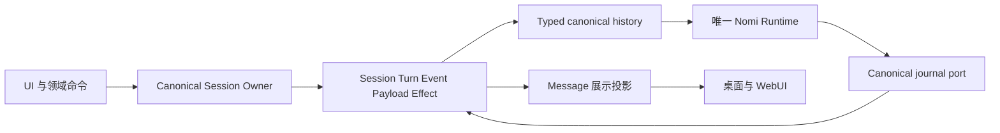

# Agent Session 日志与内容架构

AgentSession 是 NomiFun 会话、回合、内容、效果和取消的唯一事实链。产品里的“对话”和 Conversation 接口投影同一个 `AgentSessionId`，不创建第二份会话。Chat 与 Coding 都由 `nomifun.nomi` 的同一个进程内 Runtime 执行。

本页是当前开发入口。执行合同来自 Rust 类型、Session event registry 和 canonical schema；历史设计及施工说明只保存在 Git 历史中。修改实现时同时更新本页，不另建一份可长期使用的旧设计说明。

## 事实与派生数据

应用开发使用普通 Conversation 与通用 coding 能力，不创建专属创作流水线。不可变 SessionPurpose 保存在已有 `session/opening.metadata`；退役的 PluginAuthoring 仅保留 typed 只读识别，禁止新建、执行、恢复或 fork，允许原 owner 取消及删除。读取与分页只从 typed opening 事实派生用途，合法当前代旧 opening 缺省为 Conversation，缺失或非法事实拒绝读取。普通 metadata 更新不能改变用途，产品 projection 不授予工具权限。

应用页工作区固定官方 `app.developer`（内置应用），模型及推理强度仍由用户选择，复用现役 Session 与 Runtime。当前应用目录就是明确冻结的 workspace_root。应用入口创建时在 typed `session/opening.metadata.app_project_id` 建立不可变生命周期归属；Agent、模型切换和目录迁移不改变它，新 fork 继承它。普通创建接口不接受应用归属或应用保留命令身份。AppRecord 中的 `development_session_id` 只提供可验证的导航引用；重开校验 owner、应用归属、普通用途、固定模板与确切工作区，不从这个引用获得权限或删除权。

一个应用对应一个独立项目，项目可以包含多个专属 Session；不同应用不共享项目根目录。
项目历史只查询确切 owner 与 canonical 应用归属，归档状态来自 canonical metadata。
当前代已有应用入口会话只从精确 canonical opening 命令、producer、owner、因果及原始显式应用根识别，
不写回 opening 或导入退役数据。普通会话不因目录或 Agent 相同而被收编，旧同目录普通 fork 保持原归属。
最近导航、显示路径偏好及 Message 投影均不构成归属或权限。应用会话只在所属应用管理，
普通侧栏及批量操作排除它们；搜索与旧深链依据 canonical 归属返回应用工作区。
不同 Session 的内容独立保存，项目目录中不复制 transcript，不为新会话拼接全部历史。
新建明确工作目录的 Session 优先复用当前同 owner、同 canonical root 的既有 scoped `project_memory`
resource 身份；首次建立该命名空间时使用 owner 与 canonical root 的摘要。同项目的新会话复用现役记忆状态，
Agent 切换与正式存储位置迁移保留该逻辑身份。已有默认记忆 binding 不被迁移或暗改。
项目记忆保留现役 Host 内存存储合同，不声称跨重启持久；项目源码和 canonical 会话历史持久保留。

Agent 工作台的系统能力「NomiFun 应用开发」沿用冻结模块/动作选择。只有 `app.developer` 默认选入 `app.hosting` 十个动作，其他官方模板默认不启用；已有个人配置和 Session 不自动扩权。详细指南只在 `read_app_guide` 调用时返回。当前应用定位、元数据/命令更新、导入、预览及启停使用原应用 owner；有变更的 Agent 操作经现役 HostedEffectReceipts 写入同一 Effect 事实链，使用 Kernel 准入的确切 Session/Turn/operation/Snapshot 与工具事件因果，不从消息投影或最新 Turn 借权。Host 保留操作与结算直到结束，已知部分失败不表示未执行，未确认结果保持未结算和不可自动重放围栏。

手工导入、覆盖和删除持有目录及全部当前项目 Session 的既有准入围栏，在应用 gate 内复核导航引用，拒绝活动 Turn、pending/unknown Effect 和未结束的 native producer。创建、fork、binding 切换、warmup 和准入使用同一现有内存锁注册表的目录读围栏，封住成员查询后的新会话竞争。此接缝不改写 Session 事实，不新增绑定或执行账本。
处于 `deleting` 的 Session 不进入普通历史；原 typed 删除候选仍保护其确切项目目录，
不能因它已从 live 列表消失或 Runtime 缓存已释放而忽略未知效果与删除清理。

已准入的 Agent 导入持有同目录与项目 Session 围栏以及现役原生工作区写锁，精确校验本次
Session、Turn、Snapshot、operation、工具因果和 pending Effect 收据，只允许本次调用自身的效果。
其他活动回合、pending/unknown 效果不因 Agent 导入获得豁免；拒绝使用原 Effect 的执行前拒绝结算。

应用开发入口在新的闲置提交前，可通过显式 `refresh_workflow` 命令将当前代旧空职责配置更新为
正式内置应用职责。目标仅从原确切 Revision/Snapshot 派生，保留模型、权限、Skill/MCP 和所有
typed resources；在原 Runtime teardown、Effect 结算和 CAS 围栏内追加普通 ContextOnly binding
transition。旧配置、历史和 Session 身份保持原值，GET/重开不触发更新，不暗改 Runtime 系统指令。

应用界面在开发回合结束时发出的配置识别请求使用完成通知的确切已接受消息引用。
Host 只从该 canonical 输入及对应启动事实解析操作 ID，复核成功终态、后继回合及原生/效果
结算后才处理同一应用。消息 UUID、输入幂等键和操作 ID 不互换，不从消息投影、当前最新回合
或模型文字补造关联。配置识别不启动程序，也不作者或重写 Session 内容。

通用删除入口拒绝应用专属 Session。用户从应用入口明确删除应用后，目录与 Session 围栏内核验归属，
通过现役 canonical 删除流程清理全部专属 Session 的 Runtime、内容及相关资源，再删除应用文件和登记。
已进入 deleting 的专属 Session 复用原收据继续清理；部分失败保留登记与项目文件供重试，不建立另一份批删除账本。
活动 Turn、pending/unknown Effect、未结束原生 producer 或未确认清理仍拒绝破坏性操作。
同目录普通会话和其他应用会话保留，不能为物理删除关闭它们；其活动资源和未知效果仍保护真实目录。
普通会话的创建、上下文、工作区、切换及删除合同保持原样。

| 数据 | 所有者与用途 |
| --- | --- |
| `agent_sessions` 和 binding transitions | Session 身份、冻结的 Agent Revision 与 Snapshot、资源及明确的 Agent 切换边界 |
| `agent_turns` | accepted input 对应的 operation、准入、幂等、状态和终态回执 |
| `agent_events` 和 `agent_payloads` | 有序语义事件和它们引用的内容，是上下文与展示的事实来源 |
| `agent_effects` | 统一的效果回执；结果含义仍由执行效果的领域解释 |
| `agent_session_resources` | 不可变资源定义；保留效果回执引用的定义。当前授权集合只来自当前 `agent_binding_json.typed_resource_bindings` |
| `agent_messages` | 用户界面的查询投影；不能补造缺失的 Runtime 事件或推断完成 |
| native Runtime checkpoint | 精确绑定 build、Snapshot、Session 和 cursor 的恢复数据；不是另一套 transcript |
| AgentExecution 和领域数据 | Execution 的 Step、Attempt、租约及领域自身业务事实；引用同一 Session 与 Turn，不复制会话日志 |

### Runtime 上下文读取

`engine_history.rs` 从 canonical events 及已解析 payload 构建 typed history，不读取 `agent_messages` 来决定模型消息角色。Runtime 回合通过有序的 native journal 重建；缺失结构化日志不能降级成聊天文本继续执行。

应用工作区的内置应用 Agent 复用普通 coding、Skill、MCP 和 typed resources；个人 Agent 也可明确选入同一应用开发能力。托管工具直接调用 UI 同一命令与进程 owner，不建立专属计划、预览资格、交付证明或 checkpoint。空闲会话的 Agent、资源、知识库与扩展选择走同一 canonical binding transition，仍受活动 Turn、Remote、Attempt、未知效果与原生 checkpoint 校验约束。应用工作区固定模板的产品要求不允许借重开入口替换已有 binding。当前会话效果和产物继续读取精确 Turn 的 typed canonical event/payload，不从工具提示或网页状态补造成功。

准入后、Runtime 启动前就失败或取消的输入仍是有效 accepted input。读取时保留这个输入和明确的终态事实，不伪造 Runtime 启动、工具结果或完成证明。

可选 Mobile voice 的即时纠正只由明确设置 `SupersedeModelStep` 的 voice-started Turn 启用。普通文字请求的 `voice_immediate` 为 `None`，沿用原模型流、纠正边界和工具结算。voice 调用原 canonical writer 验证 Session、binding、context floor、精确 Operation 与 execution generation，不形成第二个工作引擎或权限账本。

中途替换模型步骤需要真实自有模型操作的取消及 JoinHandle 退出证明；关闭等待失败不授权启动后继模型步骤。`VoiceModelStepSuperseded` 记录精确 step、model Operation、已提交纠正 receipt IDs、未准入工具调用及清理证明。typed history 只排除该步骤已失效且未准入的生成内容，原审计事件与历史身份仍保留；其他步骤和已结算效果不受影响。工具的实际准入与纠正检查共享原 writer 的原子边界，已有准入工具先结算，不伪造 ToolResult 或重放未知效果。

voice 的转写、媒体、来源关联和待处理输入保存在独立 VoiceJournal，只引用上述 canonical 事实。模型重试的新调用 ID 不能重新准入同一已提交来源及同一意图。不能证明转写时钟与当时工作目标时，相对取消/纠正先等待 authenticated Mobile 用户对精确来源 revision 和目标呈现的确认，不能取收到事件时的最新任务补造关联。voice 关闭、媒体故障或 journal 不可用不改变文字请求的结果。

语音重启恢复只在 authenticated 用户显式启动语音并完成 lazy journal reconciliation 后接原 voice dispatcher。已确认尚未准入的 Queued 输入使用原 operation key、原策略及 namespace/binding/context-floor 围栏恢复；未知 Dispatched 只查原 canonical receipt，不盲发第二次。首次健康 HostedRuntime 的 constructor `status=None` 不表示忙碌：voice-only 入口同时验证原 registry、canonical active Turn、未结算效果与传输状态后才允许首次输入。普通文字启动及 Runtime 能力声明不改变。

voice 产品回执的可选 `request_kind` 仅来自应用实际解析、执行的输入，用于厂商无关的观测分类，不是供应商工具参数、权限或完成证明。触发事件先于工作 worker 的回执发布；纠正延迟仅从收到触发到同 operation 的 canonical Applied 回执计时。无法确定分类或没有这两个端点时无样本，不推断已听、成功或听感延迟。

Creation prompt、Cron notice、AgentExecution summary 使用正式消息事件成为数据上下文。Agent 切换前的文本和工具结果只从已提交的 canonical event/payload 读取。工具结果保持原文，以明确的不可信历史数据包装进入下一 Agent；不重放旧工具角色，不继承旧 Agent 系统指令、权限、可用进程句柄或完成门槛。历史图片和音频不作为新观察传输；MCP resource journal 仅记录 owner settlement 时不能补造资源正文。上下文清空事件和当前 accepted root cursor 限定读取窗口。

### 当前会话内的历史

同代会话的前序 Turn、不可变 Snapshot、显式 Agent transition 和模型切换是当前产品语义。它们需要验证身份、binding、sequence 和内容完整性。它们不授权读取退役的 Conversation 表、私有 transcript 或旧格式投影。

可执行恢复必须满足 native checkpoint 的精确 build 和 binding 条件；只读的已关闭事件历史允许经过明确验证的模型或 Agent transition 边界。不能为了恢复而扩大权限或补造缺失日志。

### 模型派生与内置契约演进

模型切换从 Session 已保存的不可变 Revision/Snapshot 派生，只改变 canonical Chat route 以及由该路由决定的身份与摘要。
伙伴相处页的模型下拉也使用这条显式切换通道，随后将选择保存为伙伴的默认模型。默认保存失败不撤销已提交的 Session 切换，界面显示实际会话模型并允许只重试默认保存；模型与 Agent 选择都在活动、暂停或未结算操作时拒绝修改。
能力描述、贡献锁、角色 Provider、Skill、MCP、资源授权和全部非模型创作配置保持冻结。模型派生不读取当前安装默认值或
创作目录来重新选择能力；非模型精确相等校验继续作为操作不变量，并用于模型切换后的已关闭历史验证。

内置发布可以产生新的精确 Schema、产物和角色贡献身份。普通本地新 Turn、模型选择与 warmup 之前，同一个 Session owner
在空闲边界准备新的执行契约。编译器沿用冻结的创作配置、角色合同 key 与 Provider mount，证明 Action 身份与授权、效果类型、
资源要求、依赖图、Runtime 要求和发布来源没有变化。展示元数据和精确 Schema/产物摘要允许演进；这表示绑定到新发布的
执行契约，不证明旧参数可以由新工具执行。Managed package、MCP 工具和 Skill 内容仍须精确一致，不设置版本、能力名称或
摘要的兼容例外。

Owner 将准备与准入串行化，证明旧 Runtime 完整退出且效果已结算，再通过已有 canonical `session/agent-binding-changed`
事务提交。Session 身份、typed resource 定义和活动能力选择保留；旧 Revision/Snapshot 与历史事件不可改写。转换边界之前的
已关闭历史作为数据上下文读取，不重放旧执行日志、不继承旧完成账本，不恢复旧 checkpoint、不重试旧工具调用，也不导入退役
Agent 数据。活动或暂停 Turn、Remote 和 Attempt（包括 Automation Attempt）绑定不获得自动换绑权限；未知效果和未处理的 Patch recovery 继续阻断。
精确幂等输入重投沿用原准入，不提前生成其他绑定；已使用当前契约的重复准备为无操作。

已关闭回合的模型正文在历史上下文中是明确的 User-role DATA：来源及降权元数据与原始文本分为不同内容块，
不能把内部包装 JSON 当作 Assistant 回答示例，诱导后继回复照搬包装或转义正文。历史内容不成为当前指令、
效果回执或交付模板；真实 Assistant 工具调用及 Tool 结果仍保持原协议角色、顺序和配对。
压缩恢复无法证明来源时保留 unknown，不从正文或看似合法的标签补造来源，也不剥壳改写历史原文。
此规则只作用于模型历史呈现，不改 canonical 事件、Message 正文、实时回复或精确 checkpoint 恢复。

完成账本的 prior_task 候选只来自最新已关闭 Turn，并要求与当前 Session、runtime binding 和 Snapshot 完全一致。模型或 Agent 切换后的旧 Snapshot 仍作为已验证的普通历史保留，但不导入它的执行账本；不向更早的 Turn 搜索一个匹配的旧账本。

Chat 路由的当前模型配置摘要只纳入该模型的任务配置及其引用的命名连接；新增其他模型或无关协议连接不改变这条路由。服务商认证、所选模型和实际连接的变化仍须通过原有精确路由校验。既有摘要只能在它原先覆盖的完整配置图仍然匹配时使用，不改写 Session 或 native checkpoint 来放宽恢复条件。Gemini 工具调用的原生签名随既有 canonical `ToolCall` metadata 保留；Broker 使用实际生产该调用的路由建立来源摘要，只有相同路由允许续传。缺少来源或来源不匹配的签名失败关闭，内部来源字段不进入上游请求。

通用 `Reasoning.signature` 没有可验证的生产路由，Broker 准备和各协议编码均明确拒绝其续传，不根据当前模型补造来源。Gemini 无签名思考仍按原生 `thought: true` 表达，带来源的工具签名和 typed Anthropic reasoning 沿用各自的精确路由边界；Gemini 的通用签名思考历史暂不支持。独立签名流事件被解析并不证明完整多轮或 native checkpoint 恢复可用。

Agent 或资源切换不能删除已结算效果引用的资源定义，也不能修改同一 binding ID 的定义。所有持久资源定义使用合同层 `resource_definition_id`：摘要覆盖 kind、resource、owner、operations、connection 和完整参数，排除 ID 自身；相同定义复用 ID，权限或参数改变生成新 ID。调用方在最终工作目录和策略参数确定后生成 ID，不以物理资源 ID 替代定义身份。执行期权限收窄继续引用原 canonical 定义，不写入第二份资源定义。

Store 在同一事务中更新当前 binding 并保留必要的历史引用；资源查询、知识库挂载和删除保护只按当前 binding 选取资源。历史定义用于回执追溯，不赋予新 Agent 权限，不形成第二份活动资源账本。

普通会话选择另一个 Agent 后直接执行切换，选择器只显示局部等待状态，不再要求确认能力、资源差异或交接方式。服务端仍提供 preview 与版本 CAS；存在经过验证的任务交接时自动使用 `continue_task`，否则保留普通数据上下文。消息、输入草稿与 Session 身份保持，目标 Agent 从下一 Turn 生效。活动或暂停 Turn、未结算效果、Patch recovery、Remote 和 Attempt 等执行安全边界继续拒绝切换，界面使用简短原因提示。

切换按目标 Agent 授权解析资源，多余资产不开放工具；可用的明确项目可以只作为零文件操作权限的工作目录保留，方便再次升级。宿主按目标授权准备可自动提供的默认资源；已撤下或暂不可用的可选资产不阻塞其他资源。缺少可选资源时相应 Action 不开放，不能补造连接、凭证或权限。知识库仍可读但不再具备写回权限时，自动关闭当前写回策略，保留读取而不阻塞切换；显式策略更新仍校验全部挂载知识库的权限。工作区和进程资源保持同一个根：可用的明确项目继续使用，无法继续使用时回到同 Session 的托管工作区，目录由原有宿主物化流程准备。降阶 Agent 不因旧工作目录失效而失败；升级后的下一 Turn 仍经过目标资源与 native Runtime 准入校验。资源所属、合同完整性和存储错误不能通过忽略资产绕过。

切换继承仍可用的全局 Skill 与 MCP 选择，已移除的 Skill、已停用或不再发布工具的 MCP 不带入目标。Package Skill 还须由目标 Agent 自身声明。保留的选择通过原编译器形成新的精确 Snapshot 与资源定义，不复用旧 MCP authority，也不修改旧 Snapshot。普通会话挂载 Canvas 或 Channel 资产不等于固定产品身份；实际 Canvas 业务会话、Companion、Customer 与 Cron 等归属继续遵循各自绑定边界。

### 官方预设的能力与资源补齐

官方 seed 按真实业务 Action 配置七种预设，不以人格文案或模块名称替代授权。各预设的职责保持明确：

| 预设 | 默认能力边界 |
| --- | --- |
| `chat.minimal` | 保持零模块、零 Action；普通文字对话不因本次补齐而获得工具权限。 |
| `assistant.general` | 通用文件、进程、版本管理、产物、项目记忆、网页研究、计划任务、浏览器、桌面操作、媒体、素材和 Office，以及 SSH、知识库和会话管理。 |
| `coding.codex` | 文件、版本管理、进程、产物、项目记忆、研究、协作、SSH、知识库和会话管理；保留 headless Runtime 要求，不依赖浏览器或桌面控制。 |
| `app.developer` | 完整 Coding 基线加应用托管十个动作；应用目录固定为工作区，普通多会话与运行设置共用原 owner。其他预设不默认选择应用托管。 |
| `companion.default` | 保留伙伴人格、长期记忆、机器人视觉、渠道和计划任务；补齐日常文件、进程、产物、研究、浏览器、桌面、媒体、素材、Office、SSH、协作与管理能力。 |
| `customer-service.default` | 客服笔记读写与交接、知识检索、渠道发送和回复，以及文件、进程、产物、研究和计划任务；不默认授予全局知识库或跨会话、终端管理。 |
| `creative-studio.default` | 媒体、Canvas、素材、模板、Office、文件、进程、产物、项目记忆、研究、浏览器、协作和计划任务；保留三个创作 Package Skill。 |

`assistant.general` 和 `companion.default` 的 `creative.workshop` 只授予素材读写，不能因为没有 Canvas 而隐藏素材操作。Office 原生工具处理素材库中的文档、表格、演示和预览；普通本地文件处理继续使用已授权的文件与进程工具。Skill 与 MCP 仍使用统一的全局选择及精确编译路径，不代替缺失的原生 Action grant。

每个冻结 `CapabilityActionDescriptor` 可以发布 `required_resource_operations`。`None` 或字段缺省表示未发布精确 Action 资源合同，继续使用完整模块资源门槛；不能从其他 Action 推断它不需要资源。`Some(empty)` 明确声明该 Action 不消费资源槽，`Some(map)` 则要求相应 kind 的绑定包含全部指定 operations。模型工具目录和 Kernel 准入使用同一冻结检查；Context/Event 消费继续校验模块资源，Role Provider 继续保留自身精确实现槽位。缺少可选目标仅使依赖它的 Action 不可用，不能用展示过滤绕过 owner、Snapshot、活动能力或实际调用的权限校验。

普通新建和产品入口从目标冻结授权补齐宿主可提供的确定性资源：Workspace、Process Session、项目记忆、素材库、Scheduler，以及适用的 Terminal、Browser 和 Computer。伙伴、客户、Canvas 等产品身份只取真实目标 ID；Workspace 和 Process 使用同一工作根。Browser/Computer 的已发布 Role 合同可以冻结而设备环境仍未绑定，宿主环境不可用时省略该可选资源。知识库、渠道、SSH 主机和机器人只继承实际选项，不补造连接或凭证。真实 owner 不匹配、存储 I/O/损坏、合同或 Provider 不一致，以及 native checkpoint 和未知效果等执行安全问题继续拒绝操作。

已保存官方预设不会因发布 seed 被覆盖。owner-scoped `GET /api/agent-presets/{preset_id}/recommended-capabilities` 只返回缺失能力、Action 和 Package Skill 的合并草稿与差异；它保留人格、指令、模型、Runtime 配置、已有扩展及 Skill 固定版本，不写入新 Revision。界面先展示新增项，再通过现有 SaveRevision 的 `expected_current_revision` CAS 保存；未保存编辑不能被补齐覆盖。保存不改变现有 Session；伙伴显式“应用最新设定”经空闲、已结算边界复用 canonical Agent switch，在同一 Session 操作围栏与 binding version 校验内准备并提交当前 owner 已保存的配置。直接 Session preview/apply 还须验证此前预览的精确目标 Snapshot。两者均保留 Session 与旧历史，不增加配置升级或绑定账本。

`knowledge.management` 使用现有知识领域服务提供列表、详情、托管建库、元数据与 URL 来源更新、删除。建库后来源或文档失败返回已创建的真实 ID 与各项状态，重试针对该库处理；新库必须在空闲边界通过现有知识选择器挂载，不能修改当前 Turn 的冻结绑定。`session.management` 提供 canonical 会话查询和创建、向其他空闲普通本地会话发送输入、取消精确 Turn，以及真实 PTY 和关联 AgentExecution 的管理。输入沿用原 canonical 幂等与 binding/context 围栏；终端写入、重启和停止核验 owner、行版本与 PTY epoch；协作修改继续要求当前 lead/attempt 关系及精确版本。查询结果和终端输出是数据，不授予目标会话权限，不重放未知效果，也不新增效果账本。

伙伴人格与历史记忆只影响交互，不声明退役 `nomi_*` 工具或未经授权的完整能力。实际名称、参数、目标范围及完成状态来自当前 Runtime 工具目录和真实回执；延迟展示的工具通过已授权目录检索，不能因为首轮未展开就断言能力缺失。

App 的编译消费面始终是 desktop，不由 Browser/Computer 适配器是否编译决定。可选设备授权上限只对精确固定的 bundled 公开 Provider 延迟物理平台判断：必须是单公开成员、单资源种类、完整 Action 操作合同，且没有私有实现、依赖、Context 或 Event。物理平台不支持的成员只记为当前编译对象内的不可执行集合，不写入 Snapshot 或 checkpoint；资源绑定和调用仍拒绝它。其他 Provider、缺失合同和非 Agent 直接操作继续使用严格准入。

授权目录不按模块或动作总数 128 截断。启用 ToolSearch 时，初始 schema 展示按 24 KiB 和 112 个工具投影，给 Runtime 控制和一次五个搜索匹配留位；完整绑定及 schema 保留在原 ToolPlan。后继搜索成组保留最新最多五个匹配，旧展示工具填充剩余窗口，未展示的工具仍可再次搜索。Host 显式预激活直接使用最终已授权的冻结调用名，一次原子展示整个请求集合，不拆成五项搜索批次而让组内工具相互逐出。最新搜索集合与 Host 显式集合都可超过 24 KiB 软目标，但仍受最多 117 个授权定义、含 Runtime 控制最多 128 个可见工具，以及完整请求上下文预算的硬限制；超限时整组拒绝，不部分修改展示集合。canonical 恢复按原事实重建展示状态并应用相应集合规则；没有 ToolSearch 时只检查实际组装后的可见工具数。搜索窗口是展示状态，不是第二套授权或持久账本。

### 同一现役数据集的位置迁移

数据存储位置变更保留 installation owner、storage generation、Session/Turn 身份、密钥及现役历史，
由数据集协调器在旧服务退出、源目录与目标目录受锁保护后离线复制和校验。位置修订独立于数据代际，
此操作不具有 clean cut、破坏性启动重建或导入退役 Agent 数据的权限。

新建默认 Workspace 与 Process Session 使用 `workspace_location=managed-session` 的 typed 参数，
宿主只按当前有效工作根和精确 canonical Session UUID 解析为 `conversations/<Session ID>`。
明确选择的外部项目保持原绝对路径；不能通过路径前缀判断它属于产品托管空间。现役旧绑定仅在
`default-workspace`/`managed-process-session` 身份、完整单一 `workspace_root` 参数与源工作根精确一致时转换为逻辑引用。
产品托管知识库由当前 `knowledge_bases.managed` 与精确注册根证明所有权，再转换当前冻结的 `knowledge_root`；
外部知识库保持原路径。

应用托管 owner 的纯离线登记检查为本次迁移提供已验证的应用 UUID，canonical writer 再核对真实
installation owner，只认 `{source_data}/app-hosting/apps/{app_id}` 的精确登记根。检查不启动 HostingOwner，
不执行孤儿进程恢复；registry 中任何未确认的 identity、PID、running 状态或操作都阻止迁移。
完整数据副本准备后，只把 staging registry 的 `record.directory` 改为最终目标根，其他字段保持原值。
发布协调器逐项核对源登记与该精确位置变化，应用源码及其他副本文件仍通过完整大小和摘要校验；
最终 installed manifest 覆盖已改写的登记，发布恢复不重放迁移或读取旧盘补造权限。
未发布副本的重试允许逐项保留原始精确副本或仅目录已重写的登记，提交仍要求全部登记完成重写。
已有验证副本时不再打开源 SQLite，避免只读探测产生 WAL/SHM；源完整摘要、纯应用检查与暂存库校验继续执行。

转换使用原 canonical Store 的单一写事务，将所有受影响 Session 的完整资源集合成组更新，重新计算资源定义 ID，
并追加 `session/agent-binding-changed` 的 `workspace_relocation` typed proof。proof 记录源数据根、源工作根、
目标数据根、托管知识库 ID、可选 `managed_app_workspace` 的应用/owner 证明及完整前后资源定义；
只允许托管位置参数变化，owner、资源身份、权限、连接与其他参数精确不变。
此明确的位置转换保留同一 Revision/Snapshot，只增加 binding version；同 Snapshot 转换必须验证 proof 和 request digest，
不能成为普通 Agent 或能力切换的例外。原 Event/Payload、不可变 Snapshot 和历史资源定义不改写，也不建立第二份 binding 账本。
重试直接验证原转换事件的精确操作和当前绑定，不依据额外幂等日志猜测完成状态。

每次位置变化都记录 Session-owned `conversations/<Session ID>` 命名空间，即使逻辑资源定义没有变化，
或当前 Agent 已选择外部项目。可选 `managed_session_namespace` 只引用该 Session opening 中精确的默认 Workspace 定义，
原 writer 和 reader 都核验原始归属与连续的位置证明链。当前 selected Workspace/Process 的根只有精确等于该 Session
托管子目录时才更新位置参数；已注册应用通过自己的 `managed_app_workspace` 证明更新精确应用根上的
Workspace、Process Session 和 scoped project-memory 位置参数。它们的逻辑资源 ID、权限与连接保持原值，
同项目的新 Session 继续复用已搬迁的记忆身份。非登记、相邻或外部项目保持原路径，整个源工作根或其他
相似路径不能被自动收编。
历史消息只在已鉴权的 canonical 投影出口附加临时 `managed_file_paths`，按原始来源 seq、当时托管阶段、
精确 Session 根和规范相对路径解析到当前根；用户在迁移后明确引用旧目录、其他 Session 或外部项目不会被重解释。
原附件展示名的时间戳去除只通过同一 accepted 输入中的精确 `files` 回执消歧，不搜索磁盘或改写历史原文。
图片、附件与工具文件打开共用此投影映射；旧盘不可用不影响已迁移文件访问。
应用删除后保留的普通 Session 不授予后续数据迁移应用目录的权限。若精确当前资源定义与完整位置证明仍合法，
但其已删除应用根位于当前数据集之外，历史 reader 将其视为外部根，不生成新应用路径映射或重建目录。
损坏的证明或当前资源定义继续拒绝读取；默认托管 Session 命名空间仍须匹配有效数据根。

源库复制前和目标发布前都校验活动/暂停 Turn、Attempt、可恢复 native checkpoint、pending/unknown 效果和 Patch recovery。
服务器锁与 Turn 终态不证明子进程退出；离线校验还读取同一 canonical Turn 的 native dispatch、owner settlement、
`host_process_quiescent` 与 `host_cleanup_proven`，缺少精确清理证明时拒绝迁移，不猜 PID，也不从旧进程 registry 获取恢复权限。
历史 reader 将经过验证的位置转换作为普通数据历史边界，保留已关闭内容而不跨边界重放 native 日志或继承完成账本。
目标校验通过后协调器只提交一个活动目录指针；提交后的恢复继续完成该目标，不自动重新启用旧副本。

### 内置浏览器与 Agent Browser 授权

用户侧栏浏览器是 Browser domain 的同 Session 实体：认证 owner 可以直接导航网页，不以 Agent Module grant
或 typed resource binding 作为人工浏览的前提。用户打开或重试不会改写 canonical Agent binding。
Agent Browser 工具仍只从当前冻结 Snapshot、exact Provider 与 typed Resource binding 获得权限；授权后的
managed Agent wrapper 借用用户的同一真实页面，attached Chrome 工具继续独立指向已连接的 Chrome。

所有 Agent Turn 在预备阶段取得同 Session 用户浏览器的原生输入锁，包括没有 Browser 工具的聊天。
预备失败、取消和正常终态经过同一 retained owner 清理；settle 仅排空操作，exact Turn 终态持久化后才 finish 与解锁。下游清理或终态写入失败继续保持原生硬件锁。canonical running 与原生输入锁之间的窗口不放行用户创建或命令。
用户 Profile 使用独立于授权定义的 owner/Session 身份：Windows 使用 `browser-v4/agent-sessions/<hash>/`，
macOS 14+ 使用稳定派生标识的独立持久 WKWebsiteDataStore，不读取旧目录 Profile。
Session 删除也关闭与清除此用户实体，即使当前 Agent binding 中没有 Browser 资源；不另建 Agent 活动授权账本。
详见 [浏览器架构](browser-platform.zh.md)。

Runtime SDK 对同一已发表终态的重试，只能在原 root、delivery、Snapshot/route 与 canonical Runtime terminal
完全匹配时确认既有回执并继续原生 final release，不新增终态或改写失败结果。未执行取消的代际零证据链保持独立。
原生 `turn/paused` 仍保留 active Operation 与 checkpoint 恢复权；它不作为最终终态进入用户重建证明或重复终态 ACK。
完整 Runtime teardown 后，资源上下文按 exact 实例退出宿主 Weak cache；保留旧 handle 不会复活已关闭上下文，
迟到的旧 cleanup 也不会释放或驱逐后继实例。

### 推理强度

Session 只持久化一个 native `reasoning_effort`，取值由共享 `ReasoningEffort` 合同定义。写入与读取使用同一字段，不维护有损镜像，不从旧字段回退。数据库 schema 更新不得从已退役的 Agent 字段重建会话内容。

### 全局扩展与输入框选择

普通新建页与已开启会话共用协作配置控件和 AgentExecution 提交路径。模型池、方案和策略在发送前是按会话隔离的 UI 草稿，创建成功后保留该会话的后续输入配置；发送时沿用现有协作请求准入，将配置写入实际 Execution。默认单模型自动策略继续发送普通 Turn。协作草稿不修改当前 Session Snapshot、不改变已运行的 Execution，也不影响已排队的普通输入；新的协作请求等待当前回合、协作任务和队列释放。活动任务的调整继续使用原有 Execution 命令。

MCP 与 Skill 是所有 Agent 共用的全局能力，预设不持有扩展总开关。创建或空闲时明确更新会话选择，
host 捕获全局技能库；应用 MCP 来源必须由 Agent/会话明确选择，默认不全局注入。将选中的 MCP 工具编译到同一 Session-only Revision/Snapshot；变体只使用
现有 Agent Store，不创建另一份绑定或权限台账。Library Skill 冻结正文、辅助资源、来源与摘要，
`selected` 控制默认输入注入；Package Skill 保留现役精确锁与原 JSON 合同。

输入框使用 typed `session_capabilities` 和带版本 CAS 的 capability-selection API，不读写 `extra.skills`
或 MCP 镜像。空闲更新复用 canonical binding transition，保留非 MCP 资源，完成 Runtime teardown
与效果结算后原子提交 binding、资源定义与 active set。活动或暂停 Turn、Remote 和 Attempt 禁止更新。
扩展选择与普通执行共用冻结的角色 Provider 解析；选择 Skill 或 MCP 不带入无关的当前安装角色默认值。
显式更新只编译用户请求的最终配置，证明变化限于已授权的扩展选择和内置发布身份，其余 Agent 权限、依赖闭包与
Provider mount 保持冻结。不先重编译旧完整扩展选择，因此删除已撤下的 MCP 工具或 Package Skill 不要求旧扩展仍可用。
Owner 在同一个空闲、清理与效果结算边界提交一次 canonical transition。
技能正文只从 Session 冻结内容读取，大正文和辅助资源由同一个 native context reader 按需读取，
不执行 Skill hooks、shell 或 fork，不增加工具权限。工具搜索由 Runtime 自动提供。

## 消费端边界

### 智能决策的消息来源与依据

IDMM 自动输入在正式 `message/user-accepted` 内容中保存服务端作者的
`idmm_decision` 合同，记录实际规则、旁路模型或恢复路径、当次模型身份、简短依据
及精确的问题消息引用。普通输入接口拒绝此保留字段和 `origin=idmm`；UI 不通过
正文、当前配置或有限的介入日志补造来源，也不从旧 origin 回填模型与依据。

首次自动投递与问题身份、完成序列和摘要的复核在同一 Store 写事务内进行；已被
回答、清空上下文或切换 Agent 的问题不能继续自动回答。已提交输入的重放仍使用
原 exact-input 幂等规则。来源与依据随 canonical 投影进入历史和实时查询，显示开关
只控制气泡外说明的展开，不改变模型调用、输入正文或 Runtime 上下文。

等待人工与决策失败使用 `idmm/notice-recorded` 正式事件，关联原问题并通过同一
事务投影成独立历史提示。提示不创建 Turn，不修改原问题，不形成 assistant 完成
回执，也不授权暂停恢复或重放效果。重复提示保留首次事实；问题已经被回答时不
追加过期提示。首版不持久化或显示模型自报的置信度。

UI 直接消费当前 stream 与 Message projection，不保留缺少旧协议 marker 时启动的本地终态加工状态机。错误使用明确的当前 error code；不以旧错误文字猜测其含义。

会话记录导出复用 canonical `message-history` 投影及其完整 Payload hydration，按服务端消息游标读取所有历史窗口并恢复时间顺序，不以单页上限截断记录，也不另建 transcript reader。服务端 `next_cursor` 来自原始投影窗口的最旧 sequence，展示过滤导致空页时仍继续读取，不用可见消息补造分页边界。项目文件使用现有递归工作区清单；历史或文件读取失败必须使导出失败，不能用空记录或缺失文件替代后报告成功。ZIP 目的地遵循用户目录选择器的 host 路径范围，来源文件单独按工作区范围校验；此人工导出入口不扩大 Agent 文件操作权限。归档在临时文件中完成后发布，既有目标文件不被覆盖，取消及失败不留下部分归档。

Agent transition 的展示 `reference` 保持严格的 typed Payload，不混入 `last_event_id` 等投影诊断。所有消息查询在同一读取事务内，按精确 Session、sequence 和投影身份从 canonical Event 及已解析 Payload 重新生成 transition reference，现存展示投影不成为 transition 事实来源。读取验证投影摘要、事件边界、Payload 所属 Session 及存储迁移 proof；事实缺失或损坏拒绝读取，不删字段后兼容、不改写历史事件，也不在查询中重建数据库。

所有新准入输入在 Runtime 派发前，从同一 Turn 已提交的 typed accepted event 与已解析 Payload 发布
`message.userCreated`，普通文字、桌面伙伴、消息渠道与 IDMM 共用这条通知；幂等重放不重复发布。
会话窗口以服务端消息身份即时合并输入，不等待任务终态或发起窗口的本地历史刷新。
桌面伙伴先读取其唯一 canonical Session 绑定，再按精确 Session/Turn 消费流与生命周期，
不依赖旧 companion stream marker 或本窗口是否发送。活动回合不能由本地气泡消散超时结束；
断流与重连通过权威运行态和同 Turn 的消息投影恢复。关闭气泡仅抑制当前回合，终态后的
消散计时也绑定当前回合，后继回合不继承旧隐藏状态或迟到响应。
渠道私聊沿用同一伙伴 Session，渠道标题从准入输入的 `channel_platform` 派生，不再维护
独立远程气泡回合。气泡取消提交所观察的 `expected_turn_id`，owner 从不可变 accepted root
解析 Operation 后调用精确取消；迟到的旧回合取消不影响后继回合。

错误终态的诊断信息从本 Turn 已准入的 Agent、模型和工作区捕获，随同原始 detail 保存在既有 canonical 终态 payload 中。任务未完成的具体原因由后端生成 typed `taskIncompleteReason`，renderer 不从 detail 文字猜测原因。实时错误与历史投影读取同一终态信息；缺少历史诊断字段时不借用会话当前选择补造上下文。面向用户的原因和建议与折叠的技术细节分层展示。

模型请求的细分原因与请求证据使用同一个 `ModelFailureDiagnostic`，从调用层经过 Broker、typed failure 和既有终态进入 `providerDiagnostic`；不从英文文案、消息投影或未知错误正文重建分类。明确的上游机器码优先于笼统状态；401、403、404、429 等单独不足以证明 Key 过期、模型权限、错误 API 路径或余额耗尽时，提示保留不确定范围。记录脱敏的实际请求地址、服务商与模型、协议及认证方式、HTTP 状态、上游码/类型/参数、请求 ID 和等待提示；任意响应正文、凭证和认证头值不进入诊断。安全的本地传输原因可作为技术详情，诊断不改变重试、权限或终态规则。故障切换后的请求身份与会话所选模型分别展示；账号外链只使用与已记录服务商身份相符的可信配置。

失败、当前暂停和准入前请求错误使用同一报错展示组件。模型或服务商失败经过既有 owner 清理、原生资源释放与 canonical `turn/failed` 结算后，自动解除输入阻断，不要求用户再结束回合。当前代已保存的 typed 模型失败暂停可在启动、会话读取或下一次准入前由同一 owner 结算为失败；事务必须复核 exact pause revision、execution fence、Snapshot、当前代清理回执以及无 pending/unknown 效果，不运行模型、不重放工具、不转成成功或取消。清理未确认、未知效果、人工暂停与其他恢复暂停仍保留原生阻断和明确恢复权限。真正的暂停提示只从已确认的当前状态派生，不写入 Message 历史或补造失败终态。准入前错误仅在原会话临时展示，已准入请求的 canonical 错误替代其 HTTP 提示。

SSH 会话的主机身份直接来自当前 `agent_snapshot.canonical_binding.typed_resource_bindings`
中的 `ssh_host`，Header、侧栏分组和普通会话筛选共用这个 typed 来源。界面不能从
`extra.ssh_host_id` 回填或镜像资源身份；资源切换后的展示和链路状态必须匹配当前 binding。
远程命令的目录和环境属于真实长驻 shell，由 SSH owner 管理，不是另一份 Session 内容或环境台账。

官方 Agent 为每个 owner 保留稳定可编辑的 Preset 身份，保存通过同一不可变 Revision 链；发布 seed 只初始化尚未保存的配置，不覆盖用户修改。官方产品入口准备会话时读取该 owner 已保存的配置，模型或扩展变体仍由现有 Revision/Snapshot 路径冻结。官方身份由 host 验证的 owner、来源与稳定模板 key 确认，不以当前 seed 或最新可变配置的 payload 相等性判断历史身份。

内置 Agent 的会话名称来自 host 验证的 `official_template_key` 与统一翻译；创作入口统一显示“创作”。隐藏配置保留 host 写入的稳定模板 key，个人副本保持独立身份。浏览器创作草稿只保存媒体输入，不镜像 Agent 身份或名称；名称修正不改写不可变 Revision、Snapshot、Session binding 或事件历史。

已有会话的创作模式、模型选择、参数与素材草稿按会话 ID 保存到持久浏览器存储；完整 key 同时隔离 backend dataset 与 Agent data generation。重启恢复用户最后选择的模式，包括明确选择的“日常对话”，不从最近生成任务反推或覆盖选择。欢迎页草稿及待提交准入状态仍使用会话级临时存储。新建创作会话的状态移交与后续编辑使用同一 writer，权威会话删除通知同时清理其草稿；这些界面编辑偏好不授予 Agent 权限，也不改变 canonical 事实链。

欢迎页首条文字消息在目标路由和会话查询缓存就绪后直接进入正式会话，不显示独立的创建遮罩或按固定延时切换页面。当前提交的临时回显只在对应 Session 的真实时间轴呈现，复用正式用户气泡与附件布局；它不写入消息历史、不提供 Turn 身份或运行证明。用户消息通知先于发送回执和执行状态到达时，准备行持续显示，直到正式时间轴的工作状态或结果行提交；气泡与状态行保留 React 展示身份，后续 canonical root 确认也不重新挂载该状态行。准备行不创建计时边界，计时仍使用原时间轴的已准入请求与 canonical Turn 开始、结束边界。输入框在原有的真实用户消息边界释放提交交互，展示等待不延长输入阻断。失败或交接完成时按 Session 与幂等键清理展示，首条投递继续通过 canonical 准入校验和 initial-only 围栏。

语言模型可以通过冻结预设中已授权的 `creation.media` 操作调用对应生成服务；生成路由按操作独立选择，产物入库不要求额外的画布或素材管理授权。大型工具目录中的 `deferred` 只控制 schema 展示，媒体提示或工具搜索展开 schema 时不改变权限；执行前校验所有其他 binding 字段并恢复冻结 binding，Kernel、Plugin 与资源 owner 继续执行原有精确检查。媒体专用配置可以不设 Chat，但明确选择的文本模型必须形成经过验证的 Session-local Chat 路由；没有 Chat 路由的历史 Session 不通过模型切换补造路由。文本创作按原生 Chat 配置校验并使用既有文本 executor，不经过单次媒体协议探测。

生成任务与产物读取由冻结的媒体模块授权控制，独立于是否存在直接创作输入框。普通会话、伙伴及只读 Attempt 都可呈现已授权任务；只读视图不提供取消、再创作或编辑转换等效果入口。工具返回任务已准入不是产物完成证明，界面继续读取对应 canonical Turn 的生成任务终态与实际资产。

工具的 canonical `capability_id` / `action_id`、模型调用名称和用户标题分别承担身份、调用和展示职责。第一方工具从共享 `contracts/tool-presentation.json` 选择简短调用名和中英文动作标题；MCP 与插件调用名保留可读的来源和动作，并用完整身份的摘要消除碰撞。展示目录不参与授权、效果判断、重试分组或 checkpoint 恢复。

实时工具消息从已准入的 typed `ToolStarted` 投影完整身份，历史消息沿用 canonical tool event 中的身份；两者使用同一展示规则呈现动作与查询词、路径或域名，原始名称和身份保留在展开详情中。既有日志的调用名保持原值，UI 不从被截断的路由名称补造动作身份。

思考的实时展示按 canonical Turn 与 model step 使用独立于正文的稳定消息标识，历史投影使用同一标识。已记录的正文、工具或下一 model step 事件由 Runtime 展示适配器发出该思考条目的 `done` 通知；UI 直接消费它，不能因为整个任务仍在执行而继续显示已完成条目的加载状态。Turn 终态回执关闭该 Turn 的剩余思考展示，不依赖会话级处理中标志。

思考阶段首个片段及正文交接先提交 canonical Runtime 事件，再发布实时通知；后续正文仍使用有界缓冲。同一 model step 在正文交织后恢复思考时更新原有条目及其明确状态，不能按相邻位置创建重复消息。活动 Turn 的历史读取从同 Turn 已提交的 typed Runtime 阶段事件推导 `thinking` / `done`，与实时展示共用阶段转换规则；已记录思考正文不等于思考完成，不新增持久状态或完成账本。

会话容器将已验证的活动 Turn、开始时间与对应用户请求标识传入时间轴，迟到消息不能通过列表位置关闭当前回合。页面重新挂载时，尚未确认的运行状态不能当作空闲或完成；历史与实时回执共用字段规范，未结束 Turn 的 `finished_at_ms: null` 表示没有结束边界，只有有限数值才能形成计时边界。活动回合的过程默认展开，回合终态后自动折叠；各思考阶段按自己的 `thinking` / `done` 状态展开或折叠，同一阶段内的正文刷新保留用户的手动选择。

`runtime.processing_started_at` 与 Turn summary 的 `started_at_ms` 均来自该 Turn 已提交的 `turn/started` 事件 UUIDv7 墙钟，Session sequence 只用于排序和分页。工作时间使用独立时钟，每秒与流更新按墙钟计算，回到前台立即校时；页面切回及部分历史窗口恢复同一开始时间，回合终态使用已提交的结束时间，计时刷新不重绘思考和工具正文。

Channel 从当前 owner 和 typed binding 找 Session。存在会话记录但没有 authority binding 时应报告冲突，不能选择最早的旧记录自动回绑。新建、重置与取消均调用 canonical owner。

Cron、Companion、Requirements、AutoWork、IDMM 和 AgentExecution 可以保留各自业务配置及监督状态，但会话输入、准入、取消与终态必须引用 canonical Turn receipt。Conversation 名称不代表另一个存储源。

伙伴的产品 Agent 选择可以使用官方“伙伴”模板或兼容的个人 Agent。兼容性要求保留伙伴能力与必需的 `companion` 资源；资源解析始终以目标伙伴的精确身份为准，不能继承另一个伙伴的身份或记忆资源。伙伴产品会话由 owner-scoped canonical opening 事实确认，具体伙伴归属再从 typed binding 派生，与所选 Agent 是否来自官方模板无关；普通 Agent 会话仅挂载伙伴资源不会成为该伙伴的产品会话。桌面、Channel 与 Robot 继续引用同一个现役 Session。

模型与扩展派生可能把执行 binding 指向隐藏的 Session-only Preset，它不能替代用户原先选择的可编辑 Agent 身份。选择器通过现有 typed Agent transition 的 `request_digest` 验证原始选择命令，不按名称或相似配置猜测来源，也不增加来源绑定账本。初次创建前保存的产品选择仍是创作意图；编辑个人 Agent 后须显式应用最新设定，才改变当前 Session 的冻结版本。

保存伙伴 Agent 选择时，服务端在同一 Session owner 的操作围栏内验证目标归属、当前 binding 版本、可用模型与能力、资源完整性及运行清理。已有空闲 Session 使用现有 `session/agent-binding-changed` 事务切换，保留 Session 身份、当前模型、已选扩展和可继续使用的资源；旧 Revision、Snapshot 和历史事件不可改写。伙伴产品默认值供后续创建使用，不能代替当前 Session 的 canonical binding，也不能由 UI 投影补造已生效状态。已提交切换后默认值持久化失败时，API 明确报告当前设定已生效，并允许显式重试默认值保存。活动或暂停 Turn、Remote / Attempt 绑定、未结算效果、仍在运行的进程和待处理恢复继续阻断切换；切换不重放旧 checkpoint、工具或完成账本。

AgentExecution 的正常结算、重启恢复与人工采纳通过同一个 Session 输出查询读取精确 Turn 的终态、正文和工具效果。查询在同一事务中只解析该 Turn 的事件窗口，不扫描整个 Session 的历史。正文限于该 Turn 的 canonical assistant 内容，不能读取 UI 投影、推理文本或后续 Turn。产物来自该 Turn 已结算的文件操作或发布回执，并验证工作区身份、路径、字节数与摘要；目录扫描、模型声称已保存和旧工具展示 marker 都不是产物证据。同路径的后续写入、修改和删除按事件顺序决定最终可交付状态。

会话文件列表通过精确 accepted root 的只读 Turn 查询合并文件 owner 已结算回执、发布回执和 `turn/workspace-files-observed` 展示观察，不再从分页消息、工具名、参数或正文猜测文件。文件域在原资源生命周期内有界捕获当前工作区的前后指纹，包括非 Git 托管目录；不写 Git index、不创建影子仓库、不保存每轮文件内容。观察只保存规范相对路径、根身份、净变化与覆盖状态，并由原生租约校验 Session、Operation、执行代次和准入来源后写入同一 Event/Payload 链。观察元数据有 inline 字节预算，超限标记覆盖不完整，不占用原生 stored Payload 预算。暂停恢复建立真实的新段基线并保留先前已确认的观察与回执；缺失原基线时标记覆盖不完整，不从当前磁盘重建过去。没有观察或文件工作准入事实的旧纯聊天回合不生成空的不完整文件卡；旧命令执行回合保留不完整覆盖提示，不猜测历史文件。

文件观察不进入 native journal、模型上下文、完成证明或 checkpoint 预算；原生历史读取在加载 Payload 前排除该事件。展示查询保留原 Turn 终态上界，不放宽执行输出的证据窗口。采集超限或文件读取失败仅降低文件列表覆盖，不改变工具结果、Turn 终态或清理证明。已删除和后来不可用的文件保留列表记录，可用性只决定现有文件动作；普通文件动作打开当前源文件，发布副本身份与源定位分开。实时与历史使用同一查询，位置迁移沿用 canonical 托管路径证明，不增加独立变更账本或改写历史。

Execution 的 Step spec 是任务输入，不是另一份产物合同。完成要求由唯一 Runtime 的 typed requirements、completion 和 delivery 机制执行；调度器不能从自然语言中的参考文件、格式或数量猜测第二个验收门槛。恢复使用 canonical Session owner 的完整 OperationId，与正常结算共享输出和错误分类；终态元数据不能冒充任务正文。缺失、未知或未完成的回执不授权自动重放，只有明确允许安全重试的结构化失败可进入重试调度。

完成审核只允许提交当前任务的完成报告时，执行工具暂时不在模型 schema 中，冻结授权并未
因此丢失。该阶段再次提议执行工具属于审核协议错误，不能重放已结算效果，也不能把未派发的
新提议计成实际执行失败或覆盖同一 Turn 中已有的工具回执。审核纠正必须明确保留这些 canonical
观察；实际失败、未知效果、未完成工作和证据不足仍由原有完成门槛拒绝。
模型已明确建立的执行计划仍有未完成步骤时，普通进度文字不能提前进入只允许报告的完成审核。
该判断使用当前 Runtime 的正式 execution plan，不依赖用户是否将需求写成编号列表，也不根据
应用页或模型正文再建一套任务账本。既有预算、已关闭审核、真实失败与未知效果围栏继续生效。
审核阶段及其有界协议纠正预算由同一个 native checkpoint 保存；暂停恢复和上下文刷新
不能重新开放已关闭的执行工具。新的 accepted input 才能明确解除对应审核阶段，旧格式
checkpoint 不通过字段回退重建审核状态。

自动工具路由只能提示当前输入中明确的动作和对象。内部委派输入只用 step_spec 判断意图，task_brief、参考内容和代码中的媒体词不能截断已授权工具目录。工具搜索覆盖全部已授权工具，包括已显示和延迟显示的工具；提前展示某个工具不增加权限。
应用开发每轮可提前展示最终 turn plan 中已授权且启用的 `app.hosting` 管理动作，避免一次有界搜索
遗漏更新、停止等当前能力动作。仍使用冻结工具 schema 和原有执行校验；未选择该能力的普通
Agent 不展示这些工具，连接指南正文按需读取。提前展示不修改 Snapshot、权限或完成审核阶段。

取消先由 canonical owner 在同一事务中固定目标 Turn；Runtime 停止只使用该回执的目标和当前 native execution generation。重复取消、迟到 StopTurn 或原 Turn 已结束时不能取消后继回合。AgentExecution 的 StopTurn write-ahead intent 保存稳定取消标识和精确目标 OperationId；决策续执行与普通 Step 共用调度 job，使其他任务结算、取消和租约丢失能继续被处理。

## 数据切换与物理删除

会话删除先提交 canonical `deleting` 准入围栏，再由各资源 owner 完成清理，最后原子清除私有内容并提交精确 tombstone。围栏和最终删除事务在读取、验证前取得 SQLite 写锁；不同会话的并发删除以及其他领域写入必须等待同一个数据库写边界，不能在读取快照后升级写锁而丢失部分删除。资源清理失败或未知效果继续保持围栏，只能由原 owner 重试或明确的效果对账完成删除。

重构采用同库 Agent 数据 clean cut：旧 Agent Session、消息、日志、Execution、Preset 与绑定不迁移、不展示、不兼容读取；非 Agent 配置按它们的 owner 和明确的数据切换合同保留。清理代码与文件不能直接操作开发者或用户正在使用的数据目录。

本次破坏性版本升级由应用启动的数据集协调器负责：可读但不属于当前 canonical migration chain 的历史数据库（包括保留 v3 身份表的 87 条旧迁移库）整体退出活动数据集，数据库及产品托管的旁路存储按受锁保护、可恢复的计划重建；不导入任何旧行，也不保留旧库里的模型或其他配置。旧文件隔离到 `retired-datasets`，不会被新版本读取。此流程不受之前一次性 legacy retirement 标记阻断，新的 installation owner 与 storage generation 在全服务初始化成功后才完成提交；正常二次启动保留新数据。数据库读取失败及现役 schema/data 损坏仍拒绝启动并保留原数据；迁移条数更多不代表应用版本较新，不能用它阻断 0.8.0/0.8.1 的破坏性升级。独立数据库初始化及备份恢复保持严格校验，不继承启动重建权限。

每次替换都必须同时删除旧 reader、writer、DTO、schema 字段、测试、夹具和文档。已经提交的数据库 lineage 与当前 schema 变更需要单独处理：不能偷偷改 checksum，也不能把长期多写和回退包装为普通升级。

不保留旧草稿自动导入、旧会话文本恢复、闲置的第二套 Runtime checkpoint API、历史删除合同或让生成器依赖过期文档的规则。需要追溯时查 Git 历史。

## 实现入口与验证

| 边界 | 实现来源 |
| --- | --- |
| Session 与 Store | [canonical_session_owner.rs](../../crates/backend/nomifun-conversation/src/canonical_session_owner.rs)、[store.rs](../../crates/backend/nomifun-agent-session/src/store.rs) |
| Runtime factory | [official_runtime.rs](../../crates/backend/nomifun-app/src/router/official_runtime.rs) |
| Journal 与 history | [engine_journal.rs](../../crates/backend/nomifun-app/src/router/engine_journal.rs)、[engine_history.rs](../../crates/backend/nomifun-app/src/router/engine_history.rs)、[unified_runtime_history.rs](../../crates/backend/nomifun-app/src/router/unified_runtime_history.rs) |
| Runtime | [nomifun-agent-runtime](../../crates/backend/nomifun-agent-runtime/src/lib.rs) |
| 合同与 schema | [nomifun-agent-contracts](../../crates/backend/nomifun-agent-contracts/src/lib.rs)、[Agent schema](../../crates/backend/nomifun-db/migrations/001_canonical_baseline.sql) |
| 官方 seed 与补齐草稿 | [official-agent-seed-manifest.payload.json](../../crates/backend/nomifun-agent-contracts/contracts/presets/official-agent-seed-manifest.payload.json)、[control-plane service.rs](../../crates/backend/nomifun-agent-control-plane/src/service.rs) |
| Action 资源准入 | [package.rs](../../crates/backend/nomifun-agent-contracts/src/package.rs)、[compiler.rs](../../crates/backend/nomifun-agent-kernel/src/compiler.rs)、[authority.rs](../../crates/backend/nomifun-agent-kernel/src/authority.rs)、[nomi_core_resource_bindings.rs](../../crates/backend/nomifun-app/src/router/nomi_core_resource_bindings.rs) |
| 原生知识库与会话管理 | [knowledge_management.rs](../../crates/backend/nomifun-app/src/router/knowledge_management.rs)、[session_management.rs](../../crates/backend/nomifun-app/src/router/session_management.rs) |

运行受影响的 Rust 与 UI 定向测试、contract generator check、`bun run check:agent-session-boundary` 和 `bun run check:uarc-boundary`。renderer 变更还需 `bun run check:desktop-ui-boundary`；支持的最小桌面窗口为 880×600。

新建、连续 Turn、准入失败后继续、显式 Agent 切换、上下文清空、取消、进程重启、暂停恢复、未知效果及删除需要覆盖。结构化日志缺失必须拒绝继续，不能通过投影读者把测试修成绿色。

预设补齐还须覆盖真实伙伴首次文件写入与产物回执、没有 Canvas 的素材/Office Action、可选环境缺失时的其余工具、推荐接口只读与 SaveRevision CAS、旧 Session 应用最新配置后下一 Turn，以及管理工具的跨 owner、版本与 PTY epoch 围栏。临时目录和模拟 HTTP 验证不能替代外部生成服务、真实设备或生产环境证明。
