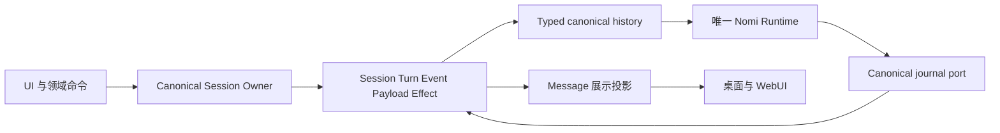

# Agent Session 日志与内容架构

AgentSession 是 NomiFun 会话、回合、内容、效果和取消的唯一事实链。产品里的“对话”和 Conversation 接口投影同一个 `AgentSessionId`，不创建第二份会话。Chat 与 Coding 都由 `nomifun.nomi` 的同一个进程内 Runtime 执行。

统一伙伴 Agent、多入口、多会话和实时共享上下文的当前实施范围、接口边界及验收状态见
[伙伴架构](companion.zh.md)。未验收项不得按已交付能力消费；本页的 canonical 执行边界始终适用。

本页是当前开发入口。执行合同来自 Rust 类型、Session event registry 和 canonical schema；历史设计及施工说明只保存在 Git 历史中。修改实现时同时更新本页，不另建一份可长期使用的旧设计说明。

## 事实与派生数据

应用开发使用普通 Conversation 与通用 coding 能力，不创建专属创作流水线。不可变 SessionPurpose 保存在已有 `session/opening.metadata`；退役的 PluginAuthoring 仅保留 typed 只读识别，禁止新建、执行、恢复或 fork，允许原 owner 取消及删除。读取与分页只从 typed opening 事实派生用途，合法当前代旧 opening 缺省为 Conversation，缺失或非法事实拒绝读取。普通 metadata 更新不能改变用途，产品 projection 不授予工具权限。

应用页工作区固定官方 `app.developer`（内置应用），模型及推理强度仍由用户选择，复用现役 Session 与 Runtime。当前应用目录就是明确冻结的 workspace_root。应用入口创建时在 typed `session/opening.metadata.app_project_id` 建立不可变生命周期归属；Agent、模型切换和目录迁移不改变它，新 fork 继承它。普通创建接口不接受应用归属或应用保留命令身份。AppRecord 中的 `development_session_id` 只提供可验证的导航引用；重开校验 owner、应用归属、普通用途、固定模板与确切工作区，不从这个引用获得权限或删除权。

一个应用对应一个独立项目，项目可以包含多个专属 Session；不同应用不共享项目根目录。
项目历史只查询确切 owner 与 canonical 应用归属，归档状态来自 canonical metadata。
当前代已有应用入口会话只从精确 canonical opening 命令、producer、owner、因果及原始显式应用根识别，
不写回 opening 或导入退役数据。普通会话不因目录或 Agent 相同而被收编，旧同目录普通 fork 保持原归属。
最近导航、显示路径偏好及 Message 投影均不构成归属或权限。应用会话只在所属应用管理，
普通侧栏及批量操作排除它们；搜索与旧深链依据 canonical 归属返回应用工作区。
不同 Session 的内容独立保存，项目目录中不复制 transcript，不为新会话拼接全部历史。
新建明确工作目录的 Session 优先复用当前同 owner、同 canonical root 的既有 scoped `project_memory`
resource 身份；首次建立该命名空间时使用 owner 与 canonical root 的摘要。同项目的新会话复用现役记忆状态，
Agent 切换与正式存储位置迁移保留该逻辑身份。已有默认记忆 binding 不被迁移或暗改。
项目记忆保留现役 Host 内存存储合同，不声称跨重启持久；项目源码和 canonical 会话历史持久保留。

Agent 工作台的系统能力「NomiFun 应用开发」沿用冻结模块/动作选择。只有 `app.developer` 默认选入 `app.hosting` 十个动作，其他官方模板默认不启用；已有个人配置和 Session 不自动扩权。详细指南只在 `read_app_guide` 调用时返回。当前应用定位、元数据/命令更新、导入、预览及启停使用原应用 owner；有变更的 Agent 操作经现役 HostedEffectReceipts 写入同一 Effect 事实链，使用 Kernel 准入的确切 Session/Turn/operation/Snapshot 与工具事件因果，不从消息投影或最新 Turn 借权。Host 保留操作与结算直到结束，已知部分失败不表示未执行，未确认结果保持未结算和不可自动重放围栏。

手工导入、覆盖和删除持有目录及全部当前项目 Session 的既有准入围栏，在应用 gate 内复核导航引用，拒绝活动 Turn、pending/unknown Effect 和未结束的 native producer。创建、fork、binding 切换、warmup 和准入使用同一现有内存锁注册表的目录读围栏，封住成员查询后的新会话竞争。此接缝不改写 Session 事实，不新增绑定或执行账本。
处于 `deleting` 的 Session 不进入普通历史；原 typed 删除候选仍保护其确切项目目录，
不能因它已从 live 列表消失或 Runtime 缓存已释放而忽略未知效果与删除清理。

已准入的 Agent 导入持有同目录与项目 Session 围栏以及现役原生工作区写锁，精确校验本次
Session、Turn、Snapshot、operation、工具因果和 pending Effect 收据，只允许本次调用自身的效果。
其他活动回合、pending/unknown 效果不因 Agent 导入获得豁免；拒绝使用原 Effect 的执行前拒绝结算。

应用开发入口在新的闲置提交前，可通过显式 `refresh_workflow` 命令将当前代旧空职责配置更新为
正式内置应用职责。目标仅从原确切 Revision/Snapshot 派生，保留模型、权限、Skill/MCP 和所有
typed resources；在原 Runtime teardown、Effect 结算和 CAS 围栏内追加普通 ContextOnly binding
transition。旧配置、历史和 Session 身份保持原值，GET/重开不触发更新，不暗改 Runtime 系统指令。

应用界面在开发回合结束时发出的配置识别请求使用完成通知的确切已接受消息引用。
Host 只从该 canonical 输入及对应启动事实解析操作 ID，复核成功终态、后继回合及原生/效果
结算后才处理同一应用。消息 UUID、输入幂等键和操作 ID 不互换，不从消息投影、当前最新回合
或模型文字补造关联。配置识别不启动程序，也不作者或重写 Session 内容。

通用删除入口拒绝应用专属 Session。用户从应用入口明确删除应用后，目录与 Session 围栏内核验归属，
通过现役 canonical 删除流程清理全部专属 Session 的 Runtime、内容及相关资源，再删除应用文件和登记。
已进入 deleting 的专属 Session 复用原收据继续清理；部分失败保留登记与项目文件供重试，不建立另一份批删除账本。
活动 Turn、pending/unknown Effect、未结束原生 producer 或未确认清理仍拒绝破坏性操作。
同目录普通会话和其他应用会话保留，不能为物理删除关闭它们；其活动资源和未知效果仍保护真实目录。
普通会话的创建、上下文、工作区、切换及删除合同保持原样。

| 数据 | 所有者与用途 |
| --- | --- |
| `agent_sessions` 和 binding transitions | Session 身份、冻结的 Agent Revision 与 Snapshot、资源及明确的 Agent 切换边界 |
| `agent_turns` | accepted input 对应的 operation、准入、幂等、状态和终态回执 |
| `agent_events` 和 `agent_payloads` | 有序语义事件和它们引用的内容，是上下文与展示的事实来源 |
| `agent_effects` | 统一的效果回执；结果含义仍由执行效果的领域解释 |
| `agent_session_resources` | 不可变资源定义；保留效果回执引用的定义。当前授权集合只来自当前 `agent_binding_json.typed_resource_bindings` |
| `agent_messages` | 用户界面的查询投影；不能补造缺失的 Runtime 事件或推断完成 |
| native Runtime checkpoint | 精确绑定 build、Snapshot、Session 和 cursor 的恢复数据；不是另一套 transcript |
| AgentExecution 和领域数据 | Execution 的 Step、Attempt、租约及领域自身业务事实；引用同一 Session 与 Turn，不复制会话日志 |

### Runtime 上下文读取

`engine_history.rs` 从 canonical events 及已解析 payload 构建 typed history，不读取 `agent_messages` 来决定模型消息角色。Runtime 回合通过有序的 native journal 重建；缺失结构化日志不能降级成聊天文本继续执行。

工具正文服务模型上下文、效果核验、恢复和用户按需只读查看。Store 在原 Event/Payload 链内提取正式工具参数、结果及压缩上下文中对应的内容槽；相同 Session 内相同类型、相同字节的内容复用按摘要标识的 Payload，事件仍保留各自的调用身份、顺序、宿主结算与 Runtime 观察语义。读者在同一事务内验证来源、类型、长度、摘要和精确槽位后恢复原 typed 内容；不读取当前磁盘来补造历史，不增加内容表、旁路日志或恢复账本。保留的存储引用由 Store 作者，提交草稿不能提供保留的引用元数据；缺失或损坏拒绝读取。唯一内容计入原 Payload 预算，展开后的内容与日志仍受原有边界约束，内容共享不扩大可执行 checkpoint 的 build、binding 或权限范围。

Turn 与 Effect 索引只保留生命周期及精确 `terminal_event_id`，不镜像终态正文；读取在原事务内验证起止事件、归属、状态和索引边界后解析原 Payload。Payload 只保存数据库中的非空内容，不声明未实现的对象目录。前向迁移只删除这些冗余列，物理替换 Payload 表时逐字节保留已有内容、身份及事件引用；无法读取的对象模式数据拒绝迁移。原 baseline 和已提交迁移 checksum 不变，不转换退役 Agent 数据，也不清除现役 Session。

Windows 显式 native 文件修改的目标证明保存在原 Effect started 的 typed `native_mutation_targets`，不增加目标表或第二账本。Windows Store 在原写事务内读取并验证 pending/unknown 的原 Event/Payload，再原子检查跨项目、Session 与执行身份的物理重叠及提交准入；结算不能替换或给旧事实倒填目标。实际执行持有同一次捕获的 native pins，数据库事务不跨 I/O。原 owner、project/resource、Snapshot 和幂等身份继续校验。publication 与动态目录采用明确的原生卷保守范围，普通 Entry 比较对象与命名空间；缺失充分旧证明时拒绝无法证明不相交的新文件修改，不读取当前磁盘重建过去。其他平台保留原文件 owner 和项目围栏，本次不声明 Unix mount 目标证明。精确范围和 opaque process 边界见[全局操作系统能力](global-os-capabilities.zh.md)。

该围栏按用户明确选择的合作式并发边界协调 NomiFun 已准入的显式文件 Action，不证明其他程序或用户同时编辑文件、链接与 staging 名称时的全局目标冻结。外部竞争由用户协调；发现实际变化或不完整结果仍保留原部分效果、unknown 与清理证明，不自动重放、不回填旧事实。不能把这个范围说成任意 process/shell 的完整文件 footprint。

应用工作区的内置应用 Agent 复用普通 coding、Skill、MCP 和 typed resources；个人 Agent 也可明确选入同一应用开发能力。托管工具直接调用 UI 同一命令与进程 owner，不建立专属计划、预览资格、交付证明或 checkpoint。空闲会话的 Agent、资源、知识库与扩展选择走同一 canonical binding transition，仍受活动 Turn、Remote、Attempt、未知效果与原生 checkpoint 校验约束。应用工作区固定模板的产品要求不允许借重开入口替换已有 binding。当前会话效果和产物继续读取精确 Turn 的 typed canonical event/payload，不从工具提示或网页状态补造成功。

### 回合完成后的知识回写

主 Turn 在原工具效果、原生任务和资源清理确认后正常提交终态并释放输入；知识提炼与回写由
原 `EngineKernelSession` 的独立现役 `EngineTaskGroup` 持有，不加入主 Turn 的清理等待。
任务固定原 owner、Session、Turn operation、Snapshot、知识资源、回答正文及模型，不读取
后继 Turn 的活动状态或当前 binding。开始与结算记录追加到同一 canonical Event/Payload 链，
不会改写原 Turn 终态、结束时间、模型上下文或 checkpoint，也不增加任务表或执行账本。

回写状态从原 operation 的 canonical Turn summary 投影，实时帧只更新该原回合的展示；它
不发布第二次 `turn.completed`，不改变后继回合的忙碌状态。精确取消只命中原取消收据的
operation。清空上下文在原 Session 操作围栏内取消并等待回写退出；Session 绑定切换、删除及
明确关闭通过统一 session teardown 取消、join 全部回写后才释放资源。保留 Session 后台责任的
软 Runtime 退休关闭该载体的新回写准入，等待原回写自然结算，不因主 Turn 完成或释放 Runtime
而取消它。文件原子发布已经
开始时等待真实结果，不能把取消请求当作“未写入”证明。启动在开放 routes 前把前进程
未结算的回写标记为中断、保留已确认结果，不自动重放提炼或文件写入。

回写提炼使用独立的有界完成合同，在原 Turn 准备时捕获该模型的真实 task 配置，派发前按
同一 task 的有效连接、凭证、协议和预算复核；无关模型配置的版本变化不使回写失效。提炼
共享现役协议编码、参数合并及单次 HTTP executor，不构造已关闭 Turn 的模型因果，也不
重开 Runtime。连接等待、首帧与无实际内容进度的停滞分别有界；持续有效输出不受额外
45 秒整请求时限切断。协议解码器确认的在途思考增量也算生成进度，完整思考块仍按原
规范原子交付；空帧与签名不能延长等待。输入预算按已声明的上下文容量及 input-only 语义分配，完整保留
知识库身份并安全缩减超大说明和正文；输出与原始响应字节另有限额。未知模型上限保留
供应商缺省，不按品牌推断结构化输出支持或盲目增加请求参数。

回写结果沿同一 canonical observation 保存 typed 阶段、共享错误码、真实计量和安全
provider 诊断。未测量的信息缺省，不能补造为零；prompt、响应正文与凭证不进入诊断。
界面以原回合的紧凑提示展开、折叠和复制这些证据，复用全局异常的诊断展示，保持主回合
的生命周期与原完成时间。既有当前代自由详情只读保留，新的结果不重复写两套说明。

准入后、Runtime 启动前就失败或取消的输入仍是有效 accepted input。读取时保留这个输入和明确的终态事实，不伪造 Runtime 启动、工具结果或完成证明。

### 模型工具规则与说明

标准工作区工具由同一 Snapshot 已授权的 Action、正式 schema 和
`nomifun-agent-contracts/contracts/tool-model-guidance.json` 一次组装。
正式 schema 是唯一参数约束来源；新说明数据只保存用途、已有参数节点的说明、合法示例及
真实宿主平台的调用指导，不声明第二套类型、必填字段、互斥条件、默认值、上下限或权限。
名称来自现有工具词汇表，资源与 Action 检查继续走原 ToolPlan 编译和 Kernel。

说明数据通过严格类型读取；重复身份、非法参数路径及缺失的正式字段拒绝组装。
原 Runtime 标准 schema 工厂、旧说明抽取覆盖及结构子集比较器已退役，测试直接消费正式
Action schema 和实际组装结果。Runtime 只消费现役 ToolPlan，不依赖业务 schema 供应器。
工作区根目录来自原已准入事实，说明不复制物理程序路径、环境快照或已执行结果。

说明变更正确重算实际模型工具 schema 摘要；源码与新数据一起进入原 native build 摘要。
正式注册身份、Snapshot、Session 内容、数据库 schema 及数据代际不因此改变。
活动回合不热替换规则，native checkpoint 保留精确 build/binding 围栏，历史事实不回填。
`start_process` 使用正式 `wait_ms=0..30000` 范围，默认初始观察 1000 毫秒；仍在运行的
进程由原 owner 观察后续变化，不要求模型反复轮询。延迟展示的组件入口短提示读取同一份新说明数据，且只从
确切授权 ToolPlan 的实际组件字段产生，不改变原可见性预算或授权集合。

### 默认全局本机能力

现役 canonical 文件和进程工具不以 workspace 限制本机路径或写入。workspace 保留默认目录、项目观察、VCS、应用归属和产物身份；外部写入不伪造为项目相对变更。默认个人聊天具备文件和进程动作，当前代旧官方 exact-empty 配置在原空闲契约演进/CAS边界通过精确 `default_local_os_evolution` 补齐，历史与旧Snapshot不改写，活动/暂停、Remote/Attempt、未知效果和checkpoint边界仍生效。用户明确裁剪及子任务工具裁剪不由本机权限合同替代。

普通操作以当前登录用户执行；需要系统身份时，现役 process 工具的 `execution_identity=administrator` 使用原生系统组件，复用相同效果及进程生命周期。它不是用户权限模式，不授予TCC或交互桌面。管理员认证、系统独立许可、缺失环境与工程未实现分别表达，未知部分效果不得盲重放。完整执行与环境合同见[全局操作系统能力](global-os-capabilities.zh.md)。

指令预检按真实 canonical 目录及执行身份发现和缓存 AGENTS，文件路径与进程 cwd 中合法的 `..`、符号链接等原生拼写保留在原工具调用内；仅拼写与 canonical 路径不同不延期，也不改写调用参数。实际新增或变化的指令仍在执行前发布上下文并延期，后续须提交新调用；效果后的缓存失效、只读与身份分域、未知效果禁止重放的边界不变。

### 受管组件调用

`workspace.process/start` 的启动目标由 `component`、`command`、`cmd` 三选一。
`component` 只选择正式发布的 OfficeCLI、Bun 或 Node，宿主复用现有组件供应器自动准备已验证程序，并按每次启动组合用户工具环境。状态查询只读，缺失依赖不增加下载确认。
普通程序保留 executable + literal argv，明确 Shell 调用保留 shell 语义；cwd 可为本机绝对路径或相对 Session 默认目录。默认目录不充当访问上限，不根据技能名或脚本文字自动改成受管调用。
现役工具目录中的短 Host 说明直接给出可调用的组件入口；Skill 编译只投影冻结内容，不准备 Office
或缓存 ready、物理路径和环境快照。技能说明、组件目录与入口展示均不授予新的 Action 或资源权限。

明确的组件调用先用原 Effect 身份与读者检查既有回执；已完成结果直接返回，pending/unknown
仍禁止重放。只有没有回执的新调用才有界、可取消地准备组件，再由原 Effect 准入事务复核并进入
原进程 owner。准备失败或等待取消返回原 `process-start-observation.v1` 的 `not_started` 事实，
不预留用户工作区 Effect、不虚构进程身份或清理证明。组件自身探测的未确认清理仍由原供应器围栏保护。
准备期间的并发回执优先于本地准备失败；实际 spawn 后的不确定结果继续保留原 Effect 与进程清理围栏。

启动前复核准备对象的文件身份。实际组件身份随原工具结果记录；缺失或未提交的历史身份不从当前
组件补造。取消单个会话的准备等待不取消其他会话共享的供应任务。此接缝不新增会话表、事件类型、
绑定账本或 checkpoint；输入 schema 的发布使用现有空闲契约演进，旧 Snapshot、历史和 Skill 锁不改写。

当前代旧发布未声明 Action 的 `required_resource_operations` 时，执行使用整个所属模块的资源槽准入。补充精确操作合同只有在新 map 的键完整保留新旧相同的 `required_resource_kinds` 时才可自动演进：原资源绑定身份和准入仍存在，新操作检查仅增加限制。无资源动作的缺省声明与空 map 同样成立。删除或新增资源槽、改变或移除已有精确 map，以及效果、权限、依赖和来源变化仍拒绝；失败通过确切 `AGENT_SESSION_CONTRACT_EVOLUTION_REJECTED` 错误码传到发送界面，不泛化为未知发送失败。

数据库的非 Agent 配置扩展不等于 Agent 数据换代。迁移 010 保留同一代、同一 baseline、同一投影和全部 Agent 事实，只加入两张 OAuth 配置表；契约演进从正式 schema manifest 验证这个精确前后继关系，允许旧配置绑定到现役执行合同。该证明同时用于内置契约和会话扩展派生，不改写旧 Revision、Snapshot 或事件；未知 manifest、逆向转换及不同代际仍拒绝。官方 Agent 启动失败保留原后端错误及诊断，界面展示确切错误码与原因。

### 模型提案验证与有界纠正

模型参数尚未形成合法 JSON 对象时，记录的是未准入提案，不是工具执行失败。各协议 Adapter
复用可替换的纯参数解析器，输出 `ToolCallRejected` 与有界 typed 诊断；诊断只保存类别、位置、
字节数和摘要，不保存非法参数原文或任意响应正文。外层协议、调用身份和流完整性仍由 Broker
校验；断流与合同矛盾保持原失败路径，显式输出截断使用原 `ModelOutputTruncated` 机制。

Runtime 收齐完整正常终态后，把参数语法或根对象错误交给唯一的 `ProtocolRecovery`。
任一提案被拒绝时整批不准入，包括其中已经形成合法参数的提案；不补括号、不替换字段，
不创建 `ToolStarted`、工具结果或 Effect。模型请求及真实 Usage 仍保留。既有非原生工具正文
与空任务终态使用同一响应纠正入口；合法 JSON 的工具 Schema 前置拒绝继续沿用明确的
`not_executed` 工具反馈和现有完成统计，不把语法拒绝混入工具执行结果。

纠正决策先作为 typed `ModelResponseRejected` 写入既有 `runtime/progress-recorded`
Event/Payload，包含精确拒绝类别、整批提案身份、有界诊断、是否继续、工具约束和实际安全反馈。
只有提交确认后才更新纠正状态并开启后继模型步骤；提交失败、取消或原执行围栏失效不授权继续。
纠正沿用同一 Turn、原连续及累计预算和总模型步骤预算，使用新的模型 Operation 与调用 ID。
`ModelStepStarted.correction_source` 只引用同 Turn 的确切已提交拒绝步骤，不能替换 accepted root
或改变路由、Snapshot、资源权限与原生准入。已准入或未知效果继续由原 owner 结算、对账，
不通过格式纠正重放。先前已关闭失败的 Turn 不会被重开或改写为成功。

`ModelResponseValidated` 仅在需要结算纠正状态时记录本步骤的响应格式及参数语法通过，
不表示工具 Schema 通过、准入、效果或任务完成。live、历史及 native 恢复共用 canonical
事件 reducer 重建预算、约束和反馈；checkpoint 后已提交的拒绝反馈保留，未准入生成 carrier
可以丢弃。已有当前代拒绝事实未记录精确类别时只表达未分类的已知拒绝，不从正文、投影或
当前策略猜测原原因，不回填旧事件，也不扩大精确 native checkpoint 的恢复权限。
此机制不新增纠正表、第二套日志或 checkpoint，实际效果仍沿原 Session/Turn/Event/Payload/Effect 链。

可选 Mobile voice 的即时纠正只由明确设置 `SupersedeModelStep` 的 voice-started Turn 启用。普通文字请求的 `voice_immediate` 为 `None`，沿用原模型流、纠正边界和工具结算。voice 调用原 canonical writer 验证 Session、binding、context floor、精确 Operation 与 execution generation，不形成第二个工作引擎或权限账本。

中途替换模型步骤需要真实自有模型操作的取消及 JoinHandle 退出证明；关闭等待失败不授权启动后继模型步骤。`VoiceModelStepSuperseded` 记录精确 step、model Operation、已提交纠正 receipt IDs、未准入工具调用及清理证明。typed history 只排除该步骤已失效且未准入的生成内容，原审计事件与历史身份仍保留；其他步骤和已结算效果不受影响。工具的实际准入与纠正检查共享原 writer 的原子边界，已有准入工具先结算，不伪造 ToolResult 或重放未知效果。

voice 的转写、媒体、来源关联和待处理输入保存在独立 VoiceJournal，只引用上述 canonical 事实。模型重试的新调用 ID 不能重新准入同一已提交来源及同一意图。不能证明转写时钟与当时工作目标时，相对取消/纠正先等待 authenticated Mobile 用户对精确来源 revision 和目标呈现的确认，不能取收到事件时的最新任务补造关联。voice 关闭、媒体故障或 journal 不可用不改变文字请求的结果。

语音重启恢复只在 authenticated 用户显式启动语音并完成 lazy journal reconciliation 后接原 voice dispatcher。已确认尚未准入的 Queued 输入使用原 operation key、原策略及 namespace/binding/context-floor 围栏恢复；未知 Dispatched 只查原 canonical receipt，不盲发第二次。首次健康 HostedRuntime 的 constructor `status=None` 不表示忙碌：voice-only 入口同时验证原 registry、canonical active Turn、未结算效果与传输状态后才允许首次输入。普通文字启动及 Runtime 能力声明不改变。

voice 产品回执的可选 `request_kind` 仅来自应用实际解析、执行的输入，用于厂商无关的观测分类，不是供应商工具参数、权限或完成证明。触发事件先于工作 worker 的回执发布；纠正延迟仅从收到触发到同 operation 的 canonical Applied 回执计时。无法确定分类或没有这两个端点时无样本，不推断已听、成功或听感延迟。

Creation prompt、Cron notice、AgentExecution summary 使用正式消息事件成为数据上下文。Agent 切换前的文本和工具结果只从已提交的 canonical event/payload 读取。工具结果保持原文，以明确的不可信历史数据包装进入下一 Agent；不重放旧工具角色，不继承旧 Agent 系统指令、权限、可用进程句柄或完成门槛。历史图片和音频不作为新观察传输；MCP resource journal 仅记录 owner settlement 时不能补造资源正文。上下文清空事件和当前 accepted root cursor 限定读取窗口。

用户清空上下文、伙伴自动窗口摘要后的重置和 Cron 的每次运行清空都使用同一个 Session owner 命令。
命令先在现有 Session 操作围栏内验证本地可写的普通用途和精确归属，拒绝活动、暂停、待对账
Turn、Remote 与 Attempt / automation 审计会话，以及未结算效果和待恢复工作；随后取消并等待
知识回写、证明旧 Runtime 与资源清理完成，再由 Store 写事务复查确切 binding 和上下文边界，
提交唯一 `context/cleared` 事件。没有 live Runtime 不代表空闲，清空也不创建或预热 Runtime。
历史消息、Session 身份、冻结配置、长期记忆及已有终态回执保持原样；下一 Turn 只从新的
canonical context floor 读取上下文，不引入 Runtime 私有清空状态或额外 checkpoint 账本。

伙伴自动窗口摘要读取消息时在短操作围栏内捕获同一个 typed context boundary，摘要模型调用期间不持锁。
完成摘要后必须在 Runtime teardown 前及最终清空事务中核验原 binding、active set、输入和上下文
边界均未变化；期间到达的新 Turn 即使已经结束，也不属于旧摘要的清空权限。过期归档保留已写
摘要，跳过上下文重置与 Runtime 清理，不用消息时间戳推导准入，也不增加归档清空账本。

会话列表的 `archived` 只是 canonical metadata 注记，保留历史、工作上下文、活动任务和收件路由；
它与上述自动窗口摘要、正式清空上下文及删除分别处理。会话列表与 ensure 从 canonical metadata
读取注记，不从导航表中的旧字段推断归档或停止接收。

清空命令的幂等身份保存在原 Event 链。伙伴自动摘要以窗口身份去重，Cron 以确切运行身份去重；
Cron 在同一个 Session 操作围栏中先读取原 Turn receipt，已准入重投直接认原输入，禁止再次
清空或停止后继 Runtime。只有尚未准入的新运行执行清空并提交输入，清空成功后准入失败的
重试仍复用原事件，不重复移动 context floor。UI/API contract version 40 要求用户清空携带
明确的幂等键，并拒绝仍依赖退役命令发现、旁路提问及命令消息类型的旧前端。
快捷命令目录属于产品输入行为，不能从 Runtime 或 Skill 正文发现权限；Skill 继续使用冻结
Snapshot 与 typed `inject_skills` 链路。同一目标中未修改命令草稿的失败重试沿用原动作键，
成功后或用户明确修改草稿才创建新动作，防止丢失清空响应后误清后继输入；该交互状态不另存账本。
新清空事实同时记录现役 typed binding 引用与 active-set generation。Cron 在尚无 accepted
receipt 的重试中核对原事实、当前绑定和上下文边界，模型或资源 CAS 即使没有新的消息也会
使旧准入窗口失效。既有缺少此证明的清空事实仍限定历史 context floor，并可返回原用户清空
回执，但不能授权 Cron 的新输入；不从现配置补造过去的准入证明。
退役旁路提问后，现役 metadata 前向迁移只删除 `behavior_policy.supports_side_question`，保留
其他已保存配置与原迁移回执；损坏、未知或重复 policy 字段拒绝迁移。合法空配置仍可读，
后续 metadata 解码错误直接失败，不通过默认值掩盖配置损失，不读取或转换退役 Agent 数据。

### 命令生命周期与观察

现役命令只使用 `workspace.process/start`：启动调用在有界观察窗口内返回真实终态，或
`running`、原进程身份、已有输出和 cursor。默认观察窗口为 1000 毫秒；结束观察只结束工具
调用，不终止进程，也不证明命令成功。原进程硬期限不会因观察、提问或回复续期。
同步 `exec` 执行入口已退役；历史调用仍只读，不改写旧事件、Snapshot 或 checkpoint。
当前代旧执行授权只通过确切 bundled 来源、同效果及同资源权限的空闲 CAS 转换为单一启动
合同，不顺带授予 poll、stdin 或取消权限。旧 Agent 创建新 Session 时复用同一证明派生隐藏
执行配置，保留原作者 Revision/Snapshot；这不授予旧 checkpoint 恢复权限。
活动、暂停、Remote 与 Attempt 不热转换。

进程属于原 owner 的 Session 资源，创建它的 Turn、调用、Effect 与冻结权限保持不可变。
每个新 Turn 的控制调用同时通过当前授权和原创建授权及确切资源校验，不把历史句柄当作权限。
回合开启和进程动作使用同一共享规则比较已规范化的工作区路径；Windows 普通路径和带
`\\?\` 前缀的原生路径表示同一目录时不会被误判为权限变化，不同目录仍拒绝复用原 owner。
初始 `wait_ms` 只限定一次观察，观察结束返回原句柄，不杀进程或重跑命令。
`timeout_ms` 为可选的真实任务执行期限，省略时没有默认的 5/10 分钟期限或用户静默租约。
显式期限继续生效；第三方授权码、程序自身期限与用户回复时间分开，不能承诺外部链接永久有效。
Turn 结算关闭本轮准入并等待已派发调用，保留合法后台进程；用户还可从宿主按原 owner generation、
process ID 与 creator Turn/call 精确结束单个进程。该信号使用 spawn 时捕获的原 native capability，
不等待另一进程的长 poll 所持业务锁，不升级成 Session 或整个 Execution 取消。
保留 Session 资源以原 `host_cleanup_proven` 中的 typed retention 明确区分于 reap；
真实 owner 清理逐个以同一事实链的 `session/process-reaped` 结算原保留进程；清理后仍有未结算的
保留进程则失败关闭，不追加 `session/process-owner-released`。既有该事实只作为已提交历史读取和核验，
仅结算对应资源围栏，不授予重放权限，也不增加资源生命周期表。
未知效果、配置切换、工作区迁移和重启仍受原 owner 围栏约束。

Session 的 64 个进程上限只约束仍活动或尚无清理证明的句柄。原 first-party launch 与同一事实链
已提交的终态、真实 reap 回执共同证明结束后，才可释放内存句柄配额；历史结果保留，旧句柄不重建。
原 Supervisor 的 terminal watch 唤醒 Session 资源 owner，在主 Turn／Runtime 之外结算
`session/process-reaped`，只扣除同代际的单个原进程，不把部分 reap 当作 whole-owner release。
原 first-party ToolResult 已有终态时只引用其 Event；否则保存原 native terminal。
活动 Turn 尚未提交 retention 时，原 `host_process_dispatch` 的 typed `process_owner` 可提供
spawn 时冻结的 owner generation 与 resource binding digest；它必须与原返回的 start ToolResult、
Effect、creator、Turn Snapshot 和 native FrozenOutput 精确一致，才允许真实结束后的归档。
旧 dispatch 缺少该字段时仍须原 retention 或终态 ToolResult，不从当前绑定、PID 或时间推断。
释放最后句柄之前，原 Event/Payload 链保存原 bounded raw output、逐流 decoder 和 cursor 状态；后继 Runtime 按当前与创建权限
只读原输出，不重建进程或重放输入。写入失败保留原 witness 与重试；自然结束后空 Scope 仅释放
确切缓存实例，不永久关闭 Session 准入。应用 Quit 即使已关闭 background watch，也由原 cleanup
完成输出归档后才确认释放，不能丢失最后 stdout。
归档后还消费原 Supervisor 的 exact terminal release：核对原 owner、真实终态和零原生在途操作，
只移除这个已结束的 native registry owner，不等下一次容量淘汰，也不关闭同 Scope 的合法长兄弟。
原 witness／FrozenOutput 仍可只读；native 登记已无本身不替代真实 reap 证明。
已封口的 reap、creator 与原因果链按 portable 事实校验；本机不能解码另一平台的原输出时，
不把物理资源重新判为未释放，也不阻断清理／迁移。具体字节回放继续要求原 decoder，明确失败，
不以 flattened text 切片或重启命令替代。
纯 native 输出归档使用同一 `agent_payloads` 的原始字节块：`session/process-reaped` 保存
原终态元数据、完整归档摘要和有序 Payload 引用，每块保持原单 Payload 大小上限。
完整文本由原 FrozenOutput 按原 cursor 解码，不在根回执中重复保存。
只有原 reap writer 在核验 creator、Snapshot、实际 terminal／cleanup 后，才能在同一事务中写入
专用归档 carrier 与 manifest；普通 Payload 请求不能凭 media type 绕过预算。
这些纯观察字节与回执元数据不消耗模型／上下文 allowance，原 ToolResult 和模型内容仍消费原预算。
显式输出读取核验同 Session、原块身份、次序、长度与完整摘要；缺块或损坏拒绝回放。
物理 reap 的 portable 证明仍来自原终态和原因果，不因归档字节缺失而复活 native owner。
归档块随原 Session 一起参与清除／删除、数据库快照备份及 dataset reset；不另建文件账本或运行权限。
Session 删除与应用关闭直接清理共享资源 owner，即使当前没有 Runtime；重启后原 owner 无法证明时，
拒绝新的进程操作而不妨碍普通聊天，不接管旧 PID、不自动重启命令。

MCP 的外部业务结果与本机资源清理分别核验。原调用已 join，原 MCP owner 不再持有在途工作，
且同一 canonical Effect 的原 cleanup 明确证明本机资源关闭时，Turn／Runtime teardown 可完成；
外部结果仍保持 Unknown，`host_cleanup_proven` 不表示结果已知或已回滚。
派发、上下文与 checkpoint resume 继续拒绝该未知效果，缓存和退休均不得触发重跑。
缺失、损坏、未返回的清理证明及其他 domain 的未知效果不能借用此 MCP 证明。
取消终态使用专门的原生结算入口：在同一 writer 事务内核验原 holder、fence、generation、
原 Turn start 和本代 `host_cleanup_proven`，允许原 active Turn 从 reconciliation 收束为取消。
它不经过新工作准入，也不放宽通用事件／观察入口；未知效果保持原样，写失败仍由原 journal 重试同一终态。
宿主活动控制按原 Operation 的 1024 UTF-8 字节合同保留精确身份（含合法 Unicode），
不能误用控制请求幂等键的 128 字节上限，或截短目标去停止另一个任务。

独立 SSH 资源关闭按原 Session／host、pool instance UUID 与 link instance 捕获原 capability，
先在同一事实链写 `session/ssh-link-close-requested`，再关闭精确链接准入并由原 pool drain／close。
用户关闭还向原 shell 发单调退休信号；原 run 保留自己的 channel/receiver，发送 INT／ETX 并排空
到新的内部 sentinel，再把原 receiver 留给 close 收真实退出证明。等待命令锁、发送窗口或输出时
不需排在长命令预算之后；未知命令结果保留原 partial output，不能用请求中断或探针成功补造业务成功。
退休后的链接不能经自动 recovery 创建新 shell；已在途的开通和被替换的旧 shell 仍由同一链接登记，
只有各原 native close 的真实证明都成立，才确认该链接已释放。dial／SFTP 等仍由各原操作结算，
原库没有中断证明时保留真实 pending／unknown。
临时 sudo shell 在实际创建时登记到原 handle，退出时仅凭真实 close proof 自动退休；用户关闭会
通知主 shell 和全部临时 shell。Session／Quit 批量关闭先关准入并发出这些精确信号，再等待原
producer drain 和在途 dial 的真实交接。被动 supervisor 等待可唤醒，真实连接／开通 Future 则由
原 owner join；不使用 abort 丢弃它们。旧通道、失败初始化和此前 Lost 责任都保留在原 pool，
不能以新连接的成功或空 live map 覆盖。批量 observer 离开后原 close／最终 inventory sweep 仍收束，
同一次关闭的重试读取原结果。
原 native 的 Reaped、Lost、AlreadyDown 分别写入 `session/ssh-link-closed`，只有 Reaped 证明远端
shell 退出。重启后旧 pool 不存在时，pending／unknown 仍可见，不拨新连接来冒充旧清理；
原请求不关闭整个 Session，也不影响后继链接。cwd、env 与打开文件是合法跨 Turn SSH 责任，
不能仅以零 active action、一次 Turn 结束或闲置把连接判为可重建。

### 用户输入交接

普通会话的 `request_user_input` 将问题与剩余工作写入原 typed Runtime Event/Payload 链，
随后以 `InputRequired` 正常结束当前计算 Turn。问题引用确切调用，不构成答案、授权或任务完成
证明；`report_completion` 继续负责真实交付证据。无论是否存在后台进程，提问都不保持活动
Turn，不进入进程等待循环，也不要求普通用户输入走 native checkpoint 恢复。
问题及未完成要求由 canonical 历史保留，下次输入在同一 Session 开启新 Turn；已在终态
围栏前真实准入的补充仍可在本次安全边界消费。正常交接不新增等待表、问答表或恢复账本。

用户等待没有应用设定的回复期限。后台输出、自然退出、真实执行超时和外部链接过期只能
改变原资源的事实，不能回答问题、解除人工交接、启动模型或授权自动重开命令。
用户回来后，在新回合读取原上下文并核验真实配置或原句柄结果；“已完成”本身不证明授权成功。
外部链接实际失效时如实说明，由新的用户意图决定后续动作，不以超时作为重试许可。
纯机器资源观察仍可在活动 Turn 内等待原 owner；它与人类交接是两种不同的生命周期。
原生 checkpoint 仅用于实际中断恢复，重启不能从历史句柄声称进程仍存活，也不自动重放未知效果。

供应商一次 stop 只结束一次模型响应。统一停止决策根据真实计划、完成报告和资源状态决定
继续纠正、宿主等待、原生暂停或完成；计划未完成本身不产生失败。计划、完成报告或结束意图的
纠正耗尽时记录需要人工介入，保留真实命令与工具失败计数，不从正文猜测用户答案。有资源时
保留原 owner；原资源退出不授予额外纠正次数，资源静止后才原生暂停。原 owner 延后软窗口后
保留已确认 checkpoint 和 canonical tail，暂停不续预算，也不伪造新的 checkpoint 提交回执。
真实故障、失败停止策略、未知效果及 Patch recovery 仍按原生围栏结算，不能借等待声明逃逸。
交流控制与效果准入分开：已结算命令失败和 report-only 阶段仍允许单独提交正常输入请求，
但不擦除失败证据、不开放执行工具、不解除 Patch 或未知效果。blocked 完成报告先交付真实
部分结果，再要求精确结构化交接，不能以普通 Answered 冒充任务完成，也不直接转技术暂停。
有界声明机会耗尽才按协议/预算原因保留技术暂停。

AgentExecution、Cron、IDMM 和普通界面消费同一 typed 交接。确切的人工输入交接在 AskUser
和 Automatic 策略下都进入原有 WaitingInput 人工处理边界，不能将 Automatic 不能代答的
问题转成任务失败；人工回复仍校验精确活动 Link、Attempt、原问题与 Turn 回执，保留现役
用户准入和 native 授权围栏。自动策略不制造真人授权，也不替人回答。没有真实回复或资源变化时不轮询模型，
不自动重放效果。Cron 的闭轮输入交接结算为现有运行记录的 `input_required` 非故障终态，
消费本次触发且不增加重试，不留下永久 reserved；确切取消结算为 `cancelled`，清除故障提示，
不转成失败或重试。领域取消与直接取消原关联 Session 沿同一 canonical 取消事实收敛；
仍在原 Turn 等待资源时保持非终态。
Cron 原后台收据消费者贯穿等待及暂停，冻结已剩余的观察时限，直到原确切 Turn 结算。
定时任务的“仅停本次”由原 Cron owner 接收 owner/job/run，持久记录该原 reservation 的取消时间；
不从 job 的最新 Session 或最新配置推断目标，也不禁用或重写后续计划。Stop 不排在普通 job 控制 FIFO 后，
原 host task 在调用者离开后仍向精确 keyed Turn 发出 canonical 取消及 native 信号。
同一取消事实在 attach、正式 Turn 准入和最终 native claim/resume writer 中封住后续执行；
重启只接续原收据消费与清理，不再次发送输入。未准入的本次按 cancelled 结算，已准入的本次等待原 Turn 收据；
调用已接受、Turn 终态与原 native owner 已退出分别报告，不能从取消请求推断物理资源已释放。
重启从原 reservation 与 active-runs 围栏重挂只读收据消费者，不新建 invocation、Turn 或账本，
不重新 prepare/send；终态继续通过原 CAS 只结算一次并恢复正常调度。
宿主重启后不能以等待事件证明进程存活；原 owner 无法验证时进入恢复或对账，
不恢复旧 live handle，也不自动重启命令。

明确回复问题时引用原问题的 `question_seq` 与来源 Turn，普通新消息不隐式变成最新问题的答案。
迟到的旧问题回复保留原关联，不能投给当前另一个问题或绕过执行准入。
Channel 在平台确认交付后追加 `channel/input-question-delivered` 展示事实，关联原 Session、
Turn、问题及 platform/plugin/chat/message 身份；即使确认晚于 Turn 关闭，也只记录原历史问题。
SDK 在原问题提交后发布 `InputQuestion`，不再把问题发布绑在活动进程等待上。
没有明确引用或交付证明不能补造最新问题关联。交付事实不授予执行或恢复权限，
不进入模型上下文，也不新增渠道问题表。

已批准 Channel 输入的可信 `channel_source` 与正文一起提交原 `message/user-accepted`，记录真实渠道
Session binding、platform/plugin/chat 与入站命令身份。普通消息 JSON 不能作者该来源。共享 Session
的不同收件地及桌面输入不能互相投给活动 Turn；只有同一真实 platform/plugin/chat 的补充可共同消费，
其余输入留给后继 Turn，Host 与 Store 使用同一来源规则。消息观察按
原 input Event ID 读取，提问来自已提交问题，完整正文与产物来自确切 Turn 终态；晚订阅的流片段
不能代替完整交付。原 QueueDrain 启动和既有巡检重挂只读观察，并复核原渠道授权、binding 和插件，
不向当前新绑定目标转发旧输出。`channel/input-delivery-state` 仅记录原 input/Turn/transport 的发送
开始、真实 provider ACK 或未知结果，不复制正文，不新增队列表。已确认交付跳过，开始后结果未知
不重发正文或产物；问题 ACK 复用原 `channel/input-question-delivered` 证明收敛。资源执行和交付观察
分别结算，交付未知不授予重新执行工具的权限。

### 回合公开结果

Turn 生命周期与用户任务是否交付分开表达。共享 `AgentTurnOutcome` 从精确 Turn 的已提交
Event/Payload 只读派生，包含 `answered`、`input_required`、`waiting`、`failed`、`cancelled`、`paused` 和
`unavailable`，以及有明确无回复意图的 `silent`。它不新增结果表、完成账本或 checkpoint，也不改变原生清理、取消与终态提交顺序。
`answered` 只引用该 Turn 最终有效模型步骤中完整封口的非空公共消息，以及有明确截断续写关系
的前段；终态步骤与 typed Runtime 事实共同证明其归属，不能从较早进度回退寻找答案。思考、工具
输出、已撤回的语音步骤和后继 Turn 不能供给回答。`input_required` 只引用原问题 ID，问题和剩余工作
仍来自唯一 typed request，不复制进助手正文。`unavailable` 如实表达已关闭历史缺少可证明的
公开结果，不回填内容、不重跑模型或效果。`answered` 本身不证明用户的整个任务已完成。

`waiting` 是精确活动 Turn 的非终态，由尚未解除的 typed 等待事件派生，保留原 Operation 与
执行权。REST、实时通知、计划栏和领域消费者共享同一结果合同。计划表达步骤进度，等待和暂停
单独展示，不把 Turn 故障扩散成全部待办失败。普通提问已闭轮为 `input_required`，不再借 `waiting` 保持人工等待。IDMM 不把正常人工交接
当模型停滞，Cron 与 Execution 不把人工参与当失败重试或已交付。

历史查询和终态后的实时投影共用同一结果 reducer、确切消息身份与 Turn 归属。界面按结果引用
展示公共内容，过程折叠只处理过程条目，不再根据最后一条助手消息、到达顺序或显示时间猜最终
回答。空消息封口不成为公开结果；请求用户信息必须在折叠过程外显示，并允许后续输入创建新
Turn。UI/API contract version 40 阻止旧界面把结构化结果继续当成通用文字提示消费。

部分历史页在同一数据库快照中附带其涉及 Turn 的结果摘要，不占原始分页窗口；下一页游标只由
原始窗口决定，界面直接使用服务端 `next_cursor`。迟到的暂停快照不能覆盖已提交终态。正式领域
`message/assistant-projected` 合成回复沿其确切事件获得独立展示标记，缺少 `turn_id` 本身不构成
公开内容证明。结果查询失败显示独立提示并允许重新读取，不改写原回合结果。

普通文字回合的空终态进入原有有界协议纠正；思考和供应商的正常 stop 不构成公共回答。空回答
纠正允许直接补充正文，不强制调用工具；非法工具提案仍沿用原有工具约束与预算。合法用户交接、
已证明的领域交付、取消、截断和完成审核继续使用各自现役边界。

物理动作使用可选 Runtime `finish_without_reply` 明确声明整条请求无需公开回复；Host
只为可信物理交互入口启用，不扩展动作授权。所有动作真实成功受理、未结算事项及终态输入
围栏通过后，Runtime 记录 typed `silent_completion`（确切模型 step 和工具 call IDs），
随后按原 cleanup 与 `turn/completed` 提交。reducer 校验可信 producer、因果、最终 step
与确切空封口后派生 `silent`，`result_text` 为空；旧空回答仍不可用。该意图不是动作
物理完成或通用任务交付证明，失败、需要输入、未知效果及普通 Agent 空答保障继续生效。
界面不补确认或错误，机器人只收 `Done` 而不启动 TTS；详见[伙伴响应边界](companion.zh.md#机器人响应与思考边界)。

Execution、Cron 和 IDMM 消费同一结果类别，再由领域自身判断任务交付或是否可以安全代答。
未取得公开结果不授予重放效果的权限，个人资料问题不能由自动决策编造答案。回归需覆盖实时
完成刷新、重开、分页、迟到事件、结构化提问和后续 Turn 的真实时间轴可见性。

物理语音的提前公开使用正式 Runtime `PublicOutputCommitted` 及其 canonical 来源证明：确切模型步骤、公开内容范围、part 数与摘要。它发布已通过撤回和准入边界的不可撤回前缀，不提前封口仍可追加内容的聚合消息，也不把原始 token、推理、工具正文或 `OutputDiscarded` 变成可播文本。完整 Turn 最终结果仍由原 reducer 独立验证。媒体传输受理与用户实际听到分别计量，详见[语音架构](voice.zh.md)。

### 执行窗口与暂停

模型步骤窗口和日志窗口通过已确认的静止 checkpoint 续接同一个 Turn，原累计预算、
进程期限、取消和效果围栏继续生效。软窗口届满而原进程仍在运行时，Runtime 只开放
这些确切原进程的输入、关闭输入、读取结果和取消，以及准备输入所需的已授权文件读取
与计划更新；不准入新进程或其他新工作，也不解除完成审核的工具限制。
结算等待不保存 live handle。实际退出和清理确认后，按已消耗的模型步骤提交新的
checkpoint，只有收到提交回执才续段。空轮询、轮询参数变化和规则读取不延长无进展保护；
真实预算不足、未知效果、取消或无法取得 checkpoint 回执仍沿原安全路径停止。

普通消息统一通过 `/messages` 受理。Host 在原 Session 操作边界提交一次 `message/user-accepted`，
返回稳定 message ID、cursor 与 accepted 回执；保存输入不等于获准执行。前端只保留未发送草稿和
原 payload/幂等键的重投身份，不持有业务派发队列，不选择 steer/new-turn/resume 或携带 checkpoint。
Host 从同一 canonical 事件链派生未消费输入；活动 Turn 在安全边界 claim，空闲时建立后继 Turn。
消费事实只引用原输入，不重复存正文，不新增队列表、消息恢复台账或第二份上下文。
新输入的 native delivery 同样由 Store 保存原 claim/accepted 引用，并在读取时验证 Session、Turn、
因果与字段后还原 Runtime typed 内容；缺失原事实拒绝读取，不以旧 Runtime 正文回退。
尚未 claim 的输入不提前进入模型上下文。claim 本身不证明已投给 Runtime；只有与原 claim 和输入
精确配对的 native delivery 才能确认消费，未交付即闭轮的输入保留可查询原因。活动 Turn 的输入
容量耗尽时，未 claim 的合法输入留给后继 Turn，不标永久拒绝，也不使当前模型反复采样。
用户取消尚未 claim 的确切输入时，原 accepted 事实保留，typed `CancelledByOwner` 形成终态取消；
它不能被准备失败重试、后继 claim 或 steering 重新激活。相同幂等键只确认原回执，明确重做使用新输入。
展示为 `cancelled` / `CANCELLED_BY_OWNER`，与可修复的附件或 Skill 准备阻塞分开，不提供重试原输入按钮。
当前素材准备受阻以原输入关联的 typed 状态说明原因，不伪造成失败 Turn，不阻塞无关的有效新消息。
未知 Effect、技术暂停及领域许可继续限制执行，普通消息不会增加预算、承认清理或隐式恢复 native 执行。

前向 `/messages` 和 renderer history 复用同一 canonical Turn 结果派生；问题从原提交事件即
可读取，不依赖另一份正文写入。增量游标取真实事件序号，分页保留边界同序号的完整消息组。
界面在普通人工交接时显示问题和正常发送，不显示“结束本回合”；真实计算中的停止仅取消确切
活动 Turn，后台进程停止由原资源 owner 独立处理。关闭回合不删除 Session 上下文。
公开技术暂停仍受原 Operation、checkpoint、build、Snapshot 与观察 cursor 限定，
不从展示原因或用户文字补造清理证明、额外预算及恢复权限。
用户 native pause 只收束计算边界与已派发调用，不取消已交由原独立 Session owner 的合法后台进程。
`host_cleanup_proven` 携带原 typed process retention 时，证明本轮调用已收束且原句柄责任仍在，
不证明进程已退出或 Session 资源已物理释放；继续沿原 owner generation、process ID 和创建权限控制同一进程。
未登记的启动、清理 panic 和未证实的原生清理仍阻止清理证明；未结算 Effect 继续阻止业务执行与恢复。
原 MCP 资源关闭证明只允许资源收束，不解除外部业务 Unknown。
明确资源 Stop、Session 删除及应用退出继续由原 owner 精确取消、join 和提交真实 reap。

技术暂停的继续在清除原 pause 的同一 canonical writer 事务内重新验证原 Execution／Participant
预约和委派停止围栏。容量暂不可用时，原 `turn/resume-requested` 保存确切继续请求；响应为
`queued`，Turn 仍暂停，checkpoint、模型进度和预算额度不变。原 Session owner 等待既有容量后
重新准备和校验，仅 `turn/resume-authorized` 提交成功才报告 `authorized` 并交回原 native owner。
查询和重启补读只消费该明确继续意图，不发送原输入、不新建 Attempt，也不使缓存获得恢复权限。
失效的控制请求通过 `turn/resume-blocked` 说明原因，业务 Turn 保留原暂停；用户停止或新 pause
使旧排队意图失效。最后一道 native claim 同样在原 writer 验证领域归属和持久停止围栏，旧授权
回执不能绕过停止；原预约仍由有效任务持有时，调度暂停不阻止它继续被准确监督。

合法且仍属当前轮的 blocked 报告也不能提供完成许可。模型在必须交接用户输入时只输出
普通文字，仍由现有 `ModelResponseRejected` 与 `ProtocolRecovery` 的有界预算处理；
`tool_choice` 只是请求，只有真实提交的 typed 提问或真实用户输入才能完成该交接。

### 当前会话内的历史

同代会话的前序 Turn、不可变 Snapshot、显式 Agent transition 和模型切换是当前产品语义。它们需要验证身份、binding、sequence 和内容完整性。它们不授权读取退役的 Conversation 表、私有 transcript 或旧格式投影。

排队输入的历史窗口在它真正 claim 为 Turn 时固定，而不是在早先保存消息时截断；这样可读取前序
Turn 在排队期间提交的完整结果。关闭回合与领域 DATA 也按实际 claim 时序合并，不用较早的消息
保存时间冒充执行顺序。当前输入只作为本轮输入呈现一次，尚未准入的后续消息不混入历史。

可执行恢复必须满足 native checkpoint 的精确 build 和 binding 条件；只读的已关闭事件历史允许经过明确验证的模型或 Agent transition 边界。不能为了恢复而扩大权限或补造缺失日志。

### 模型派生与内置契约演进

模型切换从 Session 已保存的不可变 Revision/Snapshot 派生，只改变 canonical Chat route 以及由该路由决定的身份与摘要。
伙伴相处页的模型下拉也使用这条显式切换通道，随后将选择保存为伙伴的默认模型。默认保存失败不撤销已提交的 Session 切换，界面显示实际会话模型并允许只重试默认保存；模型与 Agent 选择都在活动、暂停或未结算操作时拒绝修改。
能力描述、贡献锁、角色 Provider、Skill、MCP、资源授权和全部非模型创作配置保持冻结。模型派生不读取当前安装默认值或
创作目录来重新选择能力；非模型精确相等校验继续作为操作不变量，并用于模型切换后的已关闭历史验证。

内置发布可以产生新的精确 Schema、产物和角色贡献身份。普通本地新 Turn、模型选择与 warmup 之前，同一个 Session owner
在空闲边界准备新的执行契约。编译器沿用冻结的创作配置、角色合同 key 与 Provider mount，证明 Action 身份与授权、效果类型、
资源要求、依赖图、Runtime 要求和发布来源没有变化。展示元数据和精确 Schema/产物摘要允许演进；这表示绑定到新发布的
执行契约，不证明旧参数可以由新工具执行。Managed package、MCP 工具和 Skill 内容仍须精确一致，不以任意版本、能力名称或
摘要例外授予兼容性。

Owner 将准备与准入串行化，证明旧 Runtime 完整退出且效果已结算，再通过已有 canonical `session/agent-binding-changed`
事务提交。Session 身份、typed resource 定义和活动能力选择保留；旧 Revision/Snapshot 与历史事件不可改写。转换边界之前的
已关闭历史作为数据上下文读取，不重放旧执行日志、不继承旧完成账本，不恢复旧 checkpoint、不重试旧工具调用，也不导入退役
Agent 数据。活动或暂停 Turn、Remote 和 Attempt（包括 Automation Attempt）绑定不获得自动换绑权限；未知效果和未处理的 Patch recovery 继续阻断。
精确幂等输入重投沿用原准入，不提前生成其他绑定；已使用当前契约的重复准备为无操作。

已关闭回合的模型正文在历史上下文中是明确的 User-role DATA：来源及降权元数据与原始文本分为不同内容块，
不能把内部包装 JSON 当作 Assistant 回答示例，诱导后继回复照搬包装或转义正文。历史内容不成为当前指令、
效果回执或交付模板；真实 Assistant 工具调用及 Tool 结果仍保持原协议角色、顺序和配对。
压缩恢复无法证明来源时保留 unknown，不从正文或看似合法的标签补造来源，也不剥壳改写历史原文。
此规则只作用于模型历史呈现，不改 canonical 事件、Message 正文、实时回复或精确 checkpoint 恢复。

完成账本的 prior_task 候选只来自最新已关闭 Turn，并要求与当前 Session、runtime binding 和 Snapshot 完全一致。模型或 Agent 切换后的旧 Snapshot 仍作为已验证的普通历史保留，但不导入它的执行账本；不向更早的 Turn 搜索一个匹配的旧账本。

Chat 路由的当前模型配置摘要只纳入该模型的任务配置及其引用的命名连接；新增其他模型或无关协议连接不改变这条路由。服务商认证、所选模型和实际连接的变化仍须通过原有精确路由校验。既有摘要只能在它原先覆盖的完整配置图仍然匹配时使用，不改写 Session 或 native checkpoint 来放宽恢复条件。Gemini 工具调用的原生签名随既有 canonical `ToolCall` metadata 保留；Broker 使用实际生产该调用的路由建立来源摘要，只有相同路由允许续传。缺少来源或来源不匹配的签名失败关闭，内部来源字段不进入上游请求。

通用 `Reasoning.signature` 没有可验证的生产路由，Broker 准备和各协议编码均明确拒绝其续传，不根据当前模型补造来源。Gemini 无签名思考仍按原生 `thought: true` 表达，带来源的工具签名和 typed Anthropic reasoning 沿用各自的精确路由边界；Gemini 的通用签名思考历史暂不支持。独立签名流事件被解析并不证明完整多轮或 native checkpoint 恢复可用。

Responses 供应商实际返回的 raw reasoning item 使用同一个 `ChatProviderReasoning` 原生条目保留精确身份、内容与扩展字段，沿已有 provider block 及模型上下文续传。Broker 在实际生产 attempt 的原有来源边界绑定路由摘要，只允许相同 Responses 路由回传；不从摘要或展示文本补造 raw content、加密内容或 item ID。实际正文的展示仍使用既有思考事件，已关闭历史、上下文清空、压缩和 native 恢复保持原有内容边界及精确 build/binding 围栏，不新增事实链或恢复账本。
供应商明确返回的 `content: null` 及空状态字段保持原值；已校验的流式正文可以展示，但不回填为原生 content、摘要或加密内容。续传使用原条目，避免把展示用思考再构造成第二份推理状态。

Agent 或资源切换不能删除已结算效果引用的资源定义，也不能修改同一 binding ID 的定义。所有持久资源定义使用合同层 `resource_definition_id`：摘要覆盖 kind、resource、owner、operations、connection 和完整参数，排除 ID 自身；相同定义复用 ID，权限或参数改变生成新 ID。调用方在最终工作目录和策略参数确定后生成 ID，不以物理资源 ID 替代定义身份。执行期权限收窄继续引用原 canonical 定义，不写入第二份资源定义。

Store 在同一事务中更新当前 binding 并保留必要的历史引用；资源查询、知识库挂载和删除保护只按当前 binding 选取资源。历史定义用于回执追溯，不赋予新 Agent 权限，不形成第二份活动资源账本。

机器人资源的 `typed_parameters.capability_revision` 冻结用户确认的设备能力配置版本。
工具说明、默认参数、启停及命名动作预设保存在机器人领域配置中，不成为另一份 Agent
或 Session 账本。保存配置或成功刷新设备工具后，旧版本 invoker 拒绝派发；用户在空闲
会话重新应用机器人，通过既有资源选择与 binding transition 冻结新版本。命名动作只
引用已发现的原始设备工具和有效固定参数，仍复核原始 Schema、连接、Action、设备许可
与现役效果回执；不扩大固件约束，也不自动授予新 Action。

普通会话选择另一个 Agent 后直接执行切换，选择器只显示局部等待状态，不再要求确认能力、资源差异或交接方式。服务端仍提供 preview 与版本 CAS；存在经过验证的任务交接时自动使用 `continue_task`，否则保留普通数据上下文。消息、输入草稿与 Session 身份保持，目标 Agent 从下一 Turn 生效。活动或暂停 Turn、未结算效果、Patch recovery、Remote 和 Attempt 等执行安全边界继续拒绝切换，界面使用简短原因提示。

切换按目标 Agent 授权解析资源，多余资产不开放工具；可用的明确项目可以只作为零文件操作权限的工作目录保留，方便再次升级。宿主按目标授权准备可自动提供的默认资源；已撤下或暂不可用的可选资产不阻塞其他资源。缺少可选资源时相应 Action 不开放，不能补造连接、凭证或权限。知识库仍可读但不再具备写回权限时，自动关闭当前写回策略，保留读取而不阻塞切换；显式策略更新仍校验全部挂载知识库的权限。工作区和进程资源保持同一个根：可用的明确项目继续使用，无法继续使用时回到同 Session 的托管工作区，目录由原有宿主物化流程准备。降阶 Agent 不因旧工作目录失效而失败；升级后的下一 Turn 仍经过目标资源与 native Runtime 准入校验。资源所属、合同完整性和存储错误不能通过忽略资产绕过。

切换继承仍可用的全局 Skill 与 MCP 选择，已移除的 Skill、已停用或不再发布工具的 MCP 不带入目标。Package Skill 还须由目标 Agent 自身声明。保留的选择通过原编译器形成新的精确 Snapshot 与资源定义，不复用旧 MCP authority，也不修改旧 Snapshot。普通会话挂载 Canvas 或 Channel 资产不等于固定产品身份；实际 Canvas 业务会话、Companion、Customer 与 Cron 等归属继续遵循各自绑定边界。

### 官方预设的能力与资源补齐

官方 seed 按真实业务 Action 配置七种预设，不以人格文案或模块名称替代授权。各预设的职责保持明确：

| 预设 | 默认能力边界 |
| --- | --- |
| `chat.minimal` | 默认本机文件与进程能力；相对路径按 Session 默认工作目录，绝对本机路径正常使用，无额外工作区写沙箱。 |
| `assistant.general` | 通用文件、进程、版本管理、产物、项目记忆、网页研究、计划任务、浏览器、桌面操作、媒体、素材和 Office，以及 SSH、知识库和会话管理。 |
| `coding.codex` | 文件、版本管理、进程、产物、项目记忆、研究、协作、SSH、知识库和会话管理；保留 headless Runtime 要求，不依赖浏览器或桌面控制。 |
| `app.developer` | 完整 Coding 基线加应用托管十个动作；应用目录固定为工作区，普通多会话与运行设置共用原 owner。其他预设不默认选择应用托管。 |
| `companion.default` | 统一伙伴：人格、长期记忆、渠道、计划任务、文件、进程、产物、研究、浏览器、桌面、媒体、素材、Office、SSH、协作、管理和 Robot Action；物理工具只在确切授权资源下装配。 |
| `customer-service.default` | 客服笔记读写与交接、知识检索、渠道发送和回复，以及文件、进程、产物、研究和计划任务；不默认授予全局知识库或跨会话、终端管理。 |
| `creative-studio.default` | 媒体、Canvas、素材、模板、Office、文件、进程、产物、项目记忆、研究、浏览器、协作和计划任务；保留三个创作 Package Skill。 |

`assistant.general` 和 `companion.default` 的 `creative.workshop` 只授予素材读写，不能因为没有 Canvas 而隐藏素材操作。Office 原生工具处理素材库中的文档、表格、演示和预览；普通本地文件处理继续使用已授权的文件与进程工具。Skill 与 MCP 仍使用统一的全局选择及精确编译路径，不代替缺失的原生 Action grant。

每个冻结 `CapabilityActionDescriptor` 可以发布 `required_resource_operations`。`None` 或字段缺省表示未发布精确 Action 资源合同，继续使用完整模块资源门槛；不能从其他 Action 推断它不需要资源。`Some(empty)` 明确声明该 Action 不消费资源槽，`Some(map)` 则要求相应 kind 的绑定包含全部指定 operations。模型工具目录和 Kernel 准入使用同一冻结检查；Context/Event 消费继续校验模块资源，Role Provider 继续保留自身精确实现槽位。缺少可选目标仅使依赖它的 Action 不可用，不能用展示过滤绕过 owner、Snapshot、活动能力或实际调用的权限校验。

普通新建和产品入口从目标冻结授权补齐宿主可提供的确定性资源：Workspace、Process Session、项目记忆、素材库、Scheduler，以及适用的 Terminal、Browser 和 Computer。伙伴、客户、Canvas 等产品身份只取真实目标 ID；Workspace 和 Process 使用同一工作根。Browser/Computer 的已发布 Role 合同可以冻结而设备环境仍未绑定，宿主环境不可用时省略该可选资源。知识库、渠道、SSH 主机和机器人只继承实际选项，不补造连接或凭证。真实 owner 不匹配、存储 I/O/损坏、合同或 Provider 不一致，以及 native checkpoint 和未知效果等执行安全问题继续拒绝操作。

同一物理 ComputerTool 的各 Session Host 共用设备操作锁与当前观察授权，不能各自保留可消费同一个 ref/截图缓存的独立授权。输入所需 `generation` 来自这次 Observe 精确已提交的 `tool/call-started.seq`；Store 在同一读取事务中核验当前 Session/Turn、原生租约与 typed claim、确切调用身份和未结算状态，并返回完整 canonical Snapshot，由 Host 在共享操作锁内与当前调用 context 精确比对。首次 execution fence 为零仍合法，恢复前的事实、已完成调用和已有 native settlement 不能重新产生观察授权。不以内存计数、时间戳、随机数或 head cursor 替代该事实来源。

观察授权同时绑定当前 Session、Turn、原生 execution generation/fence、完整 Snapshot、Provider、principal 和资源 binding。旧请求或其他 Session 猜测当前数字都会在执行器前拒绝，且不撤销合法持有者的观察。被准入的新观察在设备调用前撤销旧授权与缓存，失败不恢复；Input/Launch 在调用前撤销授权，设备调用返回后清理纯运行时缓存。当前 Input 的截图几何保留到该次已准入调用结束，效果结果不生成下一次输入凭据。缓存及授权只约束当前原生设备调用，不是新的 Session、绑定、checkpoint 或持久账本，也不能从历史 ToolResult 恢复。

已保存官方预设不会因发布 seed 被覆盖。owner-scoped `GET /api/agent-presets/{preset_id}/recommended-capabilities` 只返回缺失能力、Action 和 Package Skill 的合并草稿与差异；它保留人格、指令、模型、Runtime 配置、已有扩展及 Skill 固定版本，不写入新 Revision。界面先展示新增项，再通过现有 SaveRevision 的 `expected_current_revision` CAS 保存；未保存编辑不能被补齐覆盖。保存不改变现有 Session；伙伴显式“应用最新设定”经空闲、已结算边界复用 canonical Agent switch，在同一 Session 操作围栏与 binding version 校验内准备并提交当前 owner 已保存的配置。直接 Session preview/apply 还须验证此前预览的精确目标 Snapshot。两者均保留 Session 与旧历史，不增加配置升级或绑定账本。

`knowledge.management` 使用现有知识领域服务提供列表、详情、托管建库、元数据与 URL 来源更新、删除。建库后来源或文档失败返回已创建的真实 ID 与各项状态，重试针对该库处理；新库必须在空闲边界通过现有知识选择器挂载，不能修改当前 Turn 的冻结绑定。`session.management` 提供 canonical 会话查询和创建、向其他空闲普通本地会话发送输入、取消精确 Turn，以及真实 PTY 和关联 AgentExecution 的管理。输入沿用原 canonical 幂等与 binding/context 围栏；终端写入、重启和停止核验 owner、行版本与 PTY epoch；协作修改继续要求当前 lead/attempt 关系及精确版本。查询结果和终端输出是数据，不授予目标会话权限，不重放未知效果，也不新增效果账本。

伙伴人格与历史记忆只影响交互，不声明退役 `nomi_*` 工具或未经授权的完整能力。实际名称、参数、目标范围及完成状态来自当前 Runtime 工具目录和真实回执；延迟展示的工具通过已授权目录检索，不能因为首轮未展开就断言能力缺失。
Canonical Runtime 的静态 persona/instructions 取本次 admitted 的确切冻结 Revision payload；
产品人格 Context 与实时事实分别装配，旧 extra 中的记忆快照不恢复为静态模型指令。
伙伴人格 Context 在桌面、消息渠道和机器人路径统一要求可直接朗读的自然语言，禁止颜文字、
emoji、表情包/贴纸标记、装饰符号和动作、神态、舞台描写；人格、额外设定、记忆、历史及 Skill
不能覆盖这项规则。后台学习、归档和技能演化不把历史装饰习惯提炼为新的回复要求。伙伴
产品身份由已验证 canonical opening 决定；最终模型指令缺少同一规则时由 Host 补齐，不依赖
所选个人 Agent 是否包含伙伴 Persona Context；已有规则的完整贡献移到通用人格及路由指导之后、
机器人专属交付规则之前而不重写，
也不从 extra 或预设名称取得身份。伙伴气泡
及机器人语音消费处的过滤仅派生展示/播报文字，不改写 canonical Event/Payload、历史消息、
模型上下文或 native checkpoint，也不改变普通 Agent 的通用内容路径。

一个 `companion_id` 使用一套主要 Agent、默认主模型与 Skill/MCP；桌面、浮窗、已批准渠道和物理设备是交互入口，分别保留独立 canonical Session。设备重连复用该设备 Session，页面导航不改变收件目标。产品配置只使用 `companion/<companion_id>`，入口来源仍用于核验真实设备与连接，不构成第二个 Agent。

能力授权、schema 展示、上下文预算和物理资源装配分离。紧凑交互投影取决于本轮可信入口，不再通过固定弱 Robot 模块集合分类；增加搜索、知识或文件不丢失简洁交互策略，也不撤下普通工具。延迟展示不改变完整冻结权限；未绑或离线设备不阻断普通工作。初始窗口保留常用普通工具及已绑设备 Action，大 schema、Skill 正文和历史结果按需展开。

普通问题与工作直接在当前 Session 使用已授权工具。复杂任务按实际持久执行、隔离或并行收益使用通用 AgentExecution，保留必要用户约束和确切任务引用；不因物理入口或普通能力缺口强制转交另一个 Agent。结果沿原来源直接交付，不固定创建隐藏模型总结 Turn；正常成功事件推进，持久恢复不替代正常事件路径。

Robot ASR 以现有受监管任务执行，每连接最多一个识别任务和两个待识别录音。设备收帧循环持续处理
MCP 回执、abort、断连和 ping。abort 清除尚未提交的录音并等待识别任务退出；连接被替换或宿主关闭时，
旧识别结果不能提交新的伙伴输入。ASR 独立调度不改变原有最终公开结果和语音播报合同。

App 的编译消费面始终是 desktop，不由 Browser/Computer 适配器是否编译决定。可选设备授权上限只对精确固定的 bundled 公开 Provider 延迟物理平台判断：必须是单公开成员、单资源种类、完整 Action 操作合同，且没有私有实现、依赖、Context 或 Event。物理平台不支持的成员只记为当前编译对象内的不可执行集合，不写入 Snapshot 或 checkpoint；资源绑定和调用仍拒绝它。其他 Provider、缺失合同和非 Agent 直接操作继续使用严格准入。

授权目录不按模块或动作总数 128 截断。启用 ToolSearch 时，初始 schema 展示按 24 KiB 和 110 个工具投影，给 Runtime 控制和一次五个搜索匹配留位；完整绑定及 schema 保留在原 ToolPlan。后继搜索成组保留最新最多五个匹配，旧展示工具填充剩余窗口，未展示的工具仍可再次搜索。Host 显式预激活直接使用最终已授权的冻结调用名，一次原子展示整个请求集合，不拆成五项搜索批次而让组内工具相互逐出。最新搜索集合与 Host 显式集合都可超过 24 KiB 软目标，但仍受最多 115 个授权定义、含 Runtime 控制最多 128 个可见工具，以及完整请求上下文预算的硬限制；超限时整组拒绝，不部分修改展示集合。canonical 恢复按原事实重建展示状态并应用相应集合规则；没有 ToolSearch 时只检查实际组装后的可见工具数。搜索窗口是展示状态，不是第二套授权或持久账本。

### 同一现役数据集的位置迁移

数据存储位置变更保留 installation owner、storage generation、Session/Turn 身份、密钥及现役历史，
由数据集协调器在旧服务退出、源目录与目标目录受锁保护后离线复制和校验。位置修订独立于数据代际，
此操作不具有 clean cut、破坏性启动重建或导入退役 Agent 数据的权限。

新建默认 Workspace 与 Process Session 使用 `workspace_location=managed-session` 的 typed 参数，
宿主只按当前有效工作根和精确 canonical Session UUID 解析为 `conversations/<Session ID>`。
明确选择的外部项目保持原绝对路径；不能通过路径前缀判断它属于产品托管空间。现役旧绑定仅在
`default-workspace`/`managed-process-session` 身份、完整单一 `workspace_root` 参数与源工作根精确一致时转换为逻辑引用。
产品托管知识库由当前 `knowledge_bases.managed` 与精确注册根证明所有权，再转换当前冻结的 `knowledge_root`；
外部知识库保持原路径。

应用托管 owner 的纯离线登记检查为本次迁移提供已验证的应用 UUID，canonical writer 再核对真实
installation owner，只认 `{source_data}/app-hosting/apps/{app_id}` 的精确登记根。检查不启动 HostingOwner，
不执行孤儿进程恢复；registry 中任何未确认的 identity、PID、running 状态或操作都阻止迁移。
完整数据副本准备后，只把 staging registry 的 `record.directory` 改为最终目标根，其他字段保持原值。
发布协调器逐项核对源登记与该精确位置变化，应用源码及其他副本文件仍通过完整大小和摘要校验；
最终 installed manifest 覆盖已改写的登记，发布恢复不重放迁移或读取旧盘补造权限。
未发布副本的重试允许逐项保留原始精确副本或仅目录已重写的登记，提交仍要求全部登记完成重写。
已有验证副本时不再打开源 SQLite，避免只读探测产生 WAL/SHM；源完整摘要、纯应用检查与暂存库校验继续执行。

转换使用原 canonical Store 的单一写事务，将所有受影响 Session 的完整资源集合成组更新，重新计算资源定义 ID，
并追加 `session/agent-binding-changed` 的 `workspace_relocation` typed proof。proof 记录源数据根、源工作根、
目标数据根、托管知识库 ID、可选 `managed_app_workspace` 的应用/owner 证明及完整前后资源定义；
只允许托管位置参数变化，owner、资源身份、权限、连接与其他参数精确不变。
此明确的位置转换保留同一 Revision/Snapshot，只增加 binding version；同 Snapshot 转换必须验证 proof 和 request digest，
不能成为普通 Agent 或能力切换的例外。原 Event/Payload、不可变 Snapshot 和历史资源定义不改写，也不建立第二份 binding 账本。
重试直接验证原转换事件的精确操作和当前绑定，不依据额外幂等日志猜测完成状态。

每次位置变化都记录 Session-owned `conversations/<Session ID>` 命名空间，即使逻辑资源定义没有变化，
或当前 Agent 已选择外部项目。可选 `managed_session_namespace` 只引用该 Session opening 中精确的默认 Workspace 定义，
原 writer 和 reader 都核验原始归属与连续的位置证明链。当前 selected Workspace/Process 的根只有精确等于该 Session
托管子目录时才更新位置参数；已注册应用通过自己的 `managed_app_workspace` 证明更新精确应用根上的
Workspace、Process Session 和 scoped project-memory 位置参数。它们的逻辑资源 ID、权限与连接保持原值，
同项目的新 Session 继续复用已搬迁的记忆身份。非登记、相邻或外部项目保持原路径，整个源工作根或其他
相似路径不能被自动收编。
历史消息只在已鉴权的 canonical 投影出口附加临时 `managed_file_paths`，按原始来源 seq、当时托管阶段、
精确 Session 根和规范相对路径解析到当前根；用户在迁移后明确引用旧目录、其他 Session 或外部项目不会被重解释。
原附件展示名的时间戳去除只通过同一 accepted 输入中的精确 `files` 回执消歧，不搜索磁盘或改写历史原文。
图片、附件与工具文件打开共用此投影映射；旧盘不可用不影响已迁移文件访问。
应用删除后保留的普通 Session 不授予后续数据迁移应用目录的权限。若精确当前资源定义与完整位置证明仍合法，
但其已删除应用根位于当前数据集之外，历史 reader 将其视为外部根，不生成新应用路径映射或重建目录。
损坏的证明或当前资源定义继续拒绝读取；默认托管 Session 命名空间仍须匹配有效数据根。

源库复制前和目标发布前都校验活动/暂停 Turn、Attempt、可恢复 native checkpoint、pending/unknown 效果和 Patch recovery。
服务器锁与 Turn 终态不证明子进程退出；离线校验还读取同一 canonical Turn 的 native dispatch、owner settlement、
`host_process_quiescent` 与 `host_cleanup_proven`，缺少精确清理证明时拒绝迁移，不猜 PID，也不从旧进程 registry 获取恢复权限。
历史 reader 将经过验证的位置转换作为普通数据历史边界，保留已关闭内容而不跨边界重放 native 日志或继承完成账本。
目标校验通过后协调器只提交一个活动目录指针；提交后的恢复继续完成该目标，不自动重新启用旧副本。

### 按操作检查系统权限

Computer 的系统权限是执行环境前提，不能因为未授权而阻断普通会话、撤下已冻结的工具，或在首页、会话 Header 常驻授权提示。每次真正的原生操作在冻结能力、资源、canonical 调用因果与观察授权校验后、设备执行前静默检查；截图只检查屏幕录制，AX 观察及输入只检查辅助功能，启动应用与不消费这些权限的观察不要求补齐无关授权。

只有确认缺失的权限返回 `SYSTEM_PERMISSION_REQUIRED` 和 `system-permission-required.v1` 结构化的 `not_executed` 结果，沿原 canonical 工具结果事实传输并派生实时、历史展示。检查失败、未知状态和普通原生错误不从诊断文字补造权限请求。输入在原 Effect 中拒绝结算，并撤销旧观察授权；授权恢复后仍需重新观察，不重放旧物理输入。

消息流仅从确切 Turn 的未解决工具拒绝派生紧凑授权操作，合并相同缺失条件，普通输入与首页不触发。用户返回窗口时重新读取当前权限；通过后收起提示，后续操作静默通过。提示隐藏、点击稍后及授权成功都不改写历史工具结果、Session binding 或 Agent 能力范围，也不创建权限账本。任务未完成摘要可以紧凑展示，但不能仅凭权限工具失败推断或删掉其他受阻条件。Browser 的资源连接与网站授权沿各自原生边界处理，不能混用 Computer 的系统授权。

### 内置浏览器与 Agent Browser 授权

用户侧栏浏览器是 Browser domain 的同 Session 实体：认证 owner 可以直接导航网页，不以 Agent Module grant
或 typed resource binding 作为人工浏览的前提。用户打开或重试不会改写 canonical Agent binding。
Agent Browser 工具仍只从当前冻结 Snapshot、exact Provider 与 typed Resource binding 获得权限；授权后的
managed Agent wrapper 借用用户的同一真实页面，attached Chrome 工具继续独立指向已连接的 Chrome。

Turn 预备只冻结 Browser 授权，不锁 managed 浏览器；每次实际浏览器调用才取得当前 Workspace 的原生输入锁与
guard，拥有本次浏览器工作。原生工作、按下输入的清理及适用的 Effect 结果记录均结算后，本次调用释放所有权，
同一 Turn 可以继续思考或使用无关工具。等待中的浏览器对话框或其他 retained 原生工作在安全完成前继续持锁。
取得锁失败、原生清理不确定及 Effect 结果持久化失败保留原恢复 owner；请求取消或丢弃调用方不证明已经完成。
正常局部 release 不要求 Turn 终态持久化，也不改变 canonical Turn 状态或 Effect 事实。
普通人工交接以 `InputRequired` 闭轮，沿终态生命周期结算保留的 Browser 工作，Session 后台进程继续保留。
真实机器资源或介入等待仍可在同 Turn 交还 Browser：原 Store 在 settle 前后均复核 exact owner、活动 Operation、
已提交 `waiting` 与无 pending/unknown Effect，只释放 Browser 控制权；后续 Browser 调用沿冻结授权取得新的
lazy admission 与新观察。正常单次调用释放则保留同 Turn 内仍可用的观察；原生 target、document 与 observation
检查继续拒绝导航、标签关闭或 runtime 换代后的旧引用。终态清理仍须排空保留的工作并重试失败的 release。
用户 API 按实际 coordinator 门禁准入，不从 Session 的 running/paused、模型正文或已配置的 Browser 权限推导占用。
普通聊天、文件任务、attached Chrome 及隔离后台渲染不会占用 managed 浏览器；没有活动浏览器 owner 时，
用户可正常操作与关闭浏览器。
用户 Profile 使用独立于授权定义的 owner/Session 身份：Windows 使用 `browser-v4/agent-sessions/<hash>/`，
macOS 14+ 使用稳定派生标识的独立持久 WKWebsiteDataStore，不读取旧目录 Profile。
Session 删除也关闭与清除此用户实体，即使当前 Agent binding 中没有 Browser 资源；不另建 Agent 活动授权账本。
详见 [浏览器架构](browser-platform.zh.md)。

Runtime SDK 对同一已发表终态的重试，只能在原 root、delivery、Snapshot/route 与 canonical Runtime terminal
完全匹配时确认既有回执并继续原生 final release，不新增终态或改写失败结果。未执行取消的代际零证据链保持独立。
原生 `turn/paused` 仍保留 active Operation 与 checkpoint 恢复权；它不作为最终终态进入用户重建证明或重复终态 ACK。
完整 Runtime teardown 后，资源上下文按 exact 实例退出宿主 Weak cache；保留旧 handle 不会复活已关闭上下文，
迟到的旧 cleanup 也不会释放或驱逐后继实例。

专用 Execution Attempt 的 inactive link 由原 cleanup worker 携带原 Attempt 的确切 Turn 处理。
停止确认与 Runtime 退休分开：闭轮 relay 确认正式终态并释放原 Turn admission 后，由现役
Session owner 调度原实例退休。原生暂停已结束 relay 时，后续精确取消也在原持久取消／信号任务内
交给同一退休路径，不能等待不存在的第二次终态流；原 Operation、实例、后继准入及 Effect 校验仍适用。
后台 task owner 在 Session 锁外等待原知识回写，再在 Session 操作围栏内复核原最新 Turn、
无活动 Turn 和无 pending/unknown Effect。原 registry 在自己的生命周期围栏内验证同一个
Runtime Arc 和无新准入后，通过原 awaitable teardown 退休该载体、注销原 Host 上下文。
不要求用户关闭历史会话，原 canonical 历史保留。失败保留原 quarantine 并只重试退休；
真正退出时转交原应用 shutdown，不重开业务。
文件、产物和 VCS 的 Workspace Host 强缓存同时使用原准入时的 canonical root 捕获 Weak 实例票据。
原生 teardown 证明后，只在原缓存锁内确认同一实例、无能力调用强引用且 Git 已结算才移除；
不重新解析目录，不影响后继实例或共享在途调用。暂时仍有责任时，原后台 owner 只持 Weak 票据
退避收束，同一缓存实例只有一个清理任务，不继续保活已退休 Runtime/Kernel，也不重跑文件或模型工作。
Session process owner 与用户 BrowserWorkspace 的责任分别保留，Runtime 退休本身不证明这些资源
已经释放，不能把这条路径当作用户网页或后台服务的自动关闭许可。

### 推理强度

Session 只持久化一个 native `reasoning_effort`，取值由共享 `ReasoningEffort` 合同定义。写入与读取使用同一字段，不维护有损镜像，不从旧字段回退。数据库 schema 更新不得从已退役的 Agent 字段重建会话内容。

canonical 物理交互入口且该字段未设置时，Host 可在现役 Turn 模型配置 pin 上附带临时
`ResponsiveRobot` 接待策略。实际 attempt 只在确切供应商、模型、协议与文档支持档位
匹配时选择轻量档位，不从 `Reasoning` feature、模型名前缀或网关上游名称猜测。
显式 Session 选择与更轻配置保留；未知模型仍用原配置。后台任务保持自己的冻结执行配置。
此策略不持久化、不增加 Session 字段或修改冻结授权，详见[伙伴响应边界](companion.zh.md#机器人响应与思考边界)。

### 全局扩展与输入框选择

普通新建页与已开启会话共用协作配置控件和 AgentExecution 提交路径。模型池、方案和策略在发送前是按会话隔离的 UI 草稿，创建成功后保留该会话的后续输入配置；发送时沿用现有协作请求准入，将配置写入实际 Execution。默认单模型自动策略继续发送普通 Turn。协作草稿不修改当前 Session Snapshot、不改变已运行的 Execution，也不影响已排队的普通输入；新的协作请求等待当前回合、协作任务和队列释放。活动任务的调整继续使用原有 Execution 命令。

MCP 与 Skill 是所有 Agent 共用的全局能力，预设不持有扩展总开关。创建或空闲时明确更新会话选择，
host 捕获全局技能库；所有 MCP 来源都必须由 Agent/会话明确选择，全局启用或连接成功不构成默认选择。
省略会话扩展选择时保留默认技能与 Agent 已明确保存的 MCP 授权，不加入其它已安装来源。
将选中的 MCP 工具编译到同一 Session-only Revision/Snapshot；变体只使用
现有 Agent Store，不创建另一份绑定或权限台账。Library Skill 冻结正文、辅助资源、来源与摘要，
`selected` 控制默认输入注入；Package Skill 保留现役精确锁与原 JSON 合同。

输入框使用 typed `session_capabilities` 和带版本 CAS 的 capability-selection API，不读写 `extra.skills`
或 MCP 镜像。空闲更新复用 canonical binding transition，保留非 MCP 资源，完成 Runtime teardown
与效果结算后原子提交 binding、资源定义与 active set。活动或暂停 Turn、Remote 和 Attempt 禁止更新。
扩展选择与普通执行共用冻结的角色 Provider 解析；选择 Skill 或 MCP 不带入无关的当前安装角色默认值。
显式更新只编译用户请求的最终配置，证明变化限于已授权的扩展选择和内置发布身份，其余 Agent 权限、依赖闭包与
Provider mount 保持冻结。不先重编译旧完整扩展选择，因此删除已撤下的 MCP 工具或 Package Skill 不要求旧扩展仍可用。
Owner 在同一个空闲、清理与效果结算边界提交一次 canonical transition。
技能正文只从 Session 冻结内容读取，大正文和辅助资源由同一个 native context reader 按需读取，
不执行 Skill hooks、shell 或 fork，不增加工具权限。工具搜索由 Runtime 自动提供。

MCP 工具执行默认无总时长或静默期限，接入与取消/清理仍各自有界。取消只停止新准入并控制
确切原请求，原 TaskGroup 保留执行与清理任务；原生租约续期持续到原 owner 结算或明确被围栏，
不以用户停止等待当作 producer 已退出。结果、是否派发及本地/远端清理事实沿原 Event/Payload/Effect
记录；有返回结果但清理未知时保留真实观察。只有已证明未进入效果的拒绝可以安全拒绝结算，
未知效果继续阻断重放；内存互斥不另存永久未知事实，人工对账仍须结合原实例的清理证明。

## 消费端边界

### 智能决策的消息来源与依据

IDMM 自动输入在正式 `message/user-accepted` 内容中保存服务端作者的
`idmm_decision` 合同，记录实际规则、旁路模型或恢复路径、当次模型身份、简短依据
及精确的问题消息引用。普通输入接口拒绝此保留字段和 `origin=idmm`；UI 不通过
正文、当前配置或有限的介入日志补造来源，也不从旧 origin 回填模型与依据。

首次自动投递与问题身份、完成序列和摘要的复核在同一 Store 写事务内进行；已被
回答、清空上下文或切换 Agent 的问题不能继续自动回答。已提交输入的重放仍使用
原 exact-input 幂等规则。来源与依据随 canonical 投影进入历史和实时查询，显示开关
只控制气泡外说明的展开，不改变模型调用、输入正文或 Runtime 上下文。

等待人工与决策失败使用 `idmm/notice-recorded` 正式事件，关联原问题并通过同一
事务投影成独立历史提示。提示不创建 Turn，不修改原问题，不形成 assistant 完成
回执，也不授权暂停恢复或重放效果。重复提示保留首次事实；问题已经被回答时不
追加过期提示。首版不持久化或显示模型自报的置信度。

UI 直接消费当前 stream 与 Message projection，不保留缺少旧协议 marker 时启动的本地终态加工状态机。错误使用明确的当前 error code；不以旧错误文字猜测其含义。

会话记录导出复用 canonical `message-history` 的完整公共投影，正文及附件按原合同解析，工具只保留产品元数据，不恢复内部工具正文，按服务端消息游标读取所有历史窗口并恢复时间顺序，不以单页上限截断记录，也不另建 transcript reader。服务端 `next_cursor` 来自原始投影窗口的最旧 sequence，展示过滤导致空页时仍继续读取，不用可见消息补造分页边界。项目文件使用现有递归工作区清单；历史或文件读取失败必须使导出失败，不能用空记录或缺失文件替代后报告成功。ZIP 目的地遵循用户目录选择器的 host 路径范围，来源文件单独按工作区范围校验；此人工导出入口不扩大 Agent 文件操作权限。归档在临时文件中完成后发布，既有目标文件不被覆盖，取消及失败不留下部分归档。

Agent transition 的展示 `reference` 保持严格的 typed Payload，不混入 `last_event_id` 等投影诊断。所有消息查询在同一读取事务内，按精确 Session、sequence 和投影身份从 canonical Event 及已解析 Payload 重新生成 transition reference，现存展示投影不成为 transition 事实来源。读取验证投影摘要、事件边界、Payload 所属 Session 及存储迁移 proof；事实缺失或损坏拒绝读取，不删字段后兼容、不改写历史事件，也不在查询中重建数据库。

普通会话、伙伴相处页和只读会话共用 `NomiChat`，从完整会话投影解析当前 Agent 身份。共用消息历史层收到当前 Session 的 `agentSession.agentChanged` 后立即读取已提交的切换边界。当前身份与历史边界按宿主验证的官方模板标识本地化，包含伙伴等产品 Agent；普通会话的可选模板过滤不参与名称展示，自定义 Agent 保留冻结名称。

所有新准入输入在 Runtime 派发前，从同一 Turn 已提交的 typed accepted event 与已解析 Payload 发布
`message.userCreated`，普通文字、桌面伙伴、消息渠道与 IDMM 共用这条通知；幂等重放不重复发布。
会话窗口以服务端消息身份即时合并输入，不等待任务终态或发起窗口的本地历史刷新。
桌面伙伴先读取桌面入口明确的接收 Session，再按精确 Session/Turn 消费流与生命周期，
不依赖旧 companion stream marker 或本窗口是否发送。活动回合不能由本地气泡消散超时结束；
断流与重连通过权威运行态和同 Turn 的消息投影恢复。关闭气泡仅抑制当前回合，终态后的
消散计时也绑定当前回合，后继回合不继承旧隐藏状态或迟到响应。
渠道私聊按自身绑定使用伙伴角色 Session，渠道标题从准入输入的 `channel_platform` 派生，不再维护
独立远程气泡回合。气泡取消提交所观察的 `expected_turn_id`，owner 从不可变 accepted root
解析 Operation 后调用精确取消；迟到的旧回合取消不影响后继回合。

错误终态的诊断信息从本 Turn 已准入的 Agent、模型和工作区捕获，随同原始 detail 保存在既有 canonical 终态 payload 中。任务未完成的具体原因由后端生成 typed `taskIncompleteReason`，renderer 不从 detail 文字猜测原因。实时错误与历史投影读取同一终态信息；缺少历史诊断字段时不借用会话当前选择补造上下文。面向用户的原因和建议与折叠的技术细节分层展示。

系统认证与执行设施的故障沿原 `AgentTurnFailure::SystemExecution` 及 `systemExecutionError` 进入同一失败终态和 API/renderer；code、kind、raw OS error、未启动及清理证据均取真实 typed 来源，可选未知值不补造。预检认证取消是 failed Turn，仍等待原 owner cleanup；不等于用户 Stop、binding 缺失或执行成功。派发后的 transport unknown 不降级为未执行取消，也不授予自动重试。旧错误事件与失败报告保持原样。

模型请求的细分原因与请求证据使用同一个 `ModelFailureDiagnostic`，从调用层经过 Broker、typed failure 和既有终态进入 `providerDiagnostic`；不从英文文案、消息投影或未知错误正文重建分类。明确的上游机器码优先于笼统状态；401、403、404、429 等单独不足以证明 Key 过期、模型权限、错误 API 路径或余额耗尽时，提示保留不确定范围。记录脱敏的实际请求地址、服务商与模型、协议及认证方式、HTTP 状态、上游码/类型/参数、请求 ID 和等待提示；任意响应正文、凭证和认证头值不进入诊断。安全的本地传输原因可作为技术详情，诊断不改变重试、权限或终态规则。故障切换后的请求身份与会话所选模型分别展示；账号外链只使用与已记录服务商身份相符的可信配置。

失败、当前暂停和准入前请求错误使用同一报错展示组件。模型或服务商失败经过既有 owner 清理、原生资源释放与 canonical `turn/failed` 结算后，自动解除输入阻断，不要求用户再结束回合。当前代已保存的 typed 模型失败暂停可在启动、会话读取或下一次准入前由同一 owner 结算为失败；事务必须复核 exact pause revision、execution fence、Snapshot、当前代清理回执以及无 pending/unknown 效果，不运行模型、不重放工具、不转成成功或取消。清理未确认、未知效果、人工暂停与其他恢复暂停仍保留原生阻断和明确恢复权限。真正的暂停提示只从已确认的当前状态派生，不写入 Message 历史或补造失败终态。准入前错误仅在原会话临时展示，已准入请求的 canonical 错误替代其 HTTP 提示。

SSH 会话的主机身份直接来自当前 `agent_snapshot.canonical_binding.typed_resource_bindings`
中的 `ssh_host`，Header、侧栏分组和普通会话筛选共用这个 typed 来源。界面不能从
`extra.ssh_host_id` 回填或镜像资源身份；资源切换后的展示和链路状态必须匹配当前 binding。
远程命令的目录和环境属于真实长驻 shell，由 SSH owner 管理，不是另一份 Session 内容或环境台账。

官方 Agent 为每个 owner 保留稳定可编辑的 Preset 身份，保存通过同一不可变 Revision 链；发布 seed 只初始化尚未保存的配置，不覆盖用户修改。官方产品入口准备会话时读取该 owner 已保存的配置，模型或扩展变体仍由现有 Revision/Snapshot 路径冻结。官方身份由 host 验证的 owner、来源与稳定模板 key 确认，不以当前 seed 或最新可变配置的 payload 相等性判断历史身份。

Agent 工作台的默认模型是可空的预设配置。选择器读取已启用的 Chat 模型目录，以供应商与模型身份向 Host 请求确切路由；解析候选不保存 Revision，也不改变 Session。选择或清空默认值通过原有 SaveRevision 与 CAS 保存，不把安装默认模型自动写入明确提交的空配置。新建会话页从所选 Agent 的同一已保存文档读取默认模型，先通过现役预设文档边界还原接口省略的合法空字段，不把空模型误判为能力读取失败；仅用于当前选择，不写入安装默认值，用户随后明确选择的模型优先。真正的读取失败提供显式只读重试，等待期间继续阻止发送，不借模板或缓存补造已保存权限。创建会话时，界面中选定的模型由既有 Session 模型派生路径冻结；执行模型要求不因作者配置可空而放宽，已有 Revision、Snapshot 与会话历史不改写。

内置 Agent 的会话名称来自 host 验证的 `official_template_key` 与统一翻译；创作入口统一显示“创作”。隐藏配置保留 host 写入的稳定模板 key，个人副本保持独立身份。浏览器创作草稿只保存媒体输入，不镜像 Agent 身份或名称；名称修正不改写不可变 Revision、Snapshot、Session binding 或事件历史。

已有会话的创作模式、模型选择、参数与素材草稿按会话 ID 保存到持久浏览器存储；完整 key 同时隔离 backend dataset 与 Agent data generation。重启恢复用户最后选择的模式，包括明确选择的“日常对话”，不从最近生成任务反推或覆盖选择。欢迎页草稿及待提交准入状态仍使用会话级临时存储。新建创作会话的状态移交与后续编辑使用同一 writer，权威会话删除通知同时清理其草稿；这些界面编辑偏好不授予 Agent 权限，也不改变 canonical 事实链。

欢迎页首条文字消息在目标路由和会话查询缓存就绪后直接进入正式会话，不显示独立的创建遮罩或按固定延时切换页面。当前提交的临时回显只在对应 Session 的真实时间轴呈现，复用正式用户气泡与附件布局；它不写入消息历史、不提供 Turn 身份或运行证明。用户消息通知先于发送回执和执行状态到达时，准备行持续显示，直到正式时间轴的工作状态或结果行提交；气泡与状态行保留 React 展示身份，后续 canonical root 确认也不重新挂载该状态行。准备行不创建计时边界，计时仍使用原时间轴的已准入请求与 canonical Turn 开始、结束边界。输入框在原有的真实用户消息边界释放提交交互，展示等待不延长输入阻断。失败或交接完成时按 Session 与幂等键清理展示，首条投递继续通过 canonical 准入校验和 initial-only 围栏。

语言模型可以通过冻结预设中已授权的 `creation.media` 操作调用对应生成服务；生成路由按操作独立选择，产物入库不要求额外的画布或素材管理授权。大型工具目录中的 `deferred` 只控制 schema 展示，媒体提示或工具搜索展开 schema 时不改变权限；执行前校验所有其他 binding 字段并恢复冻结 binding，Kernel、Plugin 与资源 owner 继续执行原有精确检查。媒体专用配置可以不设 Chat，但明确选择的文本模型必须形成经过验证的 Session-local Chat 路由；没有 Chat 路由的历史 Session 不通过模型切换补造路由。文本创作按原生 Chat 配置校验并使用既有文本 executor，不经过单次媒体协议探测。

生成任务与产物读取由冻结的媒体模块授权控制，独立于是否存在直接创作输入框。普通会话、伙伴及只读 Attempt 都可呈现已授权任务；只读视图不提供取消、再创作或编辑转换等效果入口。工具返回任务已准入不是产物完成证明，界面继续读取对应 canonical Turn 的生成任务终态与实际资产。

工具的 canonical `capability_id` / `action_id`、模型调用名称和用户标题分别承担身份、调用和展示职责。第一方工具从共享 `contracts/tool-presentation.json` 选择简短调用名和中英文动作标题；MCP 与插件调用名保留可读的来源和动作，并用完整身份的摘要消除碰撞。展示目录不参与授权、效果判断、重试分组或 checkpoint 恢复。

实时和历史共用 canonical 分段时间轴。现役 `message/content-part`、`thinking/content-part`、内容封口及 `agent_messages` 内容索引保持原职责；分段只从原有内容事件与 typed Runtime 工具事件只读派生，不创建阶段表、第二份正文或 checkpoint。正文阅读块与思考活动分别维护生命周期：同一正文来源跨思考增量、思考封口和签名保持连续，不能用 delta 类型切换、网络分包、字数或标点创建正文边界。每块引用原消息的精确 UTF-16 半开区间，工具引用原调用；稳定块身份来自首个 canonical 内容事件，初始过程组锚定原 Turn，后续组锚定真实正文边界。新的正文来源、模型步骤、工具提案/调用、用户插入输入、撤回及已审核交付保留各自边界；后到工具结果只更新原组成员。

分页内容与时间轴在同一 Store 读事务中返回，`through_seq` 固定观察上界；原始分页游标保持原义。只加载半个 Turn 时也返回真实组锚点，不以页面首条、数组位置或显示时间猜边界，不为分组拉完整长回合。实时正文帧原子携带对应来源的 canonical 时间轴，不能依赖稍后可丢弃的通知来确认新正文边界。确切展示快照暂时不可用时，原 Turn 的有界临时队列保留尚未发布的正文，读取恢复后连同边界按原序发布，不重复写 canonical 内容，也不将展示失败改成执行失败；普通未提交尾部复用同来源已确认的范围。独立 `canonical_timeline` 只更新对应 Turn 的既有消息引用，不添加正文、改变忙碌状态或发布第二次终态。持久缓冲有实际提交时才刷新，逐 token 的未提交尾部仍是临时显示；重开只能恢复已保存的有界内容。语音撤回保留原边界身份而不重新展示失效正文。暂停通知或权威暂停确认同样使 canonical 历史失效重读，补齐暂缓发布的正文；该内容刷新不发布完成事件、不释放暂停 Turn 或输入队列。

模型规范事件中的可选 `ChatOutputTextSource` 保留供应商已验证的正文 item、输出位置和 content block 身份，沿原 Runtime 事件和 `message/content-part.source` 传递；Responses 与 Anthropic 的真实正文块因此不会被合并。没有原生块身份的协议使用原模型步骤的 canonical 消息来源，已保存的当前代旧事件也按原消息身份及真实工具/步骤边界直接派生连续正文，不回填来源、不改写历史、不另建内容表。Runtime 对同来源正文使用相同组装规则；普通无签名思考不拆正文，signed、opaque、provider reasoning 与工具块仍是原生内容屏障，不为展示改写它们的顺序或续传状态。

每个正文来源及思考活动的首个真实片段先提交，再发布实时增量，确保现有 UTF-16 引用及时指向活动尾部；思考到达不会重开正文来源。后续内容继续按 16KiB 有界缓冲，缓冲批次不能混合不同正文块；checkpoint 刷新不重开来源，晚到工具结算不改变正文边界。完成报告仍在原审核和结算后整段交付，单独建立阅读边界，不提前公开未验证正文。

过程说明与最终回答共用 `ConversationProse` 和 Session 范围内的临时展示游标。消息仍按原零延时批次接收并保存完整正文，复制、结果归属、取消和 Runtime 忙碌状态不等待展示动画。实时入口显式标记可平滑呈现的来源，展示层按画面帧合并更新并沿同一 canonical source/range 共享进度；历史读取不创建新的实时资格，过程转为公共回答也不重播。每个正文阅读块使用一棵 Markdown 树，同一展示正文版本内复用，只揭示已到达的字符与完整语法范围，代码块和块级公式保持完整已接收内容的稳定展示，其他 Markdown 消费者保持默认渲染。游标不持久化、不追加另一份正文；替换、撤回、取消、暂停、会话切换及减少动态效果继续沿现有边界立即收敛。

工具展示保留原 capability/action、调用名、路径、操作标签和真实状态。ToolCall 消息仍只携带有界摘要及必要的 typed 结果，不把工具正文重新复制到消息或通知。命令与通用工具可按需展开；文件读写默认只显示路径和摘要，查看历史详情不读取当前磁盘。命令摘要保留有界首行或原生程序与参数，完整脚本从原事实读取。未知 MCP／插件使用通用详情，不从工具名称或输出猜文件效果和执行状态。进程退出、未启动、超时、检索受限、系统权限、知识写回及真实媒体结果仍由原宿主 typed 结果控制。

`GET /api/agent-sessions/{session}/tool-details` 以原 accepted input、调用及可选结果序号精确读取。Store 在同一事务核验 owner、Session、Turn、事件因果及共享 Payload；分页游标固定内容摘要、结果和观察上界，后续结果不能串入旧页。参数可在结果提交前读取；已提交空输出、尚无输出、终态结果未确认和存储损坏分别处理，读取失败不改变执行状态。取消后原宿主迟到结算仍可读取，但不借后继 Turn 或进程累计归档补造本次输出。原生输出的保留／丢弃和解码信息保留，`eof` 只表示该提交片段已读完。该入口不取得 Runtime、工具执行权限或进程操作端口，不执行、恢复或重试工作。

详情 DTO 和有界缓存独立于 TMessage，关闭详情或切换 Session 后不保留活动观察；消息、分页和重连继续使用原事实身份。已确认结果的调用身份与读取快照分开，展开期间固定首次观察上界，无关 Session 增长不清空已加载页或阅读位置；结果变化及重连失效才重新选取快照。普通会话、伙伴、只读任务与创作过程共用详情语义，桌宠气泡保持摘要。展开操作不改变导出内容，也不让导出自动抓取详情。UI/API contract version 41 区分这组只读展示接口；展示 schema 独立于持久执行 schema，不触发 Agent 数据重建。

`ToolCompleted.runtime_hold` 只说明该调用在进入 owner 端口前被 Runtime 拦住及其有限原因；`ToolStarted` 仍只是 write-ahead 准入意图。查找能力、未执行、领域失败、用户取消和未知 Effect 不互换；旧结果缺少 typed 原因时保持未分类，不从英文文案或当前配置反推。取消后没有 Runtime 完成事件时仍读取原宿主结算。展示规则不参与授权、完成审核、计量或重放决策。新提交完成报告使用 v5 公共格式，不自动向交付正文追加失败次数汇总；实际计量和完成审核保持原值，当前代已保存的旧格式仍按原精确文本验证，不改写历史。

普通、伙伴、应用、创作和只读会话保留同一 canonical 分段身份，过程内部平铺思考、工具与委派记录，正文保留原阅读边界；最终结果成员仍由 `AgentTurnOutcome` 精确选择。思考、工具摘要、委派及名单的灰色文字与正文共用字号，不另设过程小字号。过程行透明无框，展开工具详情使用浅背景，与正文统一左对齐，无前导竖线、嵌套缩进、Tab 或单次工具耗时。委派以操作名称与摘要呈现，批量名单按需平铺，来源分组规则归 [Execution 展示](agent-execution.zh.md) 管理。顶部总工作时钟独立刷新。终态整体过程默认收起只作用于未手动选择的对象；同一身份的增量、终态和刷新保留用户开合与阅读位置，不为状态保留预挂未打开的完整工具正文。段成员范围关闭不证明并行工具已结算，权限、产物和用户问题继续在必要位置呈现。

处理中的呼吸动画只作用于外层分段标题，与该组展开、收起无关，详情行不闪烁。未结束的 Turn 中，仍有运行成员的组以及后方尚无正文或新分段的末尾组保持标题活动；普通模型状态记录不关闭这段模型响应、参数生成等待。此规则只派生展示活动，不改工具结果、canonical 分段状态或默认展开选择，Turn 结束后立即停止，并尊重减少动态效果设置。

`runtime.processing_started_at` 与 Turn summary 的 `started_at_ms` 均来自该 Turn 已提交的 `turn/started` 事件 UUIDv7 墙钟，Session sequence 只用于排序和分页。工作时间使用独立时钟，每秒与流更新按墙钟计算，回到前台立即校时；页面切回及部分历史窗口恢复同一开始时间，回合终态使用已提交的结束时间，计时刷新不重绘思考和工具正文。

Channel 从当前 owner 和 typed binding 找 Session。存在会话记录但没有 authority binding 时应报告冲突，不能选择最早的旧记录自动回绑。新建、重置与取消均调用 canonical owner。

渠道 `auto_group` 访客从可信 Channel port 和 repository 关系进入独立 model-only Session，
不从调用方 extra 取得 guest 或产品权限。其最终冻结 Snapshot 的业务能力、
Context、资源、Skill 和 MCP 均为空；旧宽授权 guest 仅在 idle、CAS、效果及原生清理边界内
收窄，再正式清空旧上下文。Warmup、native 恢复和后续输入核验同一实际合同，已批准渠道
继续沿现有 Agent/资源选择。当前本轮集成验收状态见[伙伴架构](companion.zh.md)。
群聊复用按正式 creation key 只读定位确切 Session，显式发送才修正陈旧接收指针。guest 回执
重投须证明原 accepted admission Snapshot 等于当前空 Snapshot，且 root 位于 clear 之后；
旧宽回执和跨模型/合同的旧 key 不外发，原历史保留。Host 固定 `channel_guest` 输入来源，
普通输入 API 拒绝伪造，采集器排除其 owner 环境学习。
可信 guest 的 Host 请求只允许一个纯聊天模型步骤，不续接 segments、不装 HistoryPort，
并关闭 UserInput。供应商强造工具提案由现役 exposure guard 拒绝并记录，不触发第二次
模型纠错或 adaptive ToolHistory 的 LOAD/SEARCH/READ；普通 approved/minimal 保持原合同。

Cron、Companion、Requirements、AutoWork、IDMM 和 AgentExecution 可以保留各自业务配置及监督状态，但会话输入、准入、取消与终态必须引用 canonical Turn receipt。Conversation 名称不代表另一个存储源。

Cron 私有 dispatcher 将已由服务端验证的 job／run／Session 引用作为 typed
`cron_runtime_overlay` 随原 `message/user-accepted` 保存。普通消息请求不能声明这份来源，
来源不从文本、可同名的 operation key、可变任务配置或消息投影推断；旧输入不补写该字段。
它不改变 AgentInputSource、Robot 交付规则或模型权限。独立新会话的资源结束交接同时保留原
创建与正式终结回执，计划／运行历史被合法删除后也不丢失已经取得的清理责任；持久事实仍只在原链和原领域记录中。

伙伴统一选择官方 `companion.default` 或具备伙伴身份、记忆核心和所需资源的个人 Agent。完整能力目录与用户显式选择保留，资源解析使用确切目标伙伴，不能借另一伙伴的身份或记忆资源。产品 Session 由 owner-scoped canonical opening 识别；入口类型、设备和连接来自 typed origin 与 binding。普通 Agent 仅挂载伙伴资源不成为产品会话。各入口 Session 并存，当前浏览选择不改变输入目标。

已绑定机器人的语音进入该设备的机器人 Session，不以摄像头或 `robot/vision` 授权为前提。宿主在当前设备连接围栏内校验 canonical 伙伴、角色与设备，正式输入保存 `AuthenticatedRobot` 来源；普通输入不能自行声明该来源或伪造 robot origin。语音输入不修改冻结授权；工具仍校验已选资源、当前 Turn、精确连接和设备许可。采集器区分真人设备输入和 Agent/系统内容，不能仅按 origin 是否非空判断是谁说话。

后台结果提交携带原 Execution/Step/Attempt/Session/Turn 引用的 canonical 报告，沿原请求关系直接交付；不创建专属隐藏总结 Turn。问题通知引用原 `DecisionRequested` 与可验证 presentation。问题身份在真实录音/ASR 边界冻结并贯穿准入，只绑定当时已在原连接受理的问题。慢识别不晚绑新问题，旧 `None` 或旧 question ID 不升级为后继问题的答案；重复 source 不回滚当前问题。

直接设备调用的普通 `request_user_input` 使用同一 typed canonical 交接，不能因物理入口禁用。回答读取确切 accepted root 与 question identity，不接收模型生成的真人答案。多 pending、后继问题、其他连接和要求点击的审批不借语音获得授权。已完成父 Turn 的来源查询使用原只读 accepted-input API，不借 native 活动回合权限。

同伙伴共享事实在下一模型调用前读取，近期经历从 typed canonical 事件有界派生。删除或更正长期
记忆使后续事实、可追溯共享与召回失效，保留的原 Session 对话、局部摘要和已发送请求不被抹除；
需要停止使用原工作上下文时执行正式 context clear，需要移除会话记录时执行 canonical 删除。

普通明确配置 Persona 的 Agent 也可在每次模型调用前刷新有界事实，但必须证明冻结 bundled
`companion` BeforeTurn Context 已准入并 active，`companion.memory/recall` 及精确同 owner、同
伙伴 ID 的 `companion/read` 与 `companion_memory/read` 资源配对有效。它不因此成为产品
Session 或自动装入兄弟会话原话；主动历史 recall 仍可通过独立冻结工具与资源授权读取该伙伴
已验证 canonical product 来源的数据，调用方不必具有产品归属。自动近期共享遵守全部 context clear；显式历史检索只允许跨越
完整已验证 Host 自动窗口摘要的清空事实，用户明确清空及未知旧形状继续构成硬边界。

已安装记忆 Action 经 Wave 1 的正式 schema、验证和 typed DTO 进入统一 Companion service；
Wave 4 实际只注册 learn/evolve，不保留另一路记忆写入。事实及经历 query 上限均为 1024 个
Unicode 字符。写入从当前 canonical 工具因果解析
本轮真人 root/steer 的 typed message refs，正式 `mobile_voice` 输入沿同一来源规则；模型
不声明来源。来源与新增、去重或 CAS 修正由 Companion Store 原子保存，来源过滤兼容原
Session 列与 typed refs。领域幂等回执保持旧 fingerprint，并复用 `HostedEffectReceipts`
结算同一 Effect；未知结果不重放，旧无 Effect 回执不补造执行事实。
记忆工具向模型统一投影为 `AgentMemoryProjection`，不装载两组完整来源 lineage 数组；
存储、REST 和导出保留它们。默认、查询及新旧写回执的模型输出和预算使用同一投影。

Execution 历史依赖与已知回执核验使用 Store 只读 `committed_tool_call_causation`，
可以读取 closed Turn 的确切 typed 工具事实；它不放宽 active/native 读者准入，不产生新执行权限。

已有视觉观察是可选上下文。设备关闭视觉权限时省略该观察，也不读取先前缓存的视觉内容；这不会阻塞同一设备已授权的显示或其他设备工具。显式拍照调用仍在执行时校验视觉权限，关闭权限不会获得例外。机器人资源的操作集合只来自已冻结的精确 Action 选择，选择显示或设备动作不会补造视觉授权。

已成功物化机器人工具目录的 Runtime，在完整关闭的 Turn 之后，通过现有 turn-boundary recycle 证明旧 Runtime 退出并结算效果，再为下一 Turn 重建本地资源，按当前设备连接重新冻结目录。尚未开始任何 Turn 的设备预热实例，也在首次输入准入时重新物化，避免预热后重连留下旧连接目录。空目录同样刷新；普通未物化设备目录的 Session 继续复用 Runtime。该过程保留同一 Session、canonical 历史、Agent、模型及资源授权；暂停回合不触发这条重建路径，未知效果或清理未完成仍阻断后继。当前实现为每个设备新 Turn 承担一次本地 Runtime 重建，不通过放宽旧连接调用或重放旧操作处理重连。

产品 Agent 绑定入口中的显式 `conversation_id` 和资源选择只应用于该统一伙伴目标的确切 Session；
同时设置 `update_default=true` 才保存后续默认，未指定会话时默认更新伙伴默认值。更新默认且
请求带有 `model` 时才物化对应未来绑定；省略 `model` 保留 `needs_model` 合同。即使 Agent
身份相同，也比较解析后的真实资源并沿用空闲边界的 ContextOnly / CAS 切换，保留 Session
ID、当前模型和伙伴身份；完全相同的选择不追加转换事件。现役 Session 应用失败时，不先保存
未来默认配置；其他已有 Session 不被修改。

模型与扩展派生可能把执行 binding 指向隐藏的 Session-only Preset，它不能替代用户原先选择的可编辑 Agent 身份。选择器通过现有 typed Agent transition 的 `request_digest` 验证原始选择命令，不按名称或相似配置猜测来源，也不增加来源绑定账本。初次创建前保存的产品选择仍是创作意图；编辑个人 Agent 后须显式应用最新设定，才改变当前 Session 的冻结版本。

保存伙伴 Agent 选择时，服务端在同一 Session owner 的操作围栏内验证目标归属、当前 binding 版本、可用模型与能力、资源完整性及运行清理。已有空闲 Session 使用现有 `session/agent-binding-changed` 事务切换，保留 Session 身份、当前模型、已选扩展和可继续使用的资源；旧 Revision、Snapshot 和历史事件不可改写。伙伴产品默认值供后续创建使用，不能代替当前 Session 的 canonical binding，也不能由 UI 投影补造已生效状态。已提交切换后默认值持久化失败时，API 明确报告当前设定已生效，并允许显式重试默认值保存。活动或暂停 Turn、Remote / Attempt 绑定、未结算效果、仍在运行的进程和待处理恢复继续阻断切换；切换不重放旧 checkpoint、工具或完成账本。

首次伙伴绑定已提交但默认选择保存失败后，合法冻结产品绑定或会话可能没有可证明的可编辑 Agent 来源。选项查询仍校验 Session、存储和冻结配置；只在来源确实无法证明时返回 `selection: null` 与可选的兼容 Agent，不猜测官方模板、不丢弃当前绑定，也不把存储损坏伪装成未选择。用户明确重选后沿用同一切换事务恢复可编辑来源，保留原 Session、模型、资源和历史。可空选项响应受现役 UI/API 合同围栏保护，阻止旧前端把缺失的来源当作已选 Agent。

AgentExecution 的正常结算、重启恢复与人工采纳通过同一个 Session 输出查询读取精确 Turn 的终态、正文和工具效果。查询在同一事务中只解析该 Turn 的事件窗口，不扫描整个 Session 的历史。正文限于该 Turn 的 canonical assistant 内容，不能读取 UI 投影、推理文本或后续 Turn。产物来自该 Turn 已结算的文件操作或发布回执，并验证工作区身份、路径、字节数与摘要；目录扫描、模型声称已保存和旧工具展示 marker 都不是产物证据。同路径的后续写入、修改和删除按事件顺序决定最终可交付状态。

会话文件列表通过精确 accepted root 的只读 Turn 查询合并文件 owner 已结算回执、发布回执和 `turn/workspace-files-observed` 展示观察，不再从分页消息、工具名、参数或正文猜测文件。文件域在原资源生命周期内有界捕获当前工作区的前后指纹，包括非 Git 托管目录；不写 Git index、不创建影子仓库、不保存每轮文件内容。观察只保存规范相对路径、根身份、净变化与覆盖状态，并由原生租约校验 Session、Operation、执行代次和准入来源后写入同一 Event/Payload 链。观察元数据有 inline 字节预算，超限标记覆盖不完整，不占用原生 stored Payload 预算。暂停恢复建立真实的新段基线并保留先前已确认的观察与回执；缺失原基线时标记覆盖不完整，不从当前磁盘重建过去。没有观察或文件工作准入事实的旧纯聊天回合不生成空的不完整文件卡；旧命令执行回合保留不完整覆盖提示，不猜测历史文件。

文件观察不进入 native journal、模型上下文、完成证明或 checkpoint 预算；原生历史读取在加载 Payload 前排除该事件。展示查询保留原 Turn 终态上界，不放宽执行输出的证据窗口。采集超限或文件读取失败仅降低文件列表覆盖，不改变工具结果、Turn 终态或清理证明。已删除和后来不可用的文件保留列表记录，可用性只决定现有文件动作；普通文件动作打开当前源文件，发布副本身份与源定位分开。实时与历史使用同一查询，位置迁移沿用 canonical 托管路径证明，不增加独立变更账本或改写历史。

Execution 的 Step spec 是任务输入，不是另一份产物合同。完成要求由唯一 Runtime 的 typed requirements、completion 和 delivery 机制执行；调度器不能从自然语言中的参考文件、格式或数量猜测第二个验收门槛。恢复使用 canonical Session owner 的完整 OperationId，与正常结算共享输出和错误分类；终态元数据不能冒充任务正文。缺失、未知或未完成的回执不授权自动重放，只有明确允许安全重试的结构化失败可进入重试调度。

完成审核只允许提交当前任务的完成报告时，执行工具暂时不在模型 schema 中，冻结授权并未
因此丢失。该阶段再次提议执行工具属于审核协议错误，不能重放已结算效果，也不能把未派发的
新提议计成实际执行失败或覆盖同一 Turn 中已有的工具回执。审核纠正必须明确保留这些 canonical
观察；实际失败、未知效果、未完成工作和证据不足仍由原有完成门槛拒绝。
模型已明确建立的执行计划仍有未完成步骤时，普通进度文字不能提前进入只允许报告的完成审核。
该判断使用当前 Runtime 的正式 execution plan，不依赖用户是否将需求写成编号列表，也不根据
应用页或模型正文再建一套任务账本。既有预算、已关闭审核、真实失败与未知效果围栏继续生效。
审核阶段及其有界协议纠正预算由同一个 native checkpoint 保存；暂停恢复和上下文刷新
不能重新开放已关闭的执行工具。新的 accepted input 才能明确解除对应审核阶段，旧格式
checkpoint 不通过字段回退重建审核状态。

自动工具路由只能提示当前输入中明确的动作和对象。内部委派输入只用 step_spec 判断意图，task_brief、参考内容和代码中的媒体词不能截断已授权工具目录。工具搜索覆盖全部已授权工具，包括已显示和延迟显示的工具；提前展示某个工具不增加权限。
应用开发每轮可提前展示最终 turn plan 中已授权且启用的 `app.hosting` 管理动作，避免一次有界搜索
遗漏更新、停止等当前能力动作。仍使用冻结工具 schema 和原有执行校验；未选择该能力的普通
Agent 不展示这些工具，连接指南正文按需读取。提前展示不修改 Snapshot、权限或完成审核阶段。

取消先由 canonical owner 在同一事务中固定目标 Turn；Runtime 停止只使用该回执的目标和当前 native execution generation。重复取消、迟到 StopTurn 或原 Turn 已结束时不能取消后继回合。AgentExecution 的 StopTurn write-ahead intent 保存稳定取消标识和精确目标 OperationId；决策续执行与普通 Step 共用调度 job，使其他任务结算、取消和租约丢失能继续被处理。

### 模型目录删除与作者默认值

模型或供应商删除是显式配置操作，不以静态引用或历史 Agent Revision 拒绝。清理仅作用于当前
可变模型选择：Control Plane 从原 Revision/Snapshot 派生下一作者版本，删除首选模型时清空默认，
删除故障转移项时只删对应候选，不自动提升其他模型。除模型路由和必需重算的派生摘要外，
权限、指令、资源、Skill/MCP 锁及运行合同保持原值；与模型目录删除在同一 SQLite 事务中 CAS 提交。
历史 Revision、Snapshot、Session binding、Event/Payload、Execution 参与者及任务快照保留原字节。
删除不构成 Session 模型切换或未知效果重放的授权；后续调用缺少已删配置时须明确重新选择模型。
伙伴侧存储使用原配置写锁与原子文件保存清空现行槽位，不调用会清理 Session 的模型切换 hooks。
失去当前模型选择的计划任务停用并推进调度 revision，旧 timer 在现役准入围栏内失效。
已有会话的定时任务从该会话绑定的精确历史 Revision 判断实际模型，只停用调度，不更改会话绑定。

工作台作者默认模型只来自用户明确保存。首次官方会话启动所解析的全局或临时模型只创建现有
隐藏执行配置，不发布为稳定官方作者默认。目录变化不会补选默认，已明确保存的配置继续保留。

## 数据切换与物理删除

会话删除先提交 canonical `deleting` 准入围栏，再由各资源 owner 完成清理，最后原子清除私有内容并提交精确 tombstone。围栏和最终删除事务在读取、验证前取得 SQLite 写锁；不同会话的并发删除以及其他领域写入必须等待同一个数据库写边界，不能在读取快照后升级写锁而丢失部分删除。资源清理失败或未知效果继续保持围栏，只能由原 owner 重试或明确的效果对账完成删除。

重构采用同库 Agent 数据 clean cut：旧 Agent Session、消息、日志、Execution、Preset 与绑定不迁移、不展示、不兼容读取；非 Agent 配置按它们的 owner 和明确的数据切换合同保留。清理代码与文件不能直接操作开发者或用户正在使用的数据目录。

本次破坏性版本升级由应用启动的数据集协调器负责：可读但不属于当前 canonical migration chain 的历史数据库（包括保留 v3 身份表的 87 条旧迁移库）整体退出活动数据集，数据库及产品托管的旁路存储按受锁保护、可恢复的计划重建；不导入任何旧行，也不保留旧库里的模型或其他配置。旧文件隔离到 `retired-datasets`，不会被新版本读取。此流程不受之前一次性 legacy retirement 标记阻断，新的 installation owner 与 storage generation 在全服务初始化成功后才完成提交；正常二次启动保留新数据。数据库读取失败及现役 schema/data 损坏仍拒绝启动并保留原数据；迁移条数更多不代表应用版本较新，不能用它阻断 0.8.0/0.8.1 的破坏性升级。独立数据库初始化及备份恢复保持严格校验，不继承启动重建权限。

每次替换都必须同时删除旧 reader、writer、DTO、schema 字段、测试、夹具和文档。已经提交的数据库 lineage 与当前 schema 变更需要单独处理：不能偷偷改 checksum，也不能把长期多写和回退包装为普通升级。

不保留旧草稿自动导入、旧会话文本恢复、闲置的第二套 Runtime checkpoint API、历史删除合同或让生成器依赖过期文档的规则。需要追溯时查 Git 历史。

## 实现入口与验证

| 边界 | 实现来源 |
| --- | --- |
| Session 与 Store | [canonical_session_owner.rs](../../crates/backend/nomifun-conversation/src/canonical_session_owner.rs)、[store.rs](../../crates/backend/nomifun-agent-session/src/store.rs) |
| Runtime factory | [official_runtime.rs](../../crates/backend/nomifun-app/src/router/official_runtime.rs) |
| Journal 与 history | [engine_journal.rs](../../crates/backend/nomifun-app/src/router/engine_journal.rs)、[engine_history.rs](../../crates/backend/nomifun-app/src/router/engine_history.rs)、[unified_runtime_history.rs](../../crates/backend/nomifun-app/src/router/unified_runtime_history.rs) |
| Runtime | [nomifun-agent-runtime](../../crates/backend/nomifun-agent-runtime/src/lib.rs) |
| 合同与 schema | [nomifun-agent-contracts](../../crates/backend/nomifun-agent-contracts/src/lib.rs)、[Agent schema](../../crates/backend/nomifun-db/migrations/001_canonical_baseline.sql) |
| 官方 seed 与补齐草稿 | [official-agent-seed-manifest.payload.json](../../crates/backend/nomifun-agent-contracts/contracts/presets/official-agent-seed-manifest.payload.json)、[control-plane service.rs](../../crates/backend/nomifun-agent-control-plane/src/service.rs) |
| Action 资源准入 | [package.rs](../../crates/backend/nomifun-agent-contracts/src/package.rs)、[compiler.rs](../../crates/backend/nomifun-agent-kernel/src/compiler.rs)、[authority.rs](../../crates/backend/nomifun-agent-kernel/src/authority.rs)、[nomi_core_resource_bindings.rs](../../crates/backend/nomifun-app/src/router/nomi_core_resource_bindings.rs) |
| 原生知识库与会话管理 | [knowledge_management.rs](../../crates/backend/nomifun-app/src/router/knowledge_management.rs)、[session_management.rs](../../crates/backend/nomifun-app/src/router/session_management.rs) |

运行受影响的 Rust 与 UI 定向测试、contract generator check、`bun run check:agent-session-boundary` 和 `bun run check:uarc-boundary`。renderer 变更还需 `bun run check:desktop-ui-boundary`；支持的最小桌面窗口为 880×600。

新建、连续 Turn、准入失败后继续、显式 Agent 切换、上下文清空、取消、进程重启、暂停恢复、未知效果及删除需要覆盖。结构化日志缺失必须拒绝继续，不能通过投影读者把测试修成绿色。

预设补齐还须覆盖真实伙伴首次文件写入与产物回执、没有 Canvas 的素材/Office Action、可选环境缺失时的其余工具、推荐接口只读与 SaveRevision CAS、旧 Session 应用最新配置后下一 Turn，以及管理工具的跨 owner、版本与 PTY epoch 围栏。临时目录和模拟 HTTP 验证不能替代外部生成服务、真实设备或生产环境证明。
