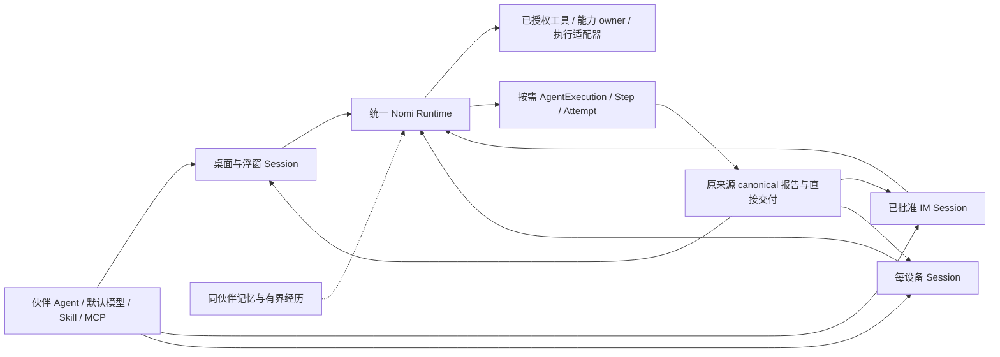

# 统一伙伴 Agent、多入口与独立会话

每个 `companion_id` 选择一套主要 Agent、默认主模型、人格、长期记忆和 Skill/MCP。
桌面、浮窗、已批准 IM 和实体机器人是交互入口；每个入口可以使用独立 canonical Session。
执行事实遵循[Agent Session](agent-session.zh.md)，媒体遵循[语音架构](voice.zh.md)。
本专项的阶段状态、检查与尚未验证的环境见[专项验收](../validation/companion-unification-2026-10-18.zh.md)。

## 身份、授权与配置

- Session、Turn、Event、Payload、Effect 是唯一 Agent 事实链。普通 Conversation 接口投影同一 Session。
- 产品归属来自 owner-scoped canonical opening、typed origin 和当前冻结 binding。模板名称、页面选择、目录和消息正文不能作者身份。
- 伙伴只有 `companion/<companion_id>` 一个产品 Agent 配置目标。`robot` 仍是设备业务能力和物理输入来源，不再是第二个 Agent 选择目标。
- 主模型、Skill/MCP 使用伙伴的统一默认；ASR、TTS、视觉和学习模型仍按各自用途配置。
- 已有会话保持冻结 Revision/Snapshot。修改默认只影响后续创建；应用最新配置、换模型或选择资源通过原 idle、CAS、cleanup、Effect 和 native checkpoint 围栏追加显式 transition。
- 不改写历史或活动 Snapshot，不导入退役 transcript，不清空伙伴记忆、设备绑定或凭据。
- 当前代旧 profile 由 registry owner 一次性严格转换，原文件字节保存在 `config.pre-unified-agent.json`；主配置继续有效，旧设备专属偏好不隐式扩权或覆盖主设置。未知字段、重复 key、损坏形状与备份冲突拒绝转换。统一 reader 不再接受旧 `robot` 字段。

同一个 Agent 不把输入挤入同一串行 Session。窗口导航、浮窗收件、设备连接和渠道绑定各有明确目标：

当前代既有物理会话通过已验证的原 Host opening，在空闲、效果结算和原生清理边界一次性采用统一主配置，
使用原 canonical binding transition 保存采纳证明。新建入口命令记录统一代际；后续默认更新不再次热替已采纳会话。
旧官方及旧个人设备配置都保留原 Session、opening 和历史，不合并旧角色授权到主 Agent。

| 引用 | 作用 |
| --- | --- |
| 当前浏览 Session | 仅本窗口导航，可查看设备或后台任务历史 |
| 浮窗接收 Session | 仅明确选择“在浮窗继续”或创建默认会话时改变 |
| 设备接收 Session | 由确切 owner、伙伴、设备和当前连接解析，重连复用该设备会话 |
| 渠道接收 Session | 沿可信渠道自身绑定解析，页面切换不改投 |
| 后台 Attempt Session | 保留自己的执行、取消、结果与审计引用 |

列表归档仅是 canonical metadata 注记，不停止任务或改投输入。清空上下文使用正式 context clear，
保留 Session 身份与历史。删除单条会话只清理该 Session；伙伴共享目录、长期记忆和其他会话由各自生命周期管理。
删除整个伙伴仍须证明全部所属会话、效果和原生资源已安全结算。

## 普通工作直接执行

普通聊天、天气、搜索、知识、文件、Office、电脑和已授权设备动作，在接收请求的 Session 中执行。
工具从当前冻结授权与真实资源解析；资源位置由能力 owner 和适配器决定，不因物理入口建立桌面 Agent 跳板。
不增加每次请求必经的分类或接待模型，普通结果也不固定再由另一模型总结。

| 工作 | 执行与反馈 |
| --- | --- |
| 普通聊天与短查询 | 当前 Session 直接回答或调用真实已授权工具 |
| 明确设备动作 | 直接调用工具；所有请求动作成功受理且不需答复时可静默 |
| 动作同时带问题、要求回执、失败或结果不明 | 保留真实回执并正常回答或澄清 |
| 长任务、隔离上下文或并行有收益的工作 | 按需使用通用 AgentExecution，交互 Session 可继续交流 |
| 缺少能力、资源或环境 | 如实报告缺口，不借统一身份扩大权限 |

后台工作沿通用 `AgentExecutionSource` 保存原 Session、Turn、工具因果、冻结配置及用户约束。
Step/Attempt、DAG、可选多 Agent、问题、状态、精确取消和恢复继续存在。
结果先在原 canonical 链提交报告，按确切来源直接交付；确有综合需要时才能由后续明确工作处理。
正常成功由事件推进，持久 outbox 用于可靠恢复，退避巡检不作为正常结果发现路径。

用户禁止多 Agent 不妨碍普通工具直接执行。停止主对话和停止后台 Execution 分别针对确切对象；
离开详情页只改变导航。中断后 `runtime_state.review_blocked` 保留核查提示和停止入口，不能用普通回答或自动重试绕过 unknown Effect。
取消不撤销已发生的效果，也不证明原生 producer 已退出；迟到 StopTurn 不得命中后继代际。

## 工具、上下文与设备装配

能力授权、可见工具、上下文投影、响应预算和物理资源装配分别管理。
完整能力目录和用户显式选择保持；初始工具窗口优先提供常用操作，大 schema、Skill 正文、历史结果通过同一授权目录按需展开。
物理入口的简洁交互投影不再依赖固定模块白名单，增加搜索、文件或知识能力不会把它变成另一类 Agent。
知识库挂载不会让每条动作或天气请求先查询并注入资料正文，知识内容通过已授权的检索与读取工具按需取得；回合后的知识回写保持独立生命周期。
预算上限不代表实际请求大小；实际 schema、请求上下文、模型轮次和装配成本见专项证据。

只有绑定了确切 owner、伙伴和设备资源的 Session 才装配设备工具。
无绑定会话不查设备目录；离线设备不阻断无关聊天和普通工作。
设备目录来自连接时的实际发现，纯描述和 schema 校验产物可以按版本与内容复用；authority、连接 lease 和每次执行许可不能当作缓存数据沿用。
能力版本变更、撤销、解绑和连接替换必须在派发前重新检查。

模型负责意图、参数和必要反馈；轨迹插值、PWM、限位和速度控制留在设备控制器或专用代码。
不逐帧调用模型，不通过模型轮询建立实时闭环，不把所有设备、舵机参数、遥测或视觉结果永久注入上下文。
工具受理、设备回执、机械完成和用户听到分别是不同事实。

## 机器人响应与思考边界

公开回复使用可直接朗读的自然语言，情绪通过措辞表达。
人格、自定义设定、记忆和 Skill 不覆盖伙伴产品的回复规则；消费边界只派生显示或播报文字，不回写 canonical 正文。
明确且全部成功受理的物理动作可使用 typed `finish_without_reply` / `silent_completion`，
但混合问题、失败、unknown、未完成计划、后续动作或必要澄清仍须按真实状态处理。
一个动作成功不能截断剩余动作；静默意图不证明物理完成。

主模型沿统一配置；显式 Session 推理选择保持。响应策略只在确切供应商、模型、协议和支持档位匹配时生效，
未知模型不从名字猜测，不改写保存配置或冻结权限。

## 生产语音与问题交接

物理语音沿 VAD/ASR、正式 canonical 输入和同一 Runtime 进入设备 Session。
仅消费正式提交、来源身份完整且不可撤回的公开片段；原始 token、推理、工具原文和已丢弃输出不可播报。
已准入工具后的公开进度可在工作 Turn 结束前交付。最终答案仍须验证封口、摘要和实际 Host 成功终态及 `Answered` 精确引用；
可被收窄为暂停的 `CompletionDelivered` 提案不授予播报许可。最终结果与历史共用 typed reducer，不从最后一条消息或到达时间猜测。

问题、回答、状态、结果和取消使用同一 typed 交互路径。直接设备请求可以正常 `request_user_input`，
问题绑定原来源 Turn 与 question identity；用户回答保留录音/识别边界冻结的问题身份。
慢 ASR、后继问题或新连接不得把旧录音补成新问题的答案。要求点击的审批保持原授权限制。

新请求、当前工作补充、改口、停止播音和取消工作分别处理。媒体 generation、任务、模型和设备动作各自有预算与取消对象。
TTS/ASR 的实际流式能力由供应商端口明确表达；批量合成后切片不能声明为真实流式。
播放保持音频节拍、有界队列与背压，停播清理旧 generation。
断连、改绑、连接替换和 context clear 后，原结果不能流入其他连接或后继请求。
运输受理、TTS 成功和设备真实播放分别报告。

## 共享记忆与访客

同伙伴各入口共享人格、当前长期事实及有界 canonical 近期情境；各 Session 工作上下文独立。
每次模型调用前替换固定 live 槽位，不累计“记忆更新”消息，不在主路径先总结全部历史。
事实与经历读取验证 owner、伙伴、Context 准入、冻结 memory grant 和资源配对。
普通显式 Persona Agent 获得事实读取能力不等于取得伙伴产品身份或所有兄弟会话原话。

写入的真人来源由 Host 从本轮 canonical accepted root/steering 解析，模型不能声明来源。
更正使用真实 memory ID 和 revision CAS；旧学习结果不能覆盖新事实。
删除影响后续事实、可追溯共享与召回，保留的 Session 对话与已经发出的模型请求遵守原上下文合同。
自动摘要清空、用户明确清空与历史 recall 的硬边界继续保留，不建立第二份 transcript 或历史索引。

已提交的当前代旧隐藏结果仅由严格只读历史解码器识别，用于原报告与真人来源的隐私追溯；
它验证原事件、工具 Effect、Execution 和终态引用，不修改原内容。现役输入枚举仍拒绝退休 callback，
不创建结果模型 Turn，也不允许借历史来源恢复执行。

`auto_group` 访客继续使用可信 Channel ingress 的 model-only 冻结 Snapshot：无业务能力、资源、Skill 或 MCP，
只允许一次纯聊天模型步骤；统一伙伴身份不向访客提供桌面授权。
旧宽访客的收缩仍通过 idle、CAS、效果结算、原生清理和正式 context clear，活动/unknown 不绕过。
访客重投、观察与结果读取通过原 canonical accepted input／claim 验证准入和当前 clear/binding 围栏；收缩后的旧宽授权结果不可重新交付。安装 owner 的原回执幂等与历史可读性继续保留。
已批准私聊和群聊沿各自原授权合同。

## 实现与验证入口

| 边界 | 入口 |
| --- | --- |
| 统一配置 | [profile.rs](../../crates/backend/nomifun-companion/src/profile.rs)、[control plane](../../crates/backend/nomifun-agent-control-plane/src/service.rs) |
| 会话与产品绑定 | [companion_sessions.rs](../../crates/backend/nomifun-app/src/router/companion_sessions.rs)、[nomi_core_session.rs](../../crates/backend/nomifun-app/src/router/nomi_core_session.rs) |
| 既有设备会话采纳统一配置 | [companion_binding_evolution.rs](../../crates/backend/nomifun-app/src/router/companion_binding_evolution.rs) |
| 工具与资源 | [agent_tool_presentation.rs](../../crates/backend/nomifun-app/src/router/agent_tool_presentation.rs)、[engine_robot_tools.rs](../../crates/backend/nomifun-app/src/router/engine_robot_tools.rs) |
| 后台报告 | [companion_report_delivery.rs](../../crates/backend/nomifun-app/src/router/companion_report_delivery.rs)、[AgentExecution](../../crates/backend/nomifun-agent-execution/src/lib.rs) |
| 物理语音 | [robot_wiring.rs](../../crates/backend/nomifun-app/src/robot_wiring.rs)、[robot session](../../crates/backend/nomifun-robot/src/session.rs) |
| 正式可播来源 | [robot_public_output.rs](../../crates/backend/nomifun-app/src/router/robot_public_output.rs) |
| 共享情境 | [companion_shared_context.rs](../../crates/backend/nomifun-app/src/router/companion_shared_context.rs) |

检查包括受影响 Rust/UI 回归、Agent Session、voice、desktop UI 边界、正式生成合同、完整 `bun run check` 和本地构建。
UI 最小支持尺寸为 880×600，补充常规桌面尺寸；实体设备、真实供应商和正式安装证据另行验收。
