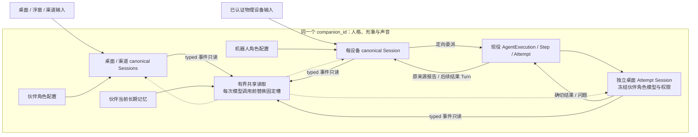

# 伙伴双角色、多会话与共享上下文

本页是伙伴本轮实施的技术方案与交付入口。用户已授权实施。执行事实继续遵循
[Agent Session 架构](agent-session.zh.md)，本文不定义第二套会话、权限或效果账本。
状态表只记录实际交付证据，不把目标设计写成已经具备的能力。

## 目标与不变量

一个 `companion_id` 拥有统一人格、形象、关系和长期记忆，同时具有「伙伴」与「机器人」
两个可独立配置的执行角色。桌面、浮窗和消息渠道使用伙伴角色；已认证物理设备使用
机器人角色。机器人使用轻量上下文接待用户，并向同一伙伴的桌面角色异步委派平台任务。
两个角色可以并行工作，不在同一个活动 Session 中反复切换权限。

- Session、Turn、Event、Payload、Effect 继续是唯一 Agent 事实链。
- 产品归属来自 canonical opening 与精确 typed binding，不从名字、目录、UI extra 或
  `origin` 字符串推断权限。当前代既有合法 opening 只通过精确旧命令身份识别，不导入退役数据。
- 每条会话拥有独立工作上下文；同一伙伴的所有角色和会话共享最新记忆与可查询经历。
- 全局共享范围限定同一 owner 和伙伴；历史数据、记忆和其他会话结果不产生新的执行授权。
- 修改角色默认值不热替换活动 Session。应用当前会话沿既有 idle、CAS、cleanup、Effect
  和 native checkpoint 围栏提交显式 binding transition。



各条 Session 保留自己的 Turn/Event/Payload/Effect 事实链。共享读取只提供有界数据上下文；
任务关系沿现役 Execution link 保存，两个角色的权限分别由各自冻结绑定决定。

## 产品配置与会话路由

复用 `product_agent_selections` 的两个角色目标：`companion/<companion_id>` 和
`robot/<companion_id>`。机器人角色的 target ID 是伙伴身份，物理资源 ID 仍是确切设备。
分别保存 Agent 与默认 Chat 模型。`robot.model=null` 明确表示继承伙伴模型，设置独立值
后使用覆盖；清除覆盖恢复继承，不改写已有 Session。机器人 Skill/MCP 默认独立为空。
当前机器人声音、ASR、TTS 和视觉模型沿用该伙伴对应的设置，没有另一套机器人语音配置。

群聊 `auto_group` 访客由可信 Channel ingress 和真实渠道关系识别，使用独立的 model-only
冻结 Snapshot：业务 capability、Context、typed resource、Skill 和 MCP 均为空。新建时丢弃
调用方 extras，不从其中取得 guest 或产品权限；复用旧宽授权访客会话时，只在 idle、效果和
原生资源已结算的 CAS 边界收窄，并用正式 context clear 隔开旧工作上下文。Warmup、恢复及
新输入也验证该实际 Snapshot 与清空边界；活动/未知效果不会借此次收窄绕过。已批准私聊及
已批准群聊继续沿各自已有 Agent 选择和资源合同。此实现的末轮验收状态见下表。

群聊复用按既有 approved/guest 层级的正式 creation key 只读查找确切创建会话；若渠道登记的
接收指针已过期，本次明确发送才写回查获的正确 Session，普通私聊入口保持原流程。访客重投
只能外发确切 accepted admission Snapshot 与当前已验证空 Snapshot 相同、且 accepted root
位于正式 clear 之后的回执；旧宽授权回执及跨模型/合同变更的旧 key 保守返回 Conflict，原
canonical 历史保留。访客输入由 Host 固定为保留来源 `channel_guest`，普通 API 拒绝伪造，
采集器不把这类群聊输入送入 owner 的环境学习。

可信 guest 输入的 Host 模型请求限定为一次纯聊天模型步骤，不续接执行 segments，不挂载
HistoryPort，并关闭 UserInput。供应商违约返回工具调用时，沿现役 exposure guard 拒绝并
记录 canonical 事实，不自动再调用模型纠正，也不通过 adaptive ToolHistory 展开 LOAD、
SEARCH 或 READ。该限制只针对可信 guest 入口，已批准渠道和普通 minimal Agent 保持原合同；
不新增 Runtime schema、工具 denylist 或另一套 native 权限上限。

官方 `companion.default` 承担桌面工作，不再默认授权物理 Robot Action；
`companion.robot` 显示为「机器人」，保留身份、记忆、设备操作和定向平台任务委派。

| 层次 | 伙伴 `companion.default` | 机器人 `companion.robot` |
| --- | --- | --- |
| 默认能力 | 19 个模块、83 个动作，保留本地电脑、文件、浏览器及工作能力 | 5 个模块、12 个动作，只保留人格、记忆、物理设备和定向任务协作 |
| 默认协作 | 执行独立桌面 Attempt 的工作，按授权使用本地资源 | 默认 `agent/delegate`；任务控制默认包含状态、取消及回答当前委派决策 |
| Persona Context | 桌面/消息渠道对应的工作指导 | 物理交互、简短应答、真实设备结果和桌面委派；用户明确授权的本地工具可以直接使用 |
| Skill/MCP | 依自己的显式选择和普通发现合同装配 | 独立显式选择，不继承桌面扩展。MCP 继续校验正式冻结映射与资源配对 |
| 共享内容 | 同一伙伴的人格、当前记忆和有界近期情境 | 读取同一伙伴的数据，不合并完整历史、工作目录或工具授权 |

动作数量仅表示预设的默认作者授权，不代表首轮展开全部工具，也不是角色的能力上限。
官方和个人 Agent 在工作台使用同一完整能力目录及动作列表，用户可以按需选择 Robot、
Computer、文件、协作和会话管理等能力。保存和运行沿普通编译、显式授权及资源合同处理，
不按伙伴或机器人角色隐藏候选、删除已选能力或拒绝正常扩展。

已有作者配置不随 seed 或启动流程重置，不自动生成收窄能力的新 Revision。编辑器采用
服务端实际保存的文档，历史 Revision/Snapshot 保持不可变。用户更新默认配置后，已有
Session 仍通过正式 binding transition 在 idle、效果结算和 CAS 边界显式采用；活动 Turn
和已捕获精确 binding version 的语音输入不被静默换绑。物理渠道的可信来源、真实设备、
owner 和连接校验独立于用户所选能力，桌面角色也可按普通资源合同使用明确授权的 Robot。

BeforeTurn Persona 通过 canonical opening、owner、伙伴身份和本次确切 Snapshot 判断角色，
不依据预设名称或可编辑的 `channel_platform="robot"` 参数。窄机器人配置优先提供必要
设备/记忆工具和轻量工作指导，并在 Skill 目录、正文及支持资源中只投影明确选择项。
用户明确增加 Computer、文件、宽协作或会话管理能力后，采用普通工作上下文和预算，
不再按角色额外过滤已冻结的 Skill 数据，执行时遵循实际冻结授权。新建机器人会话合并所选作者预设的明确扩展与
机器人 profile 的附加选择，不把默认空 profile 当作撤销作者配置；当前会话 composer 的
明确空选择仍按原合同清空该会话扩展。
模型的人格与指令从本次 admitted 的精确冻结 `Revision.payload` 读取；伙伴人格 Context 和
当前事实单独装配。旧 extra 中的记忆快照不参与该静态指令路径，也不覆盖用户选择的 Agent 指令。

| 路由引用 | 所有者与作用 |
| --- | --- |
| 当前浏览会话 | 窗口导航，URL 携带精确 Session；不同窗口互不抢占 |
| 桌面接收会话 | 伙伴的浮窗输入目标，仅明确「在浮窗继续」或创建默认会话时改变 |
| 设备接收会话 | 按伙伴和设备稳定解析；重连复用 Session，重新校验当前连接 |
| 渠道接收会话 | 沿渠道自身绑定解析，页面切换不改变投递目标 |

显式「新会话」使用调用方稳定的创建幂等键；ensure 只确保对应入口的默认会话。
新会话不清除伙伴记忆。会话列表中的归档是 canonical metadata 注记，可以隐藏、显示和恢复；
它保留历史、工作上下文、活动任务与输入路由，不使现有浮窗或设备停止接收消息。
清空上下文由独立正式命令移动 context floor，保留 Session 身份与历史。

共享伙伴工作目录由伙伴生命周期管理。删除一条会话只清理该 Session 私有资源；删除伙伴
须覆盖全部所属 Session、原生资源和效果结算后再清理伙伴目录。归档窗口按 Session 隔离，
自动摘要与归档后台扫描每条已登记的伙伴聊天/设备会话，不跟随 UI 当前选择；Execution
子任务保留自己的审计生命周期。自动摘要后的上下文重置与列表归档注记是不同操作。

自动近期共享和 Runtime 工作上下文始终遵守全部正式清空边界。显式 `scope=history` 召回可
跨越有完整 Host 命令身份、producer、因果及 typed admission 证明的 `companion_archive`
自动窗口摘要边界，继续读取原 canonical 数据；用户明确清空以及未知、旧形状或损坏的清空
保持硬边界。查询只加载有界候选/片段及单个最新硬边界，不为每次归档累计新的内存或历史账本，
也不因此扩大 native replay 或 checkpoint 恢复权限。

## 实时共享与固定预算

自动共享装载当前长期事实、近期跨会话输入及确切公开回答/领域结果；完整经历按需检索，
现役任务状态通过原 Execution 查询。用户刚提交的原话可以被另一个会话查询，不等待
后台学习将其变成长久记忆。自动装载是有界近期窗口，并不保证包含该伙伴的全部经历。
明确的记忆保存、更正和忘记先确认领域提交；后台学习只负责整理、合并和长期沉淀。

每次模型调用前由 Host 装配有界当前视图，经现有 `AgentLiveContextPort` 覆盖固定槽位。
不逐 token 广播、不累计注入「记忆更新」消息、不在主路径调用模型总结全部历史。
稳定指令、共享数据、本 Session 工作上下文和工具目录分别预算，并验证完整模型请求容量。

当前事实装载还保留普通显式 Persona Agent 的合同：只有已准入、active 的 bundled
`companion` BeforeTurn Context，加上冻结的 `companion.memory/recall` 和同 owner、同 ID 的
确切 `companion/read`、`companion_memory/read` 资源配对，才可读取有界当前事实。
ToolSearch 尚未展开记忆工具不影响这项 Context 合同。普通 Agent 获得事实块后仍没有伙伴
产品归属，也不自动装入其他 Session 的原话。主动调用 `companion.memory/recall(scope=history)`
则沿独立工具授权及精确 `companion_memory/read` 资源执行，并验证被查来源属于该伙伴的
canonical product Session；不要求调用方本身是产品 Session。资源存在、Context 排序、名称或
消息 extra 都不能替代自动 Context 的准入。

- 每次读取当前事实和 canonical 近期窗口。事实块携带内容 fingerprint，只用于判断内容
  是否相同，不充当单调 revision、授权或跨库原子事务游标。Companion store 与 Session
  store 的读取分别遵循各自快照合同。
- 当前模型路径直接查询持久事实与有界 canonical 尾部，不依赖广播、后台学习或另建历史
  索引追平；记忆检索使用现有 SQLite FTS。
- 新 runtime context 只读 typed canonical events/payloads，不拼 UI Message projection、
  采集 JSONL 或私有 transcript。
- 当前长期事实块的原始文本预算是机器人 900 字节、桌面 1800 字节，完整事实放不下时
  整条省略。近期窗口最多读取四条同伙伴 Session，每条分别保留最多两条真人输入、两条
  领域终态/报告，以及有界的最近公开回答。共享内容与视觉观察共同受 live 总预算 16 KiB
  约束，计入 JSON 转义和包装预留；超限先省略近期会话，再省略可选视觉观察。
- 用户最新更正、相关任务约束和真实状态优先；无关日记先退出自动装载。检索结果数、片段
  和翻页也有界。SQLite FTS 是首期检索基础，不以 embedding 下载作为实时性前提。
- 普通更新在下次模型调用生效。已发出的请求不追溯修改；取消和当前任务修改使用精确
  Execution/Turn 控制或 accepted steering，不能由共享记忆暗中发起。
- live 原文不进入 native checkpoint，也不能声称存在完整历史 prompt 证据。共享块不能
  成为新的完成证明、旧效果重放理由或 checkpoint 恢复例外。

记忆写入补充版本、来源与替代语义。用户更正优先于后台推断；旧后台结果提交前复核来源
和版本，不能覆盖新事实。撤回从后续事实读取、可追溯来源的共享与检索中生效，并抑制同一旧来源重新提炼。
实际安装的记忆 Action 由 Wave 1 的正式 schema、验证器、typed DTO 接入统一 Companion
service；实际 Wave 4 注册只保留 learn/evolve，不维护第二条记忆写入口。事实 query 与经历
`scope=history` 的 query 上限统一为 1024 个 Unicode 字符。事实来源过滤
同时匹配原 `source_session_id` 和 typed message refs，合并后的记忆仍可按真实来源查询。

模型侧记忆工具输出使用 `AgentMemoryProjection`，省略完整 `source_event_ids` 与
`source_message_refs` lineage 数组；Store、REST 和导出保留完整来源。默认 facts、查询结果
及新旧幂等回执均按同一模型投影输出、按该投影计量预算，避免来源累积挤占模型上下文。

新工具写入的来源由 Host 从当前工具的 canonical 因果解析，只接受本轮真人 accepted root
及 accepted steering，包含正式 `mobile_voice` 当前输入；模型不能提交来源字段或用工具
operation 冒充 message ID。新增、去重合并及 CAS 修正将现役 typed message refs 与领域
变更原子保存。`memory_id` 与正数 `expected_revision` 成对表示内容修正，保留记忆身份并
增加版本；跨伙伴目标及过期版本拒绝。

写入继续复用领域已有幂等回执和 `HostedEffectReceipts` 的 canonical Effect 结算，普通写入
未提供的新可选字段不改变旧 fingerprint，CAS 身份与版本进入请求摘要。已结算回执先返回
原结果；旧回执没有 Effect 时不补造过去的 Effect。未确认的存储提交保留 unknown/pending
围栏，不自动重放记忆变更，也不把收到异常当作未执行证明。

删除记忆影响长期库、有来源映射的自动共享与召回，并抑制同源再次学习；用户保留的原
Session 对话与局部摘要仍属于该会话上下文。需要让当前会话停止使用原对话时执行正式
清空上下文，需要移除记录时删除对应会话。原始聊天删除沿 canonical owner；删除 memory
row 不表示物理抹除全部聊天、已发出的模型请求或 native checkpoint。当前 bundle 不承诺
跨安装传播撤回标记；旧无精确来源数据不声称具备完整撤回溯源。

## 定向异步委派

沿现有 `agent/delegate` 增加受限 `target_role=desktop`。只允许单目标 planned goal，
Host 从调用方 canonical 伙伴身份解析桌面角色的已保存配置，在委派准入时冻结目标
Snapshot、模型和资源。机器人不能提交任意 owner、Preset、Snapshot 或目录。

简单请求直接形成单 Step/participant/Attempt，不先调用额外规划模型。独立 Attempt Session
执行平台工作；用户当前浏览的聊天不被注入任务。机器人默认通过委派处理自身缺少的能力，
子任务使用桌面自身权限，委派不会向父 Agent 复制 Computer 权限或额外授予物理资源。
用户显式增加的普通协作、fork 和本地工作能力继续沿各自的正式合同执行。

### 机器人响应与思考边界

| 当前请求 | 处理方式 | 公开回复 |
| --- | --- | --- |
| 明确、已支持的舵机或表情动作 | 直接使用可见设备工具；不为已知动作重复搜索、预查无关状态或先做规划 | 全部请求动作成功受理后默认静默；动作就是回应，不补文字或语音回执 |
| 日常陪聊 | 机器人自己回应，依用户要求展开；不为普通聊天创建任务 | 自然简洁，用户要求深入时可展开 |
| 天气、实时信息、检索、知识、文件或应用工作，当前机器人缺少本地能力 | 立即用 `strategy=planned,target_role=desktop,goal=完整目标` 调用同一伙伴的已保存桌面 Agent；单问题也适用，不经过规划模型 | 父 Turn 受理后静默结束；需要回答的真实结果以原设备结果 Turn 回复 |
| 深度研究、自主机械创意或复杂动作编排 | 桌面子任务负责推敲与设计；传入已知设备能力、约束及用户目标，返回简短结论或动作方案 | 机器人只在原请求与当前设备权限内执行方案，不把子任务正文当成新的授权 |

窄机器人首轮工具预算先保留确切委派与原来源任务控制，再保留各设备 Action 的最小
schema。大型设备或 MCP 目录不会仅因工具数量挤掉平台入口；单个超大 schema 仍按
原 ToolSearch 合同查找，不改变完整授权或固定映射。机器人使用专门的定向协作指导，
不套用通用协作中「短而不可拆的问题直接回答」的建议，也不靠天气关键词强制路由。

当前 Turn 已确认 canonical 机器人身份、窄能力集合且没有显式 Session 推理强度时，
现役模型配置 pin 可附带临时 `ResponsiveRobot` 策略。实际调用在解析确切尝试的
provider、模型与协议后，只从精确文档档位中选择 `minimal` 或 `low`；未知、自定义、
网关映射不明或协议不匹配时保留供应商配置。显式 Session 档位、原有更轻的配置及
用户扩展成宽能力的机器人配置保留。桌面子任务使用自己的模型和推理配置负责深思。
策略不写回 Session、Agent 或模型，不增加配置账本；它和原 operation pin 一起清理。
相关文档能力表进入 Runtime build 摘要，原 checkpoint 不跨 build 恢复。

物理机器人采用独立的口语人格措辞，不复用桌面活泼人格中「喜欢颜文字」的引导。
所有 canonical 机器人（包括显式扩展了能力的配置）的模型请求，在人格、自定义设定、
Skill 与路由指导后追加物理回复规则：普通回复不添加 emoji、颜文字、ASCII 表情或
装饰性动作文字。明确动作默认静默；有问答、用户明确要求口头回执、失败受阻、结果不明或必要澄清时才说话，
需要说话时直接说明真实信息，不附带撒娇前缀、庆祝或可爱填充。
人格通过措辞表达，设备动作继续沿已授权工具执行。该规则覆盖人格或历史中的装饰偏好，
不删除用户明确要求引用的符号、代码、公式、标识符或 URL，不在 UI 或 TTS 中清洗正文，
也不回写已有 canonical 历史。新规则随下一次模型调用进入请求。

静默沿现役 Runtime 的可选 `finish_without_reply` 控制声明，不从关键词、空正文或单个
工具成功推断整项请求完成。Host 只对可信 canonical Robot 开启；实际操作仍校验原
冻结工具和设备授权。模型把控制放在最后一批动作之后；Runtime 先按原执行器串行执行
全部 `robot/motion` / `robot/display` 调用，取得成功回执，再复核任务、效果、输入、取消
与 Host 结算边界。符合条件时直接结束，省掉专门生成回执的一轮模型调用。仅能一次输出
一个工具的模型也可在全部动作受理后单独提交控制。恢复中的未知状态不重建这条快捷路径。

「坐下并告诉我北京天气」「做完告诉我」仍须正常回答。非设备工作混批、失败、未知效果、
未完成计划、进程或 patch 阻止静默；新 steering 与取消继续走原围栏，不能因控制出现而
丢掉新输入。新 typed `silent_completion` 只在终态输入围栏后记录，原工具和 Effect
回执仍是动作事实，不把设备受理当成机械完成。

公共结果只读派生 `AgentTurnOutcome::Silent`，严格匹配该 Turn 最终模型步骤与空封口，
没有正文，也没有「无公开回答」错误。旧空答没有此意图事实，仍按原保障拒绝或显示不可用。
实时、历史重开和幂等重取使用同一归约；UI 保留动作过程，机器人只接收 `Done`，不启动
TTS，并继续监听下一条指令。成功的机器人异步委派也可静默结束父 Turn，实际回答仍等
原任务结果回调。该结果不表示子任务已完成，也不成为普通 Coding、Cron 或 Attempt 的
公共交付证明。UI/API 合同版本 36 要求前后端一起更新。

设备输入的监听窗口独立于 Agent 回合和 TTS 播放。`auto` / `realtime` 的一次
`listen.start` 开启持续窗口，服务端 VAD 只完成当前分句并清空其缓冲、重置 VAD；
不把该分句结束或静默 `Done` 当作停止监听。连续纯静音只保留有界前置音频，不因
到达单段时长上限而反复提交空 ASR 或制造 TTS 状态。明确 `listen.stop`、`abort`
和连接结束关闭窗口；手动模式的明确结束或单段硬上限仍会关窗，不自动恢复。
这条生命周期保证后续语音可继续进入 ASR，不依赖固件先经历 Speaking 再补发
`listen.start`，也不为静默动作伪造 TTS 开始、结束。

显式开始监听时冻结首段输入的 `presented_question_id`；持续窗口中后续分句则在
VAD 首次识别该段语音时重新冻结；前导静音不占用问题归属。语音已开始后，
后续问题呈现、识别排队或回合完成均不得把新问题附给旧录音。
回归须从单次开始监听连续输入多段真实编码的 Opus，覆盖静默动作后再次指令、
普通问答、明确停止与取消，以及 Auto / Realtime / Manual 的不同边界；逐段重发
`listen.start` 或只断言界面状态均不能证明持续语音恢复。本次实体设备麦克风、
播放及交互时延尚未完成实测。

Persona、工具展示与 Runtime 指导覆盖当前已授权设备会话；seed 指令只影响新建作者版本，
不覆盖用户保存的指令，也不向旧 Snapshot 增加能力。缺少委派授权的已编辑官方配置可
通过「补齐推荐能力」保存；个人 Agent 在工作台手动选入 `agent/delegate`，再在空闲会话
显式应用。缺少联网供应商、凭证或目标资源时
如实报告实际条件，不能把平台能力可委派等同于实时天气已经查到。

Computer 继续使用现役物理设备共享锁和全局唯一的观察授权，锁保护单次观察/输入调用。
另一 Session 的已准入 Observe、Input 或 Launch 会使旧观察 grant 失效；Input 在锁内核对
generation 及完整 Session/Turn/native fence/Snapshot/Provider/principal/resource scope，陈旧或
跨 Session 的输入在进入设备 executor 前拒绝。production generation 来自各 Session 的精确
canonical tool-call seq，相同数字不会授予跨会话权限。独立 Session 允许机器人交互与桌面
工作并行，不提供整项电脑任务的前台独占或多个系统桌面的隔离。

接受委派后父 Turn 正常结束。Execution 的真实结果提交原来源的 canonical 报告，再在原
机器人 Session 空闲边界准入有稳定幂等键的结果 Turn，不重开父 Turn。结果 Turn 使用
typed `DirectedDelegationResult` 来源，不把报告伪装成人类输入；只播放该 Turn 最终有效的公开回答。
结果 Turn 明确失败时，追加引用原报告和确切失败终态的固定 Host 提示，沿原 socket
按 source 去重播报；不重试桌面效果，也不因此创建另一次模型回合。结果 Turn 被取消时
吸收停止，不再自动播报失败提示。
离线、改绑、连接替换或正式清空使原连接回报失效时，保留已提交历史，不转投新设备。
关系复用现有 Execution link，
结果携带精确 Execution/Step/Attempt/Session/Turn 引用。未知效果和不明恢复不自动重放。
子任务不得递归定向委派产生角色调用环。

历史 Directed graph 和已知回执重放通过 Store 的只读 `committed_tool_call_causation`
核对已提交工具及 closed Turn 的 typed 事实。该读取不续借 active/native 准入或产生新工具权限。

停止播报与取消工作分开；任务取消命中确切 Execution。任务普通问题由原
`DecisionRequested` 事件驱动幂等通知，复用现役 interaction/work target。可回答的问题必须已在原设备连接
接受播报；`presented_question_id` 在真实录音/ASR 队列边界冻结并贯穿后续识别和准入，
新问题可以在旧录音仍等待 ASR 时播放，但不能在慢识别完成时附给旧录音。物理输入的
`None` 或旧问题 ID 在准入时保持未绑定，不能补成当前新问题；同一输入重投读取原 accepted root。
重复已接受的旧播报 source 只返回确认，不把录音边界回滚到旧问题。
空参数回答 Action 只取该输入已接受的真人原话，并校验问题、版本、来源和
播放接受事件早于输入 root；后继问题、多 pending、换 socket、附和或取消语句均不借此回答。
明确要求点击的审批和超出可完整播报长度的问题交回桌面，语音不扩大权限。

结果与问题沿设备 actor 的 requested-source 播报入口去重，使用本次用户请求的原连接。
该入口与主动播报许可分开，默认主动播报关闭仍保留。运输接受只证明 actor 已受理，
不证明用户已听到、TTS 已成功或设备动作已完成；没有新增逐 token 语音播放合同。

## 交互与本地验收

### 机器人接待与能力补全回归

2026-10-17 本地验证：应用库 `robot` 筛选 76 项、模型请求与协议 25 项、工具展示 12 项、
协作路由 8 项通过；另有预设/人格 13 项、Wave 5 合同 8 项、精确模型档位匹配 1 项通过。
这些分组有交集，不相加为独立用例总数。Agent Session 边界、工具词汇、文档与合同生成检查通过。

短天气用例经过实际安装的 Robot ingress、同伙伴冻结桌面 Agent、单 Step/Attempt、
canonical 报告及原设备 actor 的模拟播放接收；断言没有额外规划模型，也没有在结果回合
再次委派或向机器人复制网页权限。天气内容来自明确标注的模型夹具，证明的是调用与回报链路，
不证明真实搜索供应商、TTS 合成、实体设备播放、舵机完成或端到端时延。
连续动作回归保留每一步真实工具回执，不以第一步成功截断后续动作。

同日补充装饰符号修正：机器人默认活泼人格不再鼓励颜文字，4 项人格相关回归通过；
3 项回复样式回归覆盖已存在 Session 更新 custom 后的实际请求、独立结果回调、
扩展机器人角色及动作回执后的模型续轮。模型端仍为夹具，检查的是发送规则与保持边界，
不把固定夹具回答当成真实模型遵守规则的证明。开发桌面已重新构建，沿原开发数据目录
启动，并核验新进程、二进制规则及 `/health` 正常；实体机器人新回复仍需实际验收。

### 能力编辑纠正

工作台恢复完整能力与动作目录，保存、启动和运行均撤回按产品角色裁剪能力的规则。
官方两预设的交叉授权保存、冻结和重新打开回归已通过；对应 UI 四个文件共 57 项测试通过。
Control Plane 92、Companion 336、AgentExecution 114 项库测试通过。
App 的 `robot_capability_configuration` 五项和双角色实际模型请求/共存一项通过，覆盖显式
工作能力保留、桌面选择 Robot、无硬件工具的设备聊天及真实资源归属。机器人相关库测试
53 项分组复验通过，包含扩展后的实际 Skill 读取、普通 fork/delegate、任务状态、正常状态
拒绝、过期版本拒绝及精确版本取消；另通过 typed 回调防环和三项角色/资源归属检查。
本轮不沿用下文基础交付的构建身份。模型请求使用本地受控接口，不代表物理设备验收。

### 双角色、多会话与记忆的基础交付记录

伙伴页顶部会话选择器、新会话和角色标记复用现有桌面交互模式；选择器旁直接提供重命名，
880×600 使用紧凑下拉，不引入移动布局。会话菜单提供列表归档/恢复、显示归档、清空上下文和删除，操作
针对确切 Session。两个角色的默认设置并列，当前会话配置与未来默认值明确区分。任务子会话
先以来源聊天中的关联任务卡呈现。草稿、附件、运行状态和导航按 Session 隔离。

| 批次 | 范围 | 当前状态与证据 |
| --- | --- | --- |
| M1 | 可信输入来源、记忆读取与有界共享刷新 | 已实现并本地通过；共享十五项、内置运行时 CRUD/来源/撤回及模型工具最小投影末轮回归通过 |
| M2 | 双角色配置、canonical 多会话、设备路由及生命周期 | 已实现并本地通过；会话、收件目标、guest 四项与 feature 产品集成十五项全通过 |
| M3 | 双角色设置、多会话与精确导航 UI | 已实现并本地通过；19 文件 UI 测试 105 通过、0 失败、699 断言，WebUI 桌面交互通过 |
| M4 | 定向桌面委派、结果回报、普通问题与精确任务控制 | 已实现并本地通过；M4 与内置运行时 CRUD 六项全通过，含历史来源、问题、失败、取消及幂等闭环 |
| M5 | 最新本地 binary、物理设备与延迟 | 最新主程序构建、同数据重启十项及 WebUI 双视口本地验收通过；物理设备听感、真实供应商时延与安装包未验 |

基础 Rust 各库最新检查均 exit 0，九个 crate 合计 1058 项测试通过、0 失败：Contracts 104、
Control Plane 88、Wave 1 七项、Wave 4 七项、Wave 5 八项、Companion 334、Agent Session
210、AgentExecution 114、Robot 186。

```powershell
cargo test --locked -p nomifun-agent-contracts -p nomifun-agent-control-plane -p nomifun-agent-domain-wave4 -p nomifun-agent-domain-wave5 -p nomifun-companion -p nomifun-agent-session -p nomifun-agent-execution -p nomifun-agent-domain-wave1 -p nomifun-robot --lib --quiet
```

App 最新同一测试 binary 中聚焦运行 53 个不同测试，全部 exit 0；并非运行全部 940 项
App 测试。覆盖 HostedEffectReceipts 十二项、Wave 1 写收据六项、mobile 当前来源/精确资源
配对/委派上限/结果无循环/静态 prompt/语音交接各一项、伙伴会话三项、M4 与内置运行时 CRUD
六项、guest 四项、共享上下文十五项和模型记忆投影一项。它们验证：

- 实际安装工具的 query/history/CAS 字段完整进入内置运行时、统一 owner 和 canonical 事实。
- 创建、查询、修正和删除沿真实记忆 ID/revision；来源 refs、旧回执及输入重放保持精确，
  更正/删除后的新兄弟会话不从原来源再次装入旧事实。
- 显式经历在 513 次自动归档后仍可查询，用户清空及伪造、溢出或非法清空形状保持硬边界。
- guest 强造 LOAD 或问题提案只有一次内置运行时模型请求，typed 拒绝为 NotExecuted，不交接、不读取
  清空前正文，approved 基线仍可正常工作。

这些是本地内置运行时 HTTP 与 canonical 链的证明，模型响应使用受控桩。数据库真实 writer
竞争的独立定向用例亦通过，覆盖七次写入变更。

启用 `browser-use,computer-use` 的产品集成十五项全部通过：
`official_companion_resource_supply` 一项、`official_preset_catalog_integrity` 四项、
`robot_capability_configuration` 四项、伙伴设置 API 五项及普通会话/伙伴共存一项。
它们覆盖真实资源供给、保存及应用 Agent 指令、损坏配置错误传播、Windows 路径规范化和
伙伴生命周期清理；这些产品集成与上述 App lib 聚焦测试分别计数。

本轮改动 UI 测试使用以下命令取得 19 文件、105 项通过、0 失败、699 断言的结果：

```powershell
$taskUiTests = git ls-files --modified --others --exclude-standard ui | Where-Object { $_ -match '\.test\.(tsx|ts)$' } | ForEach-Object { $_ -replace '^ui/', './' }; & bun test --cwd ui --timeout 15000 @taskUiTests
```

`bun run check` 整套与 `bun run build:ui` 均 exit 0。最终生产源码另外复验
`check:agent-session-boundary`、`check:voice-boundary`、`check:uarc-boundary`，均 exit 0；UARC
扫描 2960 个生产文件，retired matches 与 baseline anomalies 均为 0。`bun run check:docs`
exit 0，覆盖 122 个文件与 1251 个本地链接/图片；`git diff --check` exit 0。

最终 feature 主程序构建 exit 0，关闭默认 channels features，显式启用 `browser-use,computer-use`：

```powershell
cargo build --locked -p nomifun-app --no-default-features --features browser-use,computer-use --bin nomicore --quiet
```

该次基础验收产物 SHA-256 为
`79578c74d6843cfbc0f08e69a70707af2daa4cdfa1ed782ad17ff100fee34106`。
`binary-report.json`、`process-report.json` 与 `browser-report.json` 记录同一产物身份。

该 binary 使用同一既有验收 data/work 重启，没有重新播种数据或刷新 Session；
`verify.mjs` 十项检查全部通过。本地 loopback 真实进程下的 REST → 内置运行时 → canonical 链覆盖多 Session、
浮窗接收目标不随查看切换、近期原话跨会话读取、记忆下一模型调用更正/删除、live 内容不累积、
过期 CAS 返回 409，以及普通 Persona Agent 首轮在 ToolSearch 前装载事实、不自动装载兄弟
原话、不取得产品归属和删除后的下一调用刷新。模型请求仍使用本地 HTTP 桩。

真实 WebUI 在 880×600 验证会话切换、改名、列表归档及恢复，在 1280×800 验证双角色设置与
机器人模型继承标签。新建第三条会话后浮窗接收目标仍是第一条，浏览器 console error 为空。
最新 binary 在 1280×800 重新加载确切既有第三条 Session，双角色、机器人继承标签与会话
选择保留；页面浏览第三条后，API 返回的浮窗接收目标仍是第一条。880×600 的截图与 DOM
确认 `clientWidth=scrollWidth=880`、高度 600；本次新浏览器 tab 的 console errors 为 `[]`，
本地模型桩不证明真实供应商行为、硬件听感或物理时延，安装包亦未验收。

本轮临时后端、Vite、模型桩与验收浏览器 tab 已关闭，原端口均无监听；报告与验收 data
保留供复核，清理结果记录在 `helper-cleanup.json`。

本轮验收范围包括同伙伴共享、跨伙伴拒绝、下一模型边界刷新、预算长期有界、并发更正、
旧提炼不覆盖、归档隔离、单会话删除保留共享文件、设备重连、默认值与当前会话分离、
双入口并行、委派幂等、取消精确性、输入问题、重启与未知效果。
运行受影响 Rust/UI 检查及 Agent Session、UARC、desktop UI 边界。最终分别报告已实现、
本地测试、真实进程/设备与发布证据；不以合成测试代替物理验收，不自动 commit 或 push。
