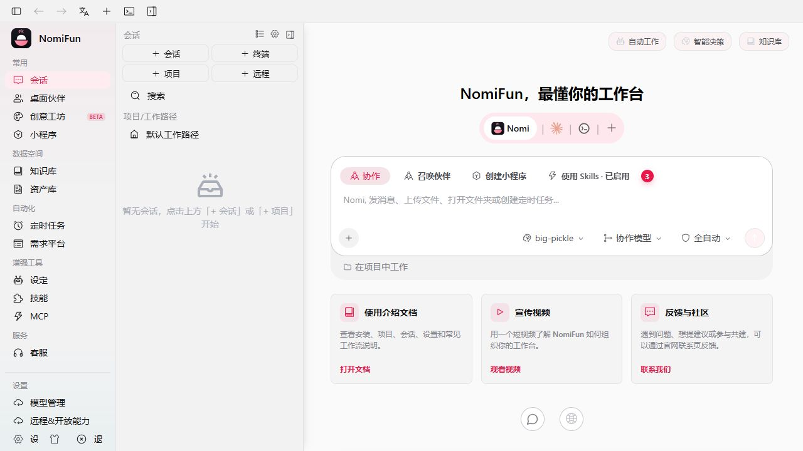

# 安装

NomiFun 可运行在 Tauri 桌面外壳或独立 Web 服务中，两者共享后端与桌面级 UI，最低支持视口为 880×600。本页负责源码环境和首次启动，长期运行配置集中在[Web 服务部署](../guides/web-server-deployment.zh.md)。

## 前置条件

从源码构建需要：

| 工具 | 要求 |
| --- | --- |
| Rust | stable，支持工作区的 edition 2024 |
| Bun | ≥1.3.13，用于工作区依赖和前端构建 |
| Git、CMake | 获取源码及编译原生依赖 |
| Windows | MSVC 构建工具与 WebView2 |
| macOS | Xcode Command Line Tools；当前桌面包要求 macOS 14.0+ |
| Linux | C/C++ 工具链、pkg-config、Perl 与下列开发包 |

Tauri CLI 已作为仓库开发依赖安装，不需要全局安装。Debian/Ubuntu 源码构建常用包：

```bash
sudo apt install build-essential cmake pkg-config git perl \
  libwebkit2gtk-4.1-dev libayatana-appindicator3-dev \
  libpipewire-0.3-dev libgbm-dev libclang-dev
```

Linux AppImage 打包还需 `librsvg2-dev` 与 `xdg-utils`。`libgbm-dev` 提供链接所需的 `libgbm.so`；`libpipewire-0.3-dev` 及其依赖提供截屏栈需要的 pkg-config 文件，`libclang-dev` 供绑定生成使用。首次构建需要下载 Rust、JS 和部分原生组件依赖，网络问题见[开发环境](../contributing/development.zh.md)。

运行用户命令时，宿主还可能需要 `ripgrep`、Node/npm、Python/uv 或第三方 CLI。按实际使用的工具安装；MCP 配置导入不会替你安装这些工具。

## 获取源码

```bash
git clone <your-fork-or-mirror>/nomifun-desktop.git
cd nomifun-desktop
bun install
```

以下命令都从仓库根目录执行。

## 桌面开发与构建

```bash
bun run dev
```

该命令启动 Vite、编译并打开 Tauri 外壳。后端在桌面进程内启动，选择空闲 localhost 端口，WebView 自动携带本地信任凭据，无需登录。



构建当前平台的发布包：

```bash
bun run build
```

产物位于 `target/release/bundle/`。分发签名、Updater、平台差异与发布检查统一见[构建与打包](../contributing/building-and-packaging.zh.md)。日常窗口、更新和故障排查见[桌面应用](../guides/desktop-app.zh.md)。

## Web 服务

首次体验可运行：

```bash
bun run serve:web
```

脚本会构建前端并运行 `nomifun-web`，默认访问 `http://127.0.0.1:8787`。首次使用创建管理员账号，此后需要登录。非本机部署应预置管理员后再开放监听；详见[Web 服务部署](../guides/web-server-deployment.zh.md)。

需要独立二进制时：

```bash
bun run build:ui
cargo build --release -p nomifun-web --features static-webui
./target/release/nomifun-web --dist ui/dist --data-dir /absolute/path/to/nomifun-data
```

Windows 将最后一行替换为对应的 `nomifun-web.exe` 路径，并使用本机绝对数据路径。`--dist` 必须指向实际构建的 UI。CLI 参数、Docker/Compose、TLS、systemd 与机器人网络配置均在[部署指南](../guides/web-server-deployment.zh.md)，不在此重复维护。

## 数据与检查

stable 默认数据根为 Windows `%LOCALAPPDATA%\NomiFun`、macOS `~/Library/Application Support/NomiFun`、Linux `$XDG_DATA_HOME/NomiFun`。开发脚本使用独立目录。`NOMIFUN_DATA_DIR` 或 Web 的 `--data-dir` 可覆盖数据根，同一根目录只允许一个后端运行。

在桌面确认工作台能显示；在 Web 确认登录、首页与 API 可达：

```bash
curl http://127.0.0.1:8787/api/auth/status
```

源码能启动并不代表已经配置模型；下一步按[快速上手](quick-start.zh.md)添加提供商并发送第一条消息。数据兼容性与备份边界见[数据与存储](../architecture/data-and-storage.zh.md)。
