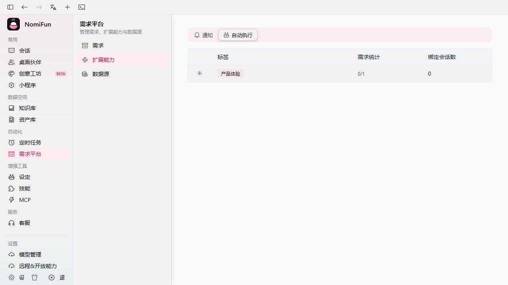
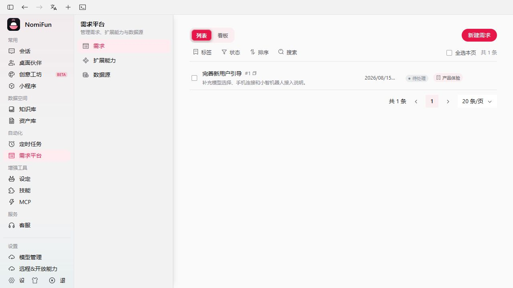
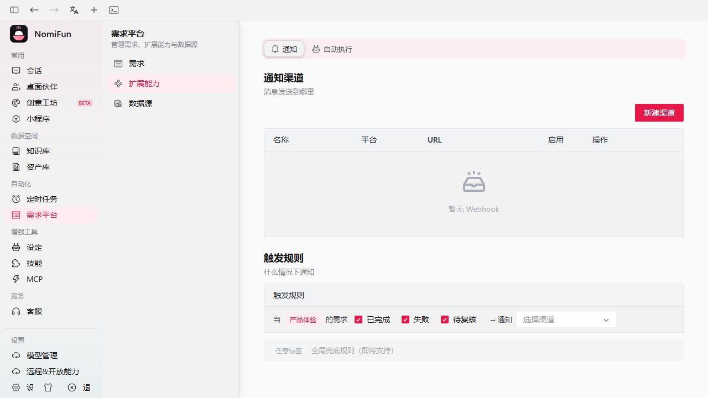

# AutoWork and Requirements

AutoWork processes requirements with the same tag through a bound AgentSession, one at a time. Requirements own queue order and results; the work remains in the same main conversation. Enabled bindings resume when the backend starts. Closing the browser page does not stop them; exiting the host process does.

## Submit and inspect requirements

1. Open **Requirements** (`/requirements`) and choose **New requirement**.
2. Enter a title, tag and content. Describe the context, requested work and completion criteria.
3. Choose an order key. Lower keys run first, using string lexicographic order, such as `1.0`, `1.1`, `1.2`.
4. Save as `pending`. An enabled Session bound to that tag picks it up after earlier work finishes.

Filter the list by tag, status or text. Open a row for its detail and edit controls. The board at `/requirements?view=board` displays the same data grouped by status; use the detail controls to change state.

## Enable automatic execution

1. Open an ordinary conversation with a suitable model, capabilities and workspace.
2. In its **AutoWork** header control, choose the tag, optionally set a completion cap, and enable.
3. Inspect the Agent's streaming work and results in that main conversation. AutoWork reuses the bound Session rather than creating a collaboration child Session per requirement.
4. Inspect bindings and Idle, Active or Paused states under **Requirements → Extensions → AutoWork** (`/requirements/extensions?tab=autowork`).

An empty queue waits for new work. Reaching the completion cap, disabling AutoWork or deleting the Session stops it. Existing Sessions use their saved configuration; confirm the model, resources and tools suit the queued requirements.

## Pauses and human review

Requirements normally move from `pending` to `in_progress`, then `done`, `failed` or `cancelled`. Process interruption, lease expiry or uncertain external effects can produce `needs_review` and pause the tag. Expiry does not establish that an operation never happened; resubmitting is not a way to verify it.

Inspect the main conversation, requirement result and actual files or external actions. Resolve required input or unknown outcomes, then select **Resume** in the conversation header. That explicit action requeues failed items and continues the queue. A model saying “done” does not replace checking the real result.

Model failover and [Intelligent Decision](intelligent-decision.md) operate at a different layer. AutoWork does not provide queue execution for third-party CLIs in terminals.

## Completion notifications

Create channels under **Requirements → Extensions → Notifications** (`/requirements/extensions?tab=notify`). Choose **Lark/Feishu**, **HTTP** or **Slack**.

1. Enter a name and URL, plus an optional signing secret for Lark, then save and enable.
2. Use **Test** to check reachability.
3. In the tag routing controls on the same page, bind a channel and select events such as completion, failure or review required.
4. Clear the binding or disable the channel to stop its notifications.

Notifications contain requirement and result summaries. Delivery failures produce diagnostics but do not roll back settled requirement results. Notification webhooks and chat bots are separate configurations; use [Channels](channels.md) for two-way messaging.

## Related guides

- [Agent Workbench](presets.md): prepare capabilities and runtime defaults.
- [Model Management](model-routing.md): configure providers and failover.
- [Scheduled Tasks](scheduled-tasks.md): run work on a clock.
- [Agent Session architecture](../architecture/agent-session.md): execution facts, recovery and effects.
