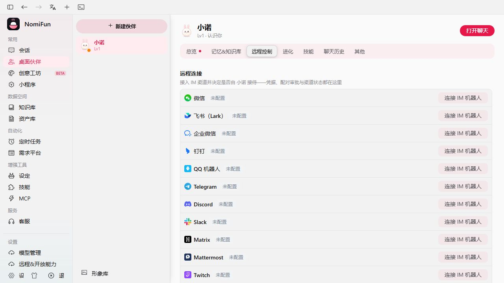
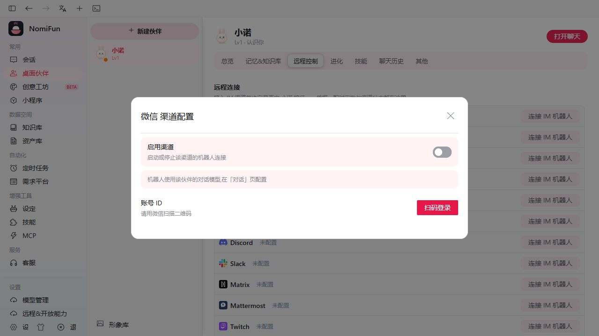

# Channels

通过 **channel**，你可以从外部聊天应用——Telegram、飞书（Lark）、钉钉、微信、企业微信（WeCom）、QQ Bot 等——操作 NomiFun 的智能体，而不必坐在桌面客户端前面。你可以把一个或多个机器人连接到伙伴或客服，然后分别决定每个机器人允许谁在私聊和群聊中使用。私聊继续使用既有配对流程；群聊则使用简单的 per-bot 访问策略。

Channel 适用于以下场景：

- 你想从手机或群聊里给智能体下达指令；
- 你希望让一个工作区感知的智能体能从团队现有 IM 中触达；
- 你希望长时任务（[AutoWork](./autowork-requirements.zh.md)）能从桌面之外被发起，而不必启动 WebUI。

> 内置适配器都是 `nomifun-channel` 的 Cargo feature：`telegram`、`lark`、`dingtalk`、`weixin`、`wecom`、`discord`、`matrix`、`mattermost`、`slack`、`twitch`、`nostr`、`qqbot`。`nomifun-app` 默认构建会全部启用；自定义构建可以省略部分适配器，被省略的平台将不可用。用户界面主称为**飞书（Lark）**，但协议与配置 key 仍是 `lark`，旧配置无需改名。

## 在哪里找

打开 Nomi 页面（`/nomi`），选择一只伙伴，然后进入 **渠道与机器人** tab（`/nomi?companion=<id>&tab=remote`）。这个 tab 会列出该伙伴可用的远程连接器，包括 Telegram、飞书（Lark）、钉钉、微信、企业微信（WeCom）、QQ Bot、Slack、Discord、Matrix、Mattermost、Twitch、Nostr 与扩展。每个已连接的机器人会显示：

- 一个状态药丸（`stopped` / `connected`）；
- 连接成功后的 bot 用户名；
- 当前已授权用户数；
- 传输凭据，以及伙伴或客服的归属绑定；
- 对能够可靠识别群聊的适配器，显示 per-bot 的**群聊访问**选择器。

企业微信和 QQ Bot 都是可运行的内置适配器，不是占位卡片。企业微信使用智能机器人的长连接协议；QQ Bot 使用官方 Gateway WebSocket 与 REST API。

## 私聊与群聊访问

群聊访问按机器人保存到 `group_access_mode`，不是整个平台共用一个开关。例如，同一个 NomiFun 实例上的两套飞书应用可以绑定不同伙伴并分别设置。

| 设置 | Wire 值 | 群聊行为 |
| ---- | ------- | -------- |
| **对群所有成员开放** | `all_members` | 任意群成员都可以用结构化 `@机器人` 发起对话，无需先配对。这只开放当前群聊，**不会**授予该成员私聊权限。 |
| **对群部分成员开放** | `allowlist` | 只有该机器人的 Authorised users 可以使用；其他成员有效 `@` 机器人时，会创建或复用一条 Pending 请求，等待负责人批准。 |
| **禁止群聊** | `disabled` | 忽略所有群消息，包括负责人和已授权用户发出的消息；私聊不受影响。 |

新伙伴机器人默认使用 `allowlist`，客服机器人默认使用 `all_members`。负责人可分别修改每个机器人的模式。

任何被接受的群消息都必须包含平台事件里**对当前机器人的结构化 `@`**。正文里仅仅写了类似 `@bot` 的文字、引用内容以及未提及机器人的普通群消息都不算；系统会在创建配对请求或 session 之前直接忽略。若平台没有提供可靠的聊天类型、发送者或 mention 数据，同样按拒绝处理。

群消息使用按“机器人 + 群”隔离的独立 session，不进入负责人或任一成员的私聊 Conversation，也不会让两个群共享上下文。选择“对群所有成员开放”后，群成员仍不会自动出现在私聊授权名单中；同一成员之后私聊伙伴机器人时，仍需正常配对。为稳定路由，NomiFun 会在内部记录隐藏的 `auto_group` 身份，但它不会显示在 Authorised users 中，其 Nomi runtime 被强制限制为“只用模型回复”：不能使用 cron、AutoWork、需求、记忆、跨会话、终端、浏览器、computer-use、自定义 MCP 或平台 Gateway 工具。通过 `allowlist` 明确批准的 `approved` 身份则保留既有的已授权渠道能力。

只有能可靠上报群聊类型和结构化 mention 的适配器才显示这个选择器。首批支持飞书、钉钉、企业微信、QQ Bot、Discord、Slack 与 Mattermost。Matrix 目前不能稳定区分私聊和群聊，Telegram 尚未统一解析消息实体里的结构化 `@`，因此两者暂不显示；仅支持私聊的适配器也不会显示。

## 各平台配置步骤

### Telegram

1. 找 [`@BotFather`](https://t.me/BotFather) 创建一个 bot，保存 token（形如 `123456:ABC-DEF…`）。
2. 在 **Nomi → Remote → Telegram** 粘入 token。
3. 点 **Test**——后端会调 `getMe`，成功后显示 bot 用户名。
4. 点 **Enable**。插件开始长轮询（25 s 超时，指数退避，最多 10 次重连）。

为了把 Telegram 用户与桌面端配对：用户给你的 bot 发消息；bot 用一个 6 位验证码（10 分钟 TTL）回复。在桌面端的 **Nomi → Remote → Pending pairings** 中粘入或键入该验证码并点 **Approve**。从此该 Telegram 用户即可与智能体对话。

### 飞书（Lark）

1. 在飞书开发者控制台创建一个自定义 app，开启你需要的事件（文本消息、卡片动作、bot 菜单）。
2. 复制 **App ID**、**App Secret**，以及（可选）**Encrypt key / Verification token**。
3. 把它们填入 Channels tab 中的**飞书（Lark）**表单，点 **Enable**。

飞书适配器通过 WebSocket 长连接接入（无需公网 webhook），带一个 60 秒的事件去重清理循环和分片重组。回复以**互动卡片**形式发送，因为飞书 API 只支持编辑卡片消息。内部协议 key 仍为 `lark`，已有部署配置无需更名。

### 钉钉

1. 在钉钉开发者后台创建一个内部 app，启用 **Stream Mode**。
2. 把 **Client ID** 与 **Client Secret** 填入 DingTalk 表单并启用。

钉钉插件通过标准 stream-mode 握手打开 WebSocket；配对流程与 Telegram 一致。

### 企业微信（WeCom）

1. 在企业微信中创建**智能机器人**，并选择**长连接（WebSocket）**模式。
2. 把机器人的 **Bot ID** 和 **Secret** 填入企业微信表单。
3. 测试凭据、启用机器人，并保持 NomiFun 运行以维持出站 WebSocket。

这种模式不需要回调 URL、回调域名或公网 IP。

### QQ Bot

1. 在 [QQ 开放平台](https://q.qq.com/)创建机器人，复制 **AppID** 与 **ClientSecret**。
2. 在平台控制台申请 `GROUP_AND_C2C` intent；否则 QQ 不会把群聊和 C2C 消息投递给机器人。
3. 把凭据填入 **QQ Bot** 表单，测试后启用。

适配器通过官方 Gateway WebSocket 接收事件，通过官方 REST API 发送回复。

### 微信

1. 微信用 QR-code 登录。在 WeChat 插件上点 **Enable**——`POST /api/channel/weixin/login/start` 会启动登录，后端通过现有的应用 WebSocket 向桌面端推送 QR-code 刷新事件。
2. 用微信 app 扫码确认登录，插件转为 `connected`。

微信 **不支持** 消息编辑——回复以新消息形式投递到同一聊天，而不是就地编辑。

## 配对与授权用户

对于绑定伙伴的机器人，陌生用户第一次发来**私聊消息**时，系统会创建 Pending 请求，并返回一个 TTL 为 10 分钟的 6 位验证码。负责人可以在 **Nomi → Remote → Pending pairings** 中批准或拒绝，也可以调用 `POST /api/channel/pairings/approve` 与 `POST /api/channel/pairings/reject`。

在“对群部分成员开放”（`allowlist`）的群里，陌生成员有效 `@` 机器人时，会创建或复用同一个 per-bot Pending 记录。NomiFun 不会把配对码公开发到群里；负责人直接在现有 Pending 列表中处理。批准后的身份会出现在该机器人的 **Authorised users** 中，不需要另建成员目录或维护复杂的群 ACL。

“对群所有成员开放”不会创建配对请求；系统只会创建或复用隐藏的 per-bot `auto_group` 身份，以保持群路由稳定。这个身份不会加入 Authorised users，也不能授权私聊。绑定客服的机器人继续沿用既有的客服私聊服务语义，不会因为新增群聊设置而被强制套用伙伴配对流程。

你可以随时撤销已批准用户（`POST /api/channel/users/revoke`），服务也会清理该用户的活跃 session。该用户下一次私聊伙伴机器人时需要重新配对；群聊能否使用则取决于机器人当前的 `group_access_mode`。

## 渠道 Agent 接入

在目标伙伴的**渠道与机器人**中连接机器人；用于客服时，在**客服**入口绑定。一个机器人对应一份归属。改绑会重置受影响的活跃渠道会话，下一条消息采用新伙伴或客服。没有有效绑定时，渠道保持未绑定，不会自动取得默认伙伴身份。

连接表单管理传输凭据与归属，Agent 和模型在伙伴或客服页面配置。实际可用工具取决于已保存 Agent、资源与渠道访问策略，不能假定桌面中的所有能力都可从 IM 使用。

群聊按机器人与群分别保存会话。自动准入的访客只获得模型回复，不获得负责人的私有上下文或管理工具。私聊授权、群聊准入和整个机器人的启停是独立控制。

## 从 IM 端能做什么

平台无关抽象（`UnifiedIncomingMessage`、`UnifiedOutgoingMessage`、`UnifiedAction`）覆盖：

- **纯文本**——双向。
- **流式编辑回复**——智能体的增量更新会被编辑进正在飞行的 bot 消息（微信除外）。
- **动作按钮**——确认 prompt、重试动作等等，渲染为 inline keyboard（Telegram）、互动卡片按钮（飞书）或对应平台的等价物。
- **安全的群聊访问**——支持群聊的适配器始终先要求对当前机器人的结构化 `@`，再应用 `all_members`、`allowlist` 或 `disabled`；这个 mention 要求不是可关闭的开关。
- **群会话隔离**——通过检查的群消息只延续该“机器人 + 群”的 session，不共享私聊或其他群的记录。

从 IM 端目前还做不到：

- 超出平台插件原生能力的文件上传；
- per-user 工作区选择——智能体的工作区就是它路由到的会话上设的那个。

## 相关

- [渠道架构](../architecture/channels.zh.md)——per-bot 策略、身份能力上限、迁移与适配器能力矩阵的规范说明。
- [伙伴（Companions）](./companions.zh.md)——多伙伴管理、按伙伴独立的记忆，以及搭载在渠道会话上的每宠知识库绑定。
- [AutoWork & Requirements](./autowork-requirements.zh.md)——从聊天里登记一条需求，再用 webhook 卡片把通知打回飞书。
- [Web Server Deployment](./web-server-deployment.zh.md)——当你在服务器上自托管后端时同样能暴露这些 channel。
