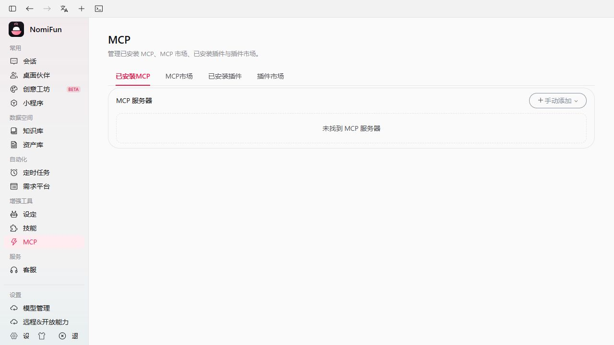
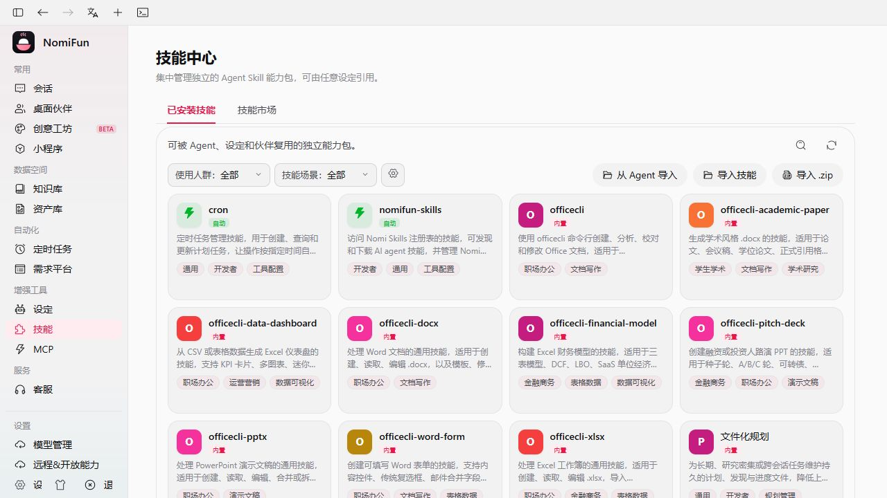

# MCP & Skills

NomiFun has two extension mechanisms that are easy to confuse:

- **MCP servers** are external tool servers. They expose callable tools over
  stdio, HTTP, or SSE.
- **Skills** are markdown/folder knowledge bundles. They tell an agent how to do
  a workflow; they are not long-running tool servers.

Current pages:

| Capability | Page |
| --- | --- |
| MCP servers | `/mcp` |
| Skills | `/skills` |
| Agent workbench | `/agent` |
| External tool access (MCP / REST) | `/connections?task=tools` |

Legacy settings URLs redirect to these pages.

## MCP Servers

Open `/mcp` to add, import, test, enable, disable, and sync MCP servers.

Each server row owns:

- name;
- transport: `stdio`, `http`, or `sse`;
- command / args / env for stdio, or URL for HTTP/SSE;
- raw imported JSON, when imported from another agent config;
- enabled state;
- last connection-test result.

Connection test uses a temporary MCP client, performs the handshake, lists tools,
and persists the result. Failure codes include command-not-found, permission,
timeout, HTTP, RPC, and protocol errors.

The enable/disable switch beside each server controls global availability separately
from connection testing. Market imports remain disabled. Complete the configuration,
test it, and enable the server to select it in a Session. Enabling before testing is
also supported, but new Session selections require a successful test and discovered
tools. Testing does not enable a server, and toggling does not launch a test. After
either operation completes, mounted Session MCP lists re-read the backend catalog
without replacing the user's selection draft.

OAuth-backed HTTP/SSE servers use the `/api/mcp/oauth/*` flow.

The canonical owner currently supports Streamable HTTP/stdio at `2025-03-26`
and explicit legacy SSE at `2024-11-05`. It does not silently convert between
transports and does not yet claim the `2026-07-28` `server/discover` lifecycle
without `initialize`; a server that only supports that lifecycle returns a
typed protocol error. That is a separate owner and security-model migration,
not part of market configuration import.

### MCP market boundary

The MCP market is a **configuration catalog**, not a package manager. When an
entry is added, NomiFun ranks the configuration examples in its market
documentation (preferring portable `npx`/`uvx` launchers and HTTPS over Docker,
global commands, or placeholder endpoints), normalizes common forms such as
`streamableHttp` and `baseUrl`, and imports the result disabled. It does not
install Node.js, Docker, Python/uv, browser drivers, complete third-party login,
or create API keys.

The confirmation screen shows the actual command, arguments, URL, env/header
keys, and fields that still need values. A server containing `${...}`, `<...>`,
`xxxxx`, `YOUR_*`, or similar placeholders cannot be tested until those fields
are completed, preventing template URLs from being contacted or unconfigured
processes from being launched. Failed entries previously imported from the
market expose a **Repair config** action; replacements are reviewed again and
remain disabled.

A connection test only proves that the configuration completed the MCP
handshake and `tools/list` at that moment; it is not a live presence signal.
Failures distinguish missing runtimes, HTTP status, timeout, RPC, and protocol
errors. URL-based servers enter the OAuth flow only after an explicit OAuth
Bearer challenge, so API-key/header configurations are not treated as OAuth.

Connection tests and real invocations share one bounded setup policy. Runtime
preparation, process launch, handshake and catalog verification have phase
limits within a cumulative setup deadline; changing phases never renews it.
Portable package runners (`npx`, `bunx`, `uvx`, and equivalent launcher forms)
may take 120 seconds for first startup; ordinary protocol setup has a 30-second
phase budget. Neither deadline includes subsequent tool execution.

Tool execution has no default total or silence deadline. An HTTP service may
wait until computation finishes before returning response headers. Business
waiting ends on user cancellation, an explicit execution deadline, a real
transport failure, a protocol/resource violation, or host shutdown. Logs, ping
and missing progress do not prove a stalled tool. Notifications use bounded
processing without a lifetime count that cuts off healthy long operations.
Cancellation targets the original request and retains local cleanup ownership;
disconnect, cancellation delivery and process exit do not prove absence of
earlier effects. Unknown results are never automatically replayed. A caller
ending its wait does not declare the tool failed.

Stdio children receive
only proxy-related variables from the parent or detected system proxy through
the shared proxy policy (including its stale loopback-proxy guard), while API
tokens and unrelated parent environment remain isolated. Raw child stderr is
never returned or logged: it is drained and
reduced to non-secret categories such as package-not-found, download/network,
missing dependency, missing configuration, permission, or early process exit.

A failed probe does not replace the same configuration's last fully verified
tool catalog with an empty list. A hosted app's transient timeout or connection
failure likewise retains the verified catalog for the same running process and
address while reporting the failed probe honestly. New selections still require
successful discovery. Existing frozen calls retain exact pre-dispatch schema
verification; cached descriptors grant no new authority.

An HTTP URL on `localhost` is only a client connection descriptor. NomiFun does
not start the referenced application or Docker container. A failed local probe
therefore reports the host and port and asks the user to start that prerequisite
service; it no longer presents every runtime or service failure as malformed
MCP JSON.

## Importing and Syncing Agent Configs

`GET /api/mcp/agent-configs` detects MCP config files from supported local agent
CLIs. The UI lets you import detected servers into NomiFun and push the NomiFun
list back to selected agent configs when an adapter supports writing.

This sync is config management only. A conversation still decides which MCP
servers are visible for that session.

## Global capabilities and Session selection

Every Agent preset can use the same installed Skill Library and global MCP catalog. The Workbench has
no Skill, MCP, or tool-search master switch. The two icons beside the composer select what this Session
uses, without editing the Agent preset or global installation state.

New Sessions select auto-injected Skills by default. MCP servers require an explicit choice; enabling
or successfully testing a server never selects it for a Session. The Session picker shows enabled MCP
sources only; disabled sources remain available on the MCP management page. Users can deselect default
Skills and choose other installed Skills or ready servers. Global Skill bodies and supporting text/images
are captured as immutable reference data.
Selected instructions accompany accepted input; long bodies and supporting resources use the native
context reader. Skill scripts, hooks, and tool declarations grant no additional permissions.

Creation accepts top-level `session_capabilities` with `skill_names` and `mcp_server_ids`. Omission keeps
default Skills and the Agent's explicitly saved MCP grants without adding other enabled sources;
explicit empty arrays select none. Existing Sessions use
`GET` / `PUT /api/agent-sessions/{id}/capability-selection` with `expected_binding_version`.
Sending waits for selection admission; failures preserve input and selection for an explicit retry.

Selections compile into the existing immutable Revision/Snapshot and apply through canonical binding
transitions. Running or paused Turns, unsettled effects, Remote bindings, and read-only Attempts cannot
change selection. Agent switches retain selection; workspace and other resources remain intact.
Accepted input and native checkpoints are not rewritten. An unchanged connection test or metadata
update keeps the same MCP connection identity; actual configuration, credential, or schema changes
require reapplying selection.

## MCP API

| Operation | Endpoint |
| --- | --- |
| List / create | `GET`, `POST /api/mcp/servers` |
| Import batch | `POST /api/mcp/servers/import` |
| Get / update / delete | `GET`, `PUT`, `DELETE /api/mcp/servers/{id}` |
| Toggle | `POST /api/mcp/servers/{id}/toggle` |
| Test connection | `POST /api/mcp/test-connection` |
| Detect agent configs | `GET /api/mcp/agent-configs` |
| OAuth | `POST /api/mcp/oauth/check-status`, `/login`, `/logout`; `GET /api/mcp/oauth/authenticated` |

## Skills

Open `/skills`.

A skill is either a single markdown file or a directory containing `SKILL.md`.
Sources:

| Source | Meaning |
| --- | --- |
| Builtin | Shipped with the app. Some are auto-injected. |
| Custom | Imported by the user or placed in a configured skill directory. |

Skills can be tagged, imported, exported/symlinked, and scanned from external paths.
Custom and bundled Skills use the same Session capture and native context reader.

The Skill Market Add action is owned by the Skill Library service: the backend validates the market identity, downloads and safely extracts the archive, and imports it into the user skill directory. It neither creates an Agent Session nor executes a command supplied by the market; installation and later Session use are separate phases.

### Official Feishu / Lark CLI skill

The bundled **Feishu CLI** (`lark-cli`, displayed as **飞书 CLI** in Chinese) skill uses the
[official Lark CLI](https://github.com/larksuite/cli/blob/main/README.zh.md) for messages, cloud
documents, Drive, Base, spreadsheets, calendars, tasks, mail and wikis. View it in `/skills`
and select it from the conversation's skill picker. It is not auto-injected. Example requests
include summarizing a linked Feishu document, reading next week's agenda, or updating a specified Base table.

On first use, the Agent discovers and reuses an existing `lark-cli` installation. Only when none
exists does it install the official `@larksuite/cli` npm package into the current OS user's shared,
durable tool directory. Local Agents, sessions and workspaces reuse the same absolute launcher;
they do not install copies in projects, temporary directories or npx caches. The Host supplies
the actual prefix through `NOMIFUN_USER_CLI_ROOT`. Typical locations are:

| Platform | Install prefix | Launcher |
| --- | --- | --- |
| Windows | `%LOCALAPPDATA%\nomifun-user-tools\npm` | `lark-cli.cmd` under the prefix |
| macOS | `~/Library/Application Support/nomifun-user-tools/npm` | `bin/lark-cli` under the prefix |
| Linux | `${XDG_DATA_HOME:-~/.local/share}/nomifun-user-tools/npm` | `bin/lark-cli` under the prefix |

Installation explicitly targets that prefix, independently of Node versions or npm's default prefix.
Runtime upgrades and Agent-data cleanup retain it. Existing user installations are reused in place;
the Agent does not install another copy to standardize location or automatically move/delete them.

For initial account setup, the Agent checks existing configuration and provides login links
and QR codes. Complete authorization in the
browser and tell the Agent when finished so it can continue. Existing installations and account
configuration are reused. The skill uses the Agent's existing process and file tools; selection
does not grant tools or Feishu permissions. Access depends on application scopes, user consent
and resource permissions.

The CLI dependency is prepared when first needed and is not embedded in the NomiFun package.
No separate MCP server or upstream skill installation into another agent's directories is required.
Feishu channel bot configuration is managed separately from this skill's Agent-initiated operations.

With this skill selected, ask “Check for Feishu CLI updates” or “Update Feishu CLI to the latest version.”
The first request only reports installed/available versions and the installation path. The second
checks first, installs the exact target version at the original prefix, and verifies the same
launcher afterward, preserving account configuration and authorization. An already-current version
does not trigger installation. The skill supplies no background auto-updater or separate update
button; upstream notices during ordinary work do not authorize changing the installation.
NomiFun's bundled skill instructions update with application releases; the CLI can update independently.

## Skill API

| Operation | Endpoint |
| --- | --- |
| List | `GET /api/skills` |
| Builtin auto-injected list | `GET /api/skills/builtin-auto` |
| Tags | `PUT /api/skills/{name}/tags` |
| Info / paths | `POST /api/skills/info`, `GET /api/skills/paths` |
| Import / export / delete | `POST /api/skills/import`, `POST /api/skills/import-symlink`, `POST /api/skills/export-symlink`, `DELETE /api/skills/{name}` |
| Scan / detect paths | `POST /api/skills/scan`, `GET /api/skills/detect-paths`, `GET /api/skills/detect-external` |
| External paths | `GET`, `POST`, `DELETE /api/skills/external-paths` |
| Skills market | `POST /api/skills/market/enable`, `POST /api/skills/market/disable`, `POST /api/skills/market/rankings/sync`, `POST /api/skills/market/install` |

## Related

- [Agent Workbench](./presets.md)
- [Remote Capability API](./remote-capability-api.md)
- [Terminal](./terminal.md)
