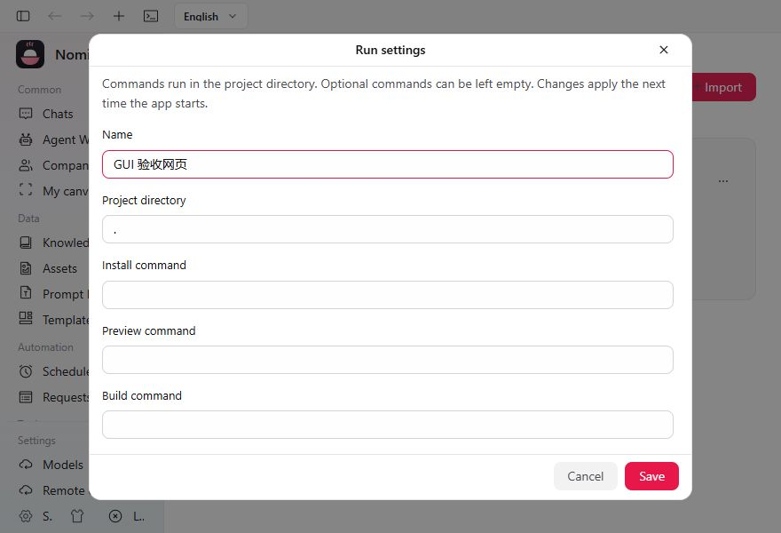
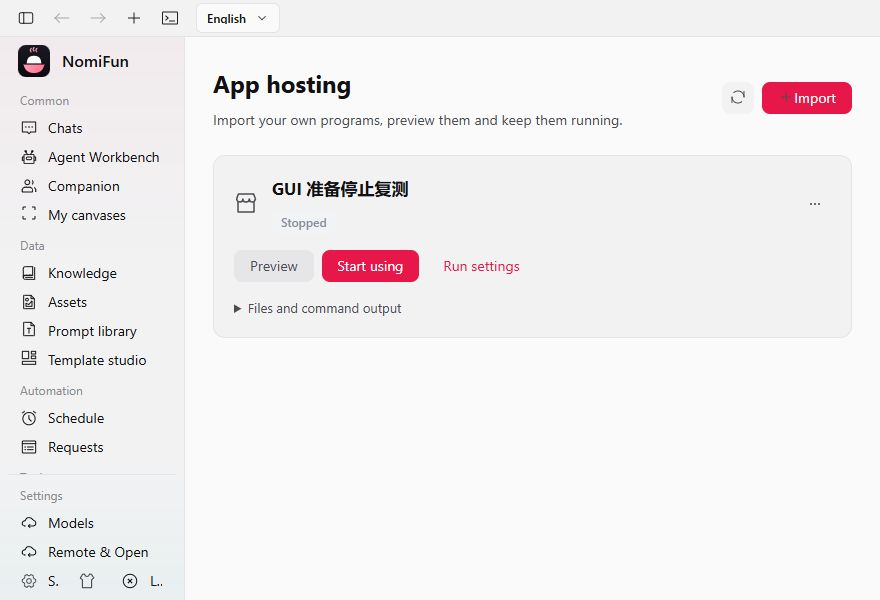
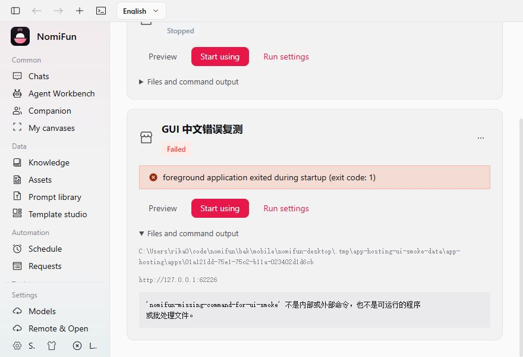

# 应用托管基础重构验证记录

本报告记录早期托管基础验证，不是用户最新手绘原型的完整验收。现役交互、固定内置应用 Agent、
普通开发会话保护及工作区资源清理以[最终设计](../specs/app-hosting-and-extensions.zh.md)和
[应用工作区重实现记录](2026-10-11-app-workspace-implementation.zh.md)为准。已退役字段和旧专项不计入新流程验收。

日期：2026 年 10 月 10 日。实现位于当前工作区，未提交、推送或发布。依据为
[最终设计](../specs/app-hosting-and-extensions.zh.md)及[实施要求](../specs/app-hosting-rewrite-prompt.zh.md)。
用户原有的审计报告、实施要求与其他无关工作保留；验证使用隔离目录，没有打开或迁移用户正在使用的数据目录。

覆盖范围说明：本报告初次验证中的 HTML/ZIP 是测试代码准备的真实项目，外部 `-ModelSmoke`
验证模型及冻结绑定，二者不能证明「自然语言 → Agent 生成项目 → 登记/启动 → 网页功能」整条链。
用户追问后已补该范围的独立生成烟测，并按用户新决策改为工作台可选能力；详见[可选能力与生成验证记录](2026-10-10-optional-app-generation.zh.md)。

## 实际行为与证据

| 要求 | 当前实现与验证 |
| --- | --- |
| 唯一薄托管 owner | `nomifun-app-hosting` 管理当前文件、JSON 登记、普通命令和受管进程树；HTTP 与 Agent 管理工具共用。没有第二个 MCP 进程所有者。 |
| 文件夹与 ZIP、源码与产物 | 原文件复制至 `app-hosting/apps/{id}`。真实目录、带包裹目录的 ZIP、源码、静态产物和服务端编译产物测试通过。 |
| 命令和环境 | 按脚本与锁文件识别，允许覆盖与空命令。系统及自定义 Node 实际执行；Node/npm/Bun 分别探测，不设置 Node 版本白名单。缺失工具返回真实错误，Node 提供官方下载帮助入口。 |
| 静态与服务器 | 普通 Node HTTP 静态预设已实际请求；任意静态产物目录可明确选择预设。编译服务端实际执行 `npm start → node dist/server.cjs` 返回动态 HTTP，即使有 `dist/index.html` 也不误当静态。无 UI 程序及其子进程也实际运行。 |
| 准备与启停 | 首次预览/使用及无预览命令的序列、空项跳过、失败停止后续步骤、日常启动、覆盖后重新准备均实测。预览与使用共用文件和数据，切换旧 PID 消失，重复启动不产生另一份服务。 |
| 并发与失败 | 单应用 gate；慢安装不锁其他应用。真实 UI 中一个程序失败、另一个仍运行。UI 可在安装/构建期间停止，旧请求的迟到响应不覆盖停止结果。异常退出，包括退出码 0，标为失败。 |
| Host 退出与崩溃 | 正常退出先取消准备、停止树，再等待 HTTP drain。真实 Desktop 慢安装退出约 197ms 取消 HTTP 等待、停止 Node，未执行启动。真实 Host 子进程强杀后核对精确 OS 身份，标失败且不自动启动；首次探针不确定时保留身份，由显式 Stop 重试。旧 PID 指向不同身份时不杀其他进程。 |
| 无感连接 | Desktop/Headless 实际 HTTP Host 与 Node 子进程自动连接 `/api/apps`；用户不配置 token。安装、构建及公开输出不含 LocalTrust。重启后旧凭据请求为 403，新凭据有效；外部未认证请求仍被拒绝。 |
| Agent 调用应用 | 托管 MCP 配置只读投影到现役目录，内存发现观察不双写 `mcp_servers`，不自动启动服务，不同步到外部 CLI。真实 Node MCP 发现、显式选择和 `tools/call` 返回 42；同一 PID，停止后仅选中来源不可用，普通 Agent 仍可创建会话。保留 128/256 等原合同上限并返回来源 ID、数量诊断，不截断。 |
| 应用调用 Agent | 用户选择 Agent，由原 RemoteBinding owner 准备连接。变更需先停止；复用同 ID CAS，设置写入失败在同 gate 内补偿。REST open/turn/observe/cancel 经真实 Runtime 与受控 HTTP 模型完成往返；另有真实外部 StepFun 模型烟测通过。 |
| 删除范围校正 | 早期 `exclusive_session_ids` 整会话删除分支没有生产 writer，已退役；旧专项不能证明现行开发工作区的删除闭环。现役删除保留全部合法普通开发及共享会话历史，只删除托管文件与运行连接；Windows 工作区目录占用与最新实测见新报告。 |
| 文件范围 | 实际复现并修复 Windows junction 导致的外部覆盖/删除。所有自有祖先、root 改址、symlink/reparse point 在写入、启动、覆盖、删除、登记前检查；真实三项路径范围回归保留外部文件，包括构建后将产物目录重定向的拒绝。 |
| 数据切换 | 001–003 已发布 SQL 未修改。004 正向退出旧活动表；切换前保护作品、导出旧登记并用 SQLite `VACUUM INTO` 保存已提交 WAL，复核文件摘要与 quick_check。资料保护失败、缺失/不匹配 metadata、未知/改变/间断 receipts 均阻止破坏性切换。 |
| 合法历史 | 当前退役 Agent 配置由原 owner 生成新 Revision，冻结 Skill、旧 Revision/Snapshot 与合法 canonical 历史不改写；单个不能等价处理的配置保留并诊断。PluginAuthoring 仅 typed 只读识别，禁止新建、执行、fork 和旧恢复；取消及删除仍走原 owner。新的 Host 代码进入 native build fingerprint。 |
| 桌面 UI | 唯一 `/apps` 入口及简洁设置、系统浏览器路径、运行输出、明确删除确认。真实 880×600 WebUI 完成目录/ZIP 导入、预览、交互、使用、停止、启动、失败及删除。关闭网页不停止进程；远程浏览器隐藏 Host loopback 打开入口。没有手机布局或手机测试。 |

## 汰换范围

删除旧 `nomifun-plugin-platform`、`nomifun-plugin-development`，以及只被旧域使用的
`nomifun-js-runtime`；删除旧 SDK/activate/bootstrap、Host KV/SQL/Files/DataRoot、
Action/Hook/Context/Surface、专属计划/预览资格/交付流程、旧 Router/Bridge/DTO/Manifest、
生成合同、活动表与索引、旧 fixtures/测试/脚本及现役创作设计。

`engine_plugin_bindings` 和旧插件页面、语言包整体退出。旧鉴权 Surface 例外也删除。
保留独立的 Agent kernel 注册、共用 MCP/工具上下文、ChannelPlugin 和 Tauri 原生插件。
新增应用托管架构、使用指南，并同步中英 README、API、数据/ID 规范与开发入口。
没有应用版本、部署、发布、维护、业务数据库迁移或第二份 Agent/删除账本。

## 检查结果

| 命令/检查 | 结果 |
| --- | --- |
| `cargo test -p nomifun-app-hosting --offline` | 18 个真实用例通过；1 个 ignored 仅供真实崩溃用例启动的子进程 fixture，实际已被调用。 |
| `cargo test -p nomifun-app --test app_hosting_e2e --test app_hosting_shutdown --offline` | 2 个通过；HTTP/Node 两种 Host 信任及实际 Desktop 准备期间退出。 |
| App MCP、`session_capability_selection_e2e hosted_` | 早期真实 Node MCP 1 个、Agent/REST 2 个、容量诊断 3 个及导入设置 1 个通过；旧在途 exclusive 专项已退役，不属于现役验收。 |
| canonical Session owner、控制面 | 7 个 owner 用例、原控制面 51 个及新退役保护用例通过；实际冻结 binding 全值比较保持原事实。 |
| DB 切换、ID、重置、native reasoning | 切换 3、ID 6、重置 2、reasoning 1 通过；clean cut lineage/回滚 4 个通过。 |
| `cargo test -p nomifun-auth --lib --offline` | 163 个通过，包含 Headless LocalTrust、外部鉴权、Cookie/CSRF/CORS/响应头等原边界。 |
| UI 定向、实际浏览器 | 初始 174 项定向测试及新增准备停止竞态通过；真实二进制 ZIP HTTP adapter 通过；最终 apps 8 项通过；真实 880×600 验收及最终中文错误/Stop 复测通过。 |
| `bun run check`、生产 UI build | 通过：typecheck、桌面边界、i18n、主题、图标、CSS、安装器、进程/浏览器/UARC/Session/托管边界、词汇及脚本目录。 |
| `agent-v2-contract write` → `check` | 最新生成物与源合同一致，检查通过；旧专属合同未保留。 |
| `cargo check -p nomifun-app -p nomifun-web --offline`、`cargo check -p nomifun-desktop --offline` | 通过；Windows Tauri 壳编译，仍有仓库原有的 feature dead-code/unused_mut 警告。 |
| 真实外部模型 | 现役 Windows Credential Manager 隔离 runner `-ModelSmoke` 通过，模型 `step-3.7-flash`；原冻结验证改为比较实际 canonical 完整 binding，未放宽生产冻结规则。凭据未写入参数、日志或仓库。 |
| `git diff --check` 与已发布迁移比对 | 通过；001–003 没有工作区差异。 |

## 具体限制

验证平台是 Windows。没有运行 macOS/Linux 真机、签名打包/发布或全仓库测试。
原生 Tauri 窗口/OS 默认浏览器的交互未实操（Computer Use 仅开放 in-app browser），
但 Tauri 编译与真实 Desktop HTTP owner/退出测试完成。跨机 loopback 防误开用定向模型测试验证，
没有第二台机器 GUI 验收。ZIP 支持普通文件，不接受链接，上传上限 256 MiB、解压上限 2 GiB；
目录导入拒绝外部链接及目录链接。运行依赖用户可用环境，Node 帮助打开官方安装入口，不自动替换环境。

运行状态只证明受管前台进程存在，业务功能及业务数据库迭代仍归应用。
托管后台按本机安装 owner 信任，共享 LocalTrust，不构成应用沙箱。
本次资料保护代码只在未来合法切换时执行，未操作真实用户数据库或旧作品目录。

## 可查看的实际证据

最终测试应用已经由 UI 同一 HTTP owner 删除，原测试 HTML/ZIP/长安装脚本保留，应用列表为 0。
浏览器验收使用隔离 `.tmp/app-hosting-ui-smoke-data`，未借助原型状态。

详细浏览器观测见 [验收 JSON](assets/app-hosting-ui-smoke-result.json) 和
[最后复测 JSON](assets/app-hosting-ui-final-retest.json)。
