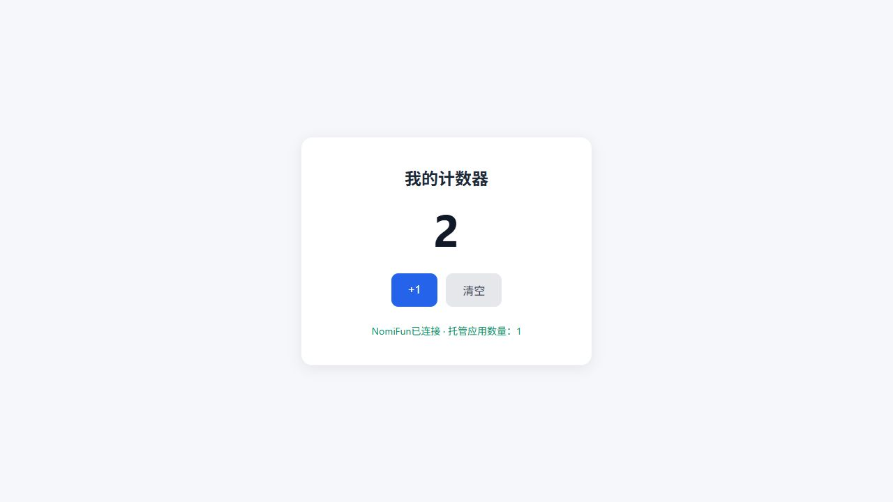

# 可选应用开发能力与真实生成验证

本报告记录普通 Agent 可选能力的早期生成验证。现役主入口已经按用户手绘原型改为应用页的
固定「内置应用」工作区；显示名称为「NomiFun 应用开发」，完整交互和最新验证见
[应用工作区重实现记录](2026-10-11-app-workspace-implementation.zh.md)。本报告的模板默认值和
工具数量描述是早期构建事实，不能作为现役生成要求。

日期：2026 年 10 月 10 日。延续[应用托管实施报告](2026-10-10-app-hosting-implementation.zh.md)，
按用户新决策把生成 NomiFun 可通信应用接入 Agent 工作台的能力候选；改动未提交、推送或发布。

## 实际使用路径

作为补充路径，可在 Agent 工作台创建或编辑个人编程 Agent，在「文件与开发」候选中选择「NomiFun 应用开发」。
需要自动导入和启停时，展开操作并明确选入对应动作，再保存。新建普通对话，选择该 Agent，
指定已有工作区与可用模型，然后描述要生成的应用。应用继续由原有工作区、进程等编程工具写入。
生成后通过同一托管 owner 导入副本及运行设置、启动，侧栏「应用」可查看、打开、修改或停止。
应用页主入口与补充路径的当前步骤见[使用指南](../guides/app-hosting.zh.md)。

## 实际改动

- `app.hosting` 成为可选候选，所有官方模板默认不选入。已有个人动作选择不自动增删；
  零动作、旧五动作 Session 的完整 Snapshot、Session-only Revision 保持原值。
- 只读 `read_app_guide` 按调用加载详细 HTTP/Agent REST/MCP 指南。
  未选入能力的 Agent 没有这组工具；详细指南不加入全局系统上下文、Hook 或官方默认提示词。
- 模块初次选择沿用工作台的安全默认，只选指南、列表与状态读取；导入、启动、停止需明确选中。
  没有增加应用 token 配置、权限审批、SDK、专属创作 Session、发布或数据库管理。
- 废弃的旧插件导入 fixture 也已替换为实际普通应用 API，旧插件域与 SDK 没有恢复。
  活动 API 清单移除 5 条旧创作/配置操作，补齐实际 12 条应用与 MCP 来源操作；
  旧 Surface 日志路径及测试已删除。通用 Kernel 插件元数据目录与已发布 baseline 校验合同保留。
- 真实生成测试发现零参数指南/列表缺少严格 `properties: {}`，已修正 schema。
  普通无 MCP 应用也不再发布工具目录；相同完整 MCP 目录重复刷新保持 Registry 和代际，
  实际目录变化仍遵守现役冻结检查。
- 导入、启停复用 `HostedEffectReceipts`、`agent_effects` 和原事务资源围栏。
  准入使用确切的 Session/Turn/operation/Snapshot 与已提交工具因果；操作与结算由 Host 保留。
  已知失败明确允许部分变更，worker 或进程树清理未确认时保留未结算，禁止换 operation 自动重放。
  没有新执行账本、冻结历史改写或放宽 Runtime 准入。

## 已完成检查

| 检查 | 实际结果 |
| --- | --- |
| 官方模板、真实目录/保存 API 与冻结保护 | `official_preset_catalog_integrity`：4 个通过，含旧五动作不自动扩权及显式新增指南。 |
| 工作台组件、语言与动作选择 | 43 个定向测试通过，包含候选可搜索、默认关闭、按需选入与旧动作保留。 |
| 指南、严格零参数 schema 与导入设置 | `app_hosting_tools`：2 个通过。 |
| 托管命令、HTTP、树清理、取消及资料保护 | `nomifun-app-hosting`：18 个真实用例通过；1 个 ignored 只用于真实 Host 崩溃子进程 fixture，实际已被调用。 |
| 实际 Host 连接及退出 | `app_hosting_e2e`、`app_hosting_shutdown`：2 个通过；Desktop/Headless 后端通信、旧凭据失效、Desktop 安装期间退出取消。 |
| canonical 托管效果 | `hosted_effect_receipts::tests`：6 个通过，覆盖确切因果、已知部分失败、错误权限事实、未结算新 operation 拒绝、导入路径别名、并发唯一准入及 Robot 原策略。 |
| 工具目录 no-op 与真实变更冻结 | `catalog_publisher_tests`：2 个通过，直接调用发布器，验证原实例/代际及实际变更仍被拒绝。 |
| 生产 UI | `bun run build:ui` 通过。 |
| 仓库检查 | `bun run check` 全部通过；含 typecheck、i18n、桌面 880×600 边界、Session/UARC、托管与旧领域退役边界。 |
| 隔离 runner | `--self-test` 通过。 |
| 活动 API 合同及生成物 | 生成器 3 个针对测试通过，最新 `agent-v2-contract write` → `check` 通过；活动 JSON 退休端点边界自测通过。 |
| 旧 fixture 替换与鉴权 | trace 4 个、实际应用安装 token 控制面 1 个通过；有效 token/JWT/LocalTrust 可访问托管，错误或缺失凭据被拒绝，token 不获得能力目录及 WebView token 权限；实际导入/删除保留原来源。 |

## 真实生成闭环结果

最终 `-AppHostingSmoke -AppHostingBrowserHold` 的 run06 为 **PASS**，使用真实 `step-3.7-flash`。
官方编程模板默认没有托管权限，由普通工作台保存 API 明确选入六动作，再建立一个普通冻结会话。
模型在空工作区写入 `index.html` 和 `server.cjs`，没有预置应用源码，也没有手工改写模型产物。

| 实际观测 | 证据 |
| --- | --- |
| 按需读取指南 | `read_app_guide` 调用 seq 46，成功结果 seq 48。 |
| 实际写文件 | 两次写入分别 seq 121→Effect 成功 123→结果 125、192→194→196。 |
| 同 owner 导入、启动 | import seq 353→Effect 成功 355→结果 357；start seq 387→389→391，指向同一个实际应用 ID。 |
| 文件和服务 | 原文件与自有副本字节相同；HTML 与后端语法检查通过；HTTP 200 正文与模型写入的 HTML 相同。 |
| 无感连接 | 生成的后端实际请求受保护 `/api/apps`，成功请求计数增加 1，返回 `connected:true,app_count:1`；无凭据请求为 403。 |
| 独立浏览器 | 初始 0，点击两次 +1 为 2，刷新仍 2；清空为 0，刷新仍 0；页面显示 NomiFun 已连接及数量 1。 |
| 实际停止 | 返回 stopped/pid null；原 PID 51064 消失，58744 端口直接 TCP 连接失败，无代理的新 HTTP 请求没有响应。 |
| 凭据与清理 | 隔离测试数据库和源码/产物的明文凭据检查通过，Host 清理成功；没有留下测试服务。 |

完整记录见[脱敏 runner 报告](assets/app-generation-live-result.json)、
[canonical 与实际 HTTP/进程证据](assets/app-generation-canonical-evidence.json)、
[独立浏览器观测](assets/app-generation-final-browser-result.json)。

试验中的失败记录没有改写为成功：run01 暴露零参 schema 缺少 `properties`，run02 暴露普通应用刷新目录导致冻结失配；两项生产缺陷已修复并有回归。
run03 导入被拒绝，当时缺少完整诊断，不能断言具体原因；没有据此修改无关旧适配器或增加 prefix/Snapshot fallback。
run04 已通过生成、HTTP 与浏览器，但最终停止检查只用了 HTTP `send().is_ok()`，没有响应内容，因此不能据此证明应用存活；
后来加上无代理新连接、实际 PID 与直接 TCP 的停止证据，run06 完整通过。
run05 模型在缺文件时提前导入，后又重复导入，未完成任务。以上失败均保留在本地 `.git/app-generation-validation`。

## 证据范围

初次托管报告中的预写项目和模型配置烟测不能证明自然语言生成整条链。
本次新增 `-AppHostingSmoke`：从空工作区使用真实模型，通过生产 Agent 工具生成普通 HTML/Node 项目，
由模型读取指南、导入并启动；再验证工具结果与 Effect 因果、原文件/托管副本摘要、真实 HTTP 和受保护的 NomiFun 请求。
浏览器功能必须单独实操确认，测试不从进程存在或模型回答推导业务成功。

run06 验证的是计数器与成功通信路径。该次模型生成的后端没有严格检查 NomiFun 的全部 HTTP 错误状态，
不能宣称其断连/错误响应行为也已通过。按需开发指南包含正确的 HTTP 状态检查示例，应用仍需按业务做错误路径验收。
真实模型可能生成缺文件或不完整的应用；本次多次尝试不能作为一次生成成功率或任意应用正确性的统计证明。

验证使用隔离数据库和目录，没有打开用户的工作数据库或作品。模型凭据通过现役 Windows Credential Manager
隔离 runner 注入测试进程 stdin；不放入参数、仓库或日志。生成源码、公开网页和保留证据检查明文凭据泄漏。

实际 MCP 目录变化继续沿用现役冻结围栏，需要在空闲时明确更新选择或新建会话。
普通 HTTP 可通信应用不必配置 MCP 地址；应用后端使用运行时环境连接 NomiFun，浏览器不获得本机凭据。
验证平台为 Windows；原生 Tauri 窗口和 OS 浏览器交互、macOS/Linux 真机、所有技术栈与业务功能没有穷举验收。
