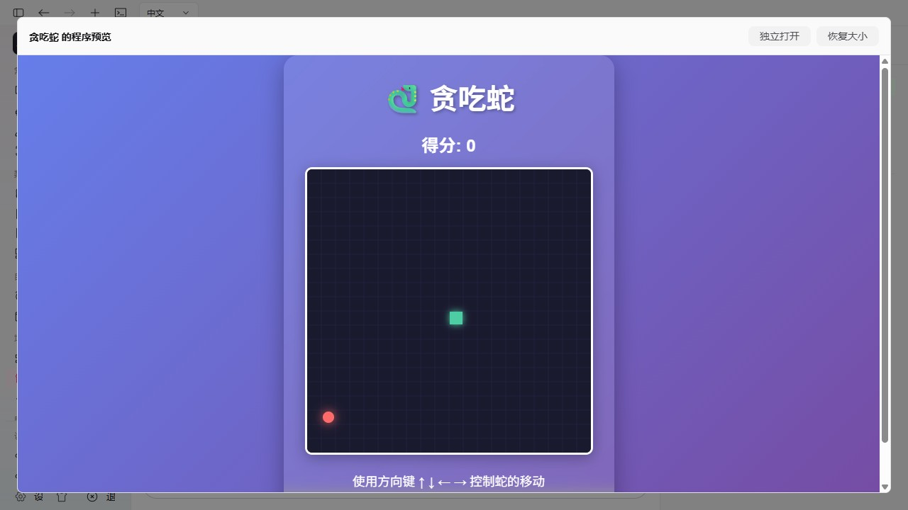

# 生成应用预览与产品文案修正

本轮处理用户反馈的「已生成应用却没有程序预览」和 Agent 名称包含原型注释「固定」的问题。代码在当前工作区，未提交、推送或发布。

## 根因与实际变化

只读核对用户贪吃蛇的合法 canonical 工具结果：文件写入、应用配置、启动和预览操作均实际成功；预览进程使用 `python -m http.server 8080`，工作目录为 `snake-game`，但 `web_url` 为空。前端因此无法加载网页。运行状态不等于已有可用网页地址。

另一个缺口是从空应用直接生成 HTML 后，托管只在导入时检测配置，生成后的当前文件没有进入检测；前端又曾依据已有命令决定是否显示预览入口。

- 程序预览保留显式入口。完全没有预览/启动命令时，点击预览或使用才检查当前文件，为唯一可识别项目补普通配置，不重复导入、不创建另一应用。README、隐藏工具目录和业务文件不会阻止唯一项目识别；多项目或无法识别时如实报错。GET/轮询不配置、不启动。
- 既有标准 Python 静态服务可根据确定的参数补网页地址，正在预览时补地址保留原 PID。只解析确定的 Python 静态服务命令；未知 Node 服务、Shell 表达式或外部目录不猜地址。已有显式 URL、前台命令和对应项目明确跳过的安装/构建保持原值。运行中修改执行命令、端口环境或工作目录须先停止，拒绝动作发生在准备回调和文件写入前；避免新地址被错误配给旧进程。元数据、网页地址及 MCP 地址仍可编辑。
- 修正 Vite 自动配置中预览端口与静态使用端口不一致的问题，两者使用同一端口合同。
- 点击预览默认打开较大的内嵌视图；可恢复到详情面板、再次放大或独立打开。使用浏览器原生 dialog 模态约束背景焦点，避免手工父页面键盘捕获遗漏 iframe。缩放保持同一个 iframe 和游戏状态，关闭网页不停止服务。操作失败时保留真实错误，不依据模型「完成」消息加载假预览。
- Agent 用户可见名称为「内置应用」。行为约束继续由系统模板处理，「固定」不再成为产品名称。其他 Agent 的「NomiFun 应用开发」仍是明确选入的能力，详细指南仍按需读取。

## 真实验证

[原贪吃蛇副本恢复](assets/app-preview-python-recovery.json)通过隔离生产 Host 的真实 import/update/operate API：只读复制用户源码，设置普通 Python 命令和空地址，首启动补地址；再用 API 清空正在预览应用的地址，点击预览恢复 URL，PID 保持相同。原件、副本、托管文件和实际 HTTP 响应的 SHA-256 一致。原作品和原 canonical 数据库没有写入。

[普通一句话生成](assets/app-preview-short-prompt-generation.json)从正式 UI 创建空应用，向真实 `step-3.7-flash` 提交唯一需求「帮我创建一个贪吃蛇游戏」。模型写出真实 `snake-game/index.html`，一个普通 Turn 完成。**该次模型只写了源码，没有调用托管配置或启停工具。** 用户点击程序预览后，生产 owner 从当前文件识别项目、配置普通 Node 静态服务、启动并提供真实网页；无需技术提示或再次导入。模型输出不被当作托管成功的证明。

[浏览器验收](assets/app-preview-browser-verification.json)独立操作这两个真实应用：默认大窗口预览、新游戏重新开始及空格暂停、原游戏开始及按钮暂停、缩小/再放大保持相同 Frame Tree 和一个 iframe、关闭网页仍运行。两个浏览器标签未捕获到 console error。检查 1280×720 与最低 880×600 桌面视口；后者 document width 为 880，预览工具条可访问，应用自己的较高内容可滚动。

复核修正运行中配置保护与原生模态后，[最终浏览器复验](assets/app-preview-final-modal-browser.json)使用新的隔离生产 Host，导入上述真实模型生成文件的相同字节副本，未再次生成模型代码。实际验证原生 `dialog:modal`、背景控件从可访问性树隐藏、Tab 不进入背景控件、工具条 Escape 和恢复按钮、缩放保持相同 Frame Tree、游戏重新开始及暂停、880×600 桌面边界和零 console error。[最终 Host/API 证据](assets/app-preview-final-host-recovery-retry.json)同时记录运行中改变端口被真实 API 拒绝。

中间一台仅 READY 的测试 Host 被工具会话中断，没有显式 finish，不计为通过。其日志保留，未覆盖原来已完成的真实生成记录。测试 TempDir 在 Windows 上可能部分回收，不能仅凭测试目录缺失推断生产退出删除源码；最终 fixture 在生产 `application.close()` 前后、TempDir 析构之前直接比较源码字节，单独记录保护结果，不把临时测试数据回收当作产品行为。

| 检查 | 本轮结果 |
| --- | --- |
| `nomifun-app-hosting` | 32 个测试通过；另一个 subprocess fixture 由真实 crash 测试执行，不独立运行。新增真实 Python 运行中配置拒绝、停止后改端口和 HTTP 校验 |
| `app_hosting_tools::tests` | 4/4 通过，指南按需读取、工具范围与 canonical 引用边界保持 |
| Apps/Preview 定向 UI | 20/20 通过，包括真实 HTTP iframe 缩放仅一次请求 |
| AppDevelopmentConversation | 12/12 通过，普通会话/模型控制/应用模板入口保持 |
| TypeScript、桌面 UI 边界、应用托管边界、UI 生产构建 | 通过；既有 React/KaTeX 及构建 chunk 警告保留 |

## 具体限制

- 本轮实际 GUI 验证为 Windows 桌面 WebUI；未实操原生 Tauri 窗口或另一台电脑。跨机浏览器仍不能把 Host loopback 当作本机地址，未增加反向代理。
- 自动识别只覆盖确定的普通项目与静态服务合同，不承诺识别任意语言或自定义服务地址。未知项目继续使用可编辑的命令及 URL。
- 原用户贪吃蛇源码已有 `backdrop-filter: blur(10px;` 缺括号，导致其网页自身样式异常；本轮保留原件不变。预览链路已验证，但未把该应用的全部业务和视觉正确性冒称通过。
- 焦点在应用 iframe 内时 Escape 不传给宿主页，不自动缩小；顶部恢复按钮始终可用，在工具条上按 Escape 可恢复大小。Tab 可到浏览器本身的焦点边界，背景 NomiFun 控件仍处于原生 inert 约束。不引入跨来源键盘桥接。
- 一次真实模型生成不保证任意需求都会自动填写名称、运行配置或一次成功；本轮证明普通生成后显式预览能够完成实际托管衔接。
- 测试 Host 和受管服务显式结束，详情见证据中的 shutdown 结果。临时本机地址不代表发布。
- 最终隔离 Host 在生产退出前后、外层 TempDir 析构之前比较 1 个应用的实际源码字节，哈希一致；该应用已关联普通开发 Session，只有 3 条初始 canonical 事件，没有第二次模型 Turn。用户原贪吃蛇哈希仍保持原值。
- [测试目录清理记录](assets/app-preview-fixture-cleanup.json)区分可确认回收的测试目录和残留。旧测试目录的删除被自动命令审批拒绝，返回仅为 `blocked by policy`，没有具体原因；未改用其他机制继续删除。所有测试服务已停止。保留残留目录不表示应用仍运行，也不影响原用户作品。
