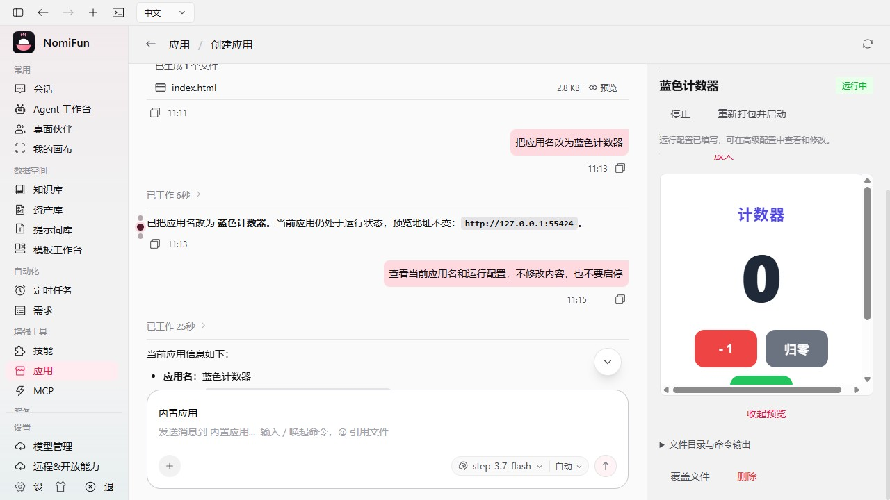
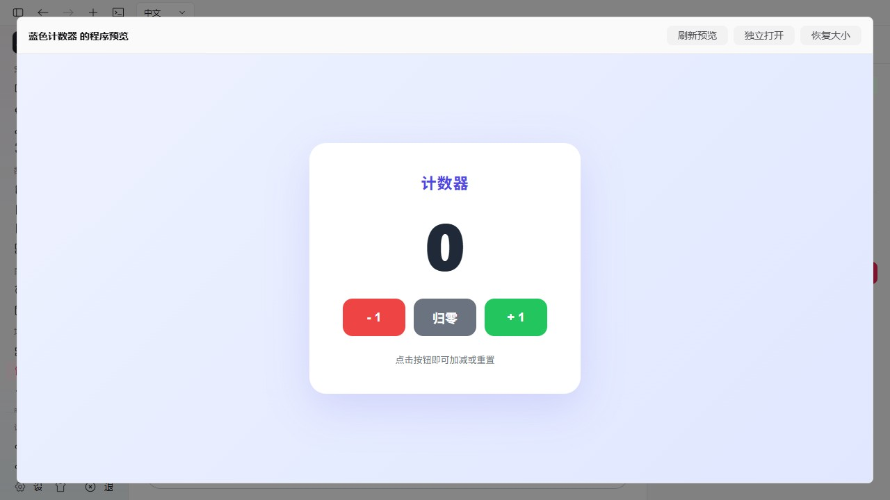

# 应用生成与托管配置联动

本轮处理「生成文件与应用右栏脱节，名称和命令没有自动填写，不能直接预览」的问题。沿用普通会话、当前应用 owner 和普通命令托管，没有增加部署、发布、版本、业务数据库管理或专属创作验收系统。代码在当前工作区，未提交、推送或发布。

最终复验日期：2026-10-12。本报告保留各次失败与范围差异，最新计数器产品流程验收通过；不把此前源码修改失败、模型参数错误或未测试平台改写为通过。

## 实际改变

- 官方「内置应用」Agent 的不可变职责明确包含当前应用的名称、说明、运行配置与实际预览，详细连接指南仍按需读取。每轮只提前展示最终已经授权、启用的托管动作，不给未选择该能力的 Agent 增加工具或应用上下文。
- 创建、继续修改和工作区导入使用精确的当前应用 ID、托管目录和普通 Session。`update_app` 与手工配置调用同一个 owner；不再要求用户把生成文件另行导入一次才能形成应用。
- 现有更新接口支持稀疏配置和 `detect_settings: true`。识别唯一实际项目后补可确定的命令和地址，保留已有配置与明确跳过的安装/构建；不在查询、轮询或历史重开时执行检测或启动。
- 右栏同步真实 owner 的名称、说明、状态和设置；用户未保存的字段逐项保留，其他字段跟随 Agent 的实际更新。安装、构建为空显示跳过，预览采用生产命令的实际 fallback 明确展示。
- 已成功运行且有可嵌入地址的预览自动加载到右栏；可以放大、恢复、单独打开和刷新。新 PID 加载新程序，普通轮询和缩放保持网页状态。精确完成回合的成功文件修改可通过现有配置响应的非持久观察刷新同 PID 的已加载网页；只读回合不刷新，也不重新打开用户已收起的预览。
- 已打开的预览意图跨停止/生产模式重建保留，停止期间不显示网页，重建后恢复内嵌视图；明确收起的预览继续保持关闭。详情读取暂时失败时保留当前会话、表单及预览，显示读取错误并允许刷新，避免卸载导致未保存内容丢失。
- 已配置本机 HTTP(S) 地址时，启动 owner 最多等待两秒确认 TCP 监听再返回；不发送 HTTP、TLS 或凭据，不探测远程地址。等待可取消，进程提前退出仍实际失败；超时保留原有进程状态语义，不把端口监听当作业务验收。
- 当前代旧空职责的开发 Session 只在明确新提交前，用既有闲置围栏和 ContextOnly canonical binding transition 更新；重开不替换冻结 Snapshot。模型、权限、资源、Session 身份、历史和旧不可变 Revision/Snapshot 保留。
- 修正普通 Runtime 的进度报告误入完成审核：已有执行计划仍有未完成步骤时继续原计划，不依赖用户将需求写成编号列表。原预算、失败、未知效果和报告锁继续有效。

界面回合完成通知中的 `turn_id` 是 accepted source Event UUID。后端从精确 owner/Session 的正式输入解析实际 OperationId，再核验因果、成功终态、后续回合和闲置围栏。补配置仅根据当前 canonical binding 工作区的成功 `write/patch` 或同应用导入效果，不依赖模型「已经完成」文字、文件存在或 Message projection。响应观察不落应用登记或第二套账本。

## 真实验证与失败保留

前两台隔离生产 Host 使用真实 `step-3.7-flash` 和普通 UI 短需求，不预填源码或运行配置。

1. [首轮诊断](assets/app-product-link-live-generation.json)：首需求能生成真实文件、命名、配置并运行，但完成通知被错误当成 OperationId，右栏出现配置提示错误。后续修改还暴露了普通 Runtime 提前关闭工具的问题。该轮产品验收保持失败。
2. [第二轮诊断](assets/app-product-link-final-live-generation.json)：首需求「帮我创建一个贪吃蛇游戏」自动填配置并加载真实游戏，浏览器开始、暂停实操通过。接着输入「把蛇的颜色改成蓝色，并把应用改名为蓝色贪吃蛇」时，源码改变而登记名仍是「贪吃蛇」，回合最终失败。工具搜索只返回五项，遗漏 `update_app`，不能标作修改闭环通过。[原始回执诊断](assets/app-product-link-deferred-schema-diagnosis.json)保留已成功、未暴露、截断搜索及预览的独立事实。
3. [应用管理工具修正后的实测](assets/app-product-link-latest4-live-generation.json)：相同普通创建和修改短需求已使同一应用/Session 完成真实文件写入、改名、受管重建及新网页加载，PID 从 30540 改为 38156。673 条 canonical 事件中的三个 Turn 都正式完成；15 个 canonical 工具结果里有 2 个真实 patch 失败。界面另展示 7 条未成功结果，包含未执行提议和参数检查，不能混计成 7 个实际执行失败。另一个普通输入「继续完成并确认这次修改」读取真实文件与应用状态完成复核。浏览器验证蓝色游戏开始、暂停画面稳定、继续后画面改变，个人未保存备注保持原值。登记描述始终为空，不宣称该模型自动填写了说明。最终网页 7375 字节，SHA-256 与托管源码相同。不过确认回合结束的自动补配置仍抢在会话锁释放前，误报正在开发，所以该轮整体产品验收仍保留失败。[界面事实](assets/app-product-link-latest4-browser.json)和[结束围栏诊断图](assets/app-product-link-completion-fence-race-1280x720.jpg)独立保留。
4. 完成配置通道增加短暂、有界等待原准入锁；取得锁后仍进行完整 canonical 身份、最新终态、活动回合及 pending/unknown 效果检查。普通手工改文件仍立即拒绝并发，不重放已执行效果。最终复测通过这个交接，先前失败记录保持不变。
5. [完成围栏修正后的计数器实测](assets/app-product-link-latest5-live-generation.json)：首个普通需求真实生成 3477 字节 HTML、登记「计数器」并运行 Python。首次 iframe 早于端口监听，显示连接拒绝；随后两个本机地址都实际返回 HTTP 200，显式刷新加载真实网页。另一次详情 GET 的短暂网络错误在健康 Host 仍监听时卸载了工作区，浏览器重开复用原 App/Session，但未保存备注丢失；保留失败后修复启动等待和缓存界面保留。第二个修改需求因模型补丁失败及恢复协议错误正式失败，没有写入源码或改名，不能作为闭环通过。

该修改失败的只读 canonical 核对：第一次 patch 失败后，真正完整读取文件的回执将 pending targets 清空；模型正常重规划后又发出第二个无效 patch，再次形成待复核目标。后续写入前没有再次读取，被原有保护正确拒绝。不是读工具不可用、schema 未展示或历史 reader 缺口；没有为通过测试放宽恢复、安全或预算约束。

6. [最终最新生产 Host 实测](assets/app-product-link-latest6-live-generation.json)与[浏览器操作证据](assets/app-product-link-final-browser.json)：从正式创建入口建立空应用，唯一生成需求「帮我创建一个计数器应用」真实写入 2890 字节 HTML、更新同一记录、填写普通 Node 静态命令和地址、完成预览，首次网页自动加载，没有人工填写命令、再次导入或点击预览/刷新。随后「把应用名改为蓝色计数器」实际更新同一 App/Session 的登记名，未改源码；只读需求「查看当前应用名和运行配置，不修改内容，也不要启停」没有写入、启停或生成效果，也不再触发完成围栏错误。三个 Turn 正式完成。

实操计数从 0 加两次到 2、减少到 1、归零到 0；放大/恢复及只读完成保持同一个 frame。真实 Stop 后 iframe 消失，Start 后 PID 从 31148 变为 17152，生产模式 `preview=false` 的网页自动恢复内嵌且不弹出模态。受控断网后实际 GET 失败只显示右栏警告，会话/iframe/个人未保存备注保持；恢复网络并刷新后警告消失、相同 frame 与备注仍在。网络与视口临时设置均恢复，测试页和服务已关闭。

该最终范围包含创建、配置、登记改名、只读、实际网页功能、启停、预览与网络恢复；**没有声称该计数器再次完成源码重写**。源码改蓝和重建的真实成功证据来自前述贪吃蛇轮次，计数器补丁失败仍是独立事实。首次生成仍展示 2 条未成功结果，canonical 9 个调用里有 1 个 `web.research/fetch` 失败，不能混计或声称零错误。

截图与模型话语不单独作为成功证据。实际运行、HTTP 源码字节、托管 owner 状态、canonical 工具/效果和网页业务交互分别核验。测试使用隔离数据目录，用户原有贪吃蛇及真实 canonical 数据库保持只读。

## 定向检查

| 检查 | 已完成结果 |
| --- | --- |
| Agent control plane | 56 个通过 |
| Agent Runtime | 379 个通过、1 个忽略 |
| 应用工具 | 4 个通过 |
| 已选能力预激活与普通 Agent 隔离 | 2 个通过 |
| 普通 Session capability selection e2e | 单线程复核及随后默认并行复跑均 11/11 通过；此前一次并行重跑在 10 项输出后以 `0xc0000005 / STATUS_ACCESS_VIOLATION` 退出，异常保留，未定位原因 |
| Hosting owner | 最新 46 个通过、1 个独立 fixture 忽略；它由 crash 测试实际调用。包含真实延迟监听、首次 HTTP、Stop/Host 退出取消、提前退出和非本机地址不等待 |
| 完成围栏交接 | 2 个通过；真实锁竞争及活动/未知效果保持拒绝 |
| Apps / Preview / 同步 / 提交前接缝 UI | 最新完整 70 个通过，8 个文件，472 个断言，0 失败；含缓存读取错误和重试保持相同表单/会话/iframe |
| TypeScript / UI 生产构建 / 桌面 UI、i18n、Agent Session、托管边界 | 最终通过，UI 生产构建 32.34s；既有 React/KaTeX/chunk 及 headless unused 警告保留 |
| 应用工作区 API | 最终 10 个通过；精确完成身份、只读完成不修改、非持久观察、旧冻结配置及历史保护 |

UI 定向命令：`bun test --preload ./ui/test/setup-dom.ts ui/src/renderer/pages/apps ui/src/renderer/pages/conversation/platforms/nomi/NomiSendBox.applicationPause.test.tsx ui/src/common/adapter/appHostingBridge.test.ts`。
API 命令：`cargo test -p nomifun-app --no-default-features --test app_workspace_api --offline -- --quiet`。

最终 Host 380 条 canonical 事件在 Stop 前后逐项/整体摘要相同，投影字节和源文件摘要同样保持；生产 `close()` 在 TempDir 析构前验证源码字节相同。Node 进程树、Host 与七个已知 PID、两处监听全部关闭，finish 返回 204。Provider 与 LocalTrust 明文检查各连续两次通过，不声称扫描浏览器 profile。用户原有贪吃蛇源码仍为 `bde848bcbc15286a1434d0154666cc5d58a70a4aa05808f7b3841a6f30f3b319`，未启动或写入其真实数据目录。

## 范围与具体限制

自动识别覆盖确定的普通项目和标准静态服务，不能猜任意自定义服务地址；未知项目保留可编辑命令。生成代码仍可能存在业务错误，不能保证任意模型或需求一次完成。仅 shell 生成或删除文件的回合不使用上述 `write/patch` 完成刷新信号，仍可通过实际重启或显式刷新加载。
本次 `step-3.7-flash` 确有补丁与重规划协议错误，一轮蓝色贪吃蛇修改实际成功，另一轮计数器修改被明确阻断。失败记录与成功结果分别保留，不承诺该模型每次自动修复。启动监听等待最多两秒，较慢或地址错误的服务仍需实际排查和刷新；TCP 连接不证明 HTTP 内容或业务正确。

本轮 GUI 实操为 Windows 桌面 WebUI，未实操原生 Tauri、macOS/Linux 或另一台电脑。最低支持窗口保持 880×600；没有移动端布局或跨机 loopback 代理。iframe 内 Escape 不跨文档传给宿主页，放大预览提供始终可用的恢复按钮。
普通 Session capability selection 的一次并行回归出现 Windows 原生 access violation，单线程及随后默认并行复跑均 11 项通过；不能把复跑通过改写为该次异常通过或声称已定位崩溃原因。应用工作区 API 10 项、实际三个会话回合及其关闭验证均独立通过。

测试服务通过实际停止和 finish 结束，源码保护在生产退出前后、TempDir 析构前比较字节；测试数据清理和产品数据保护分别记录。旧测试临时目录清理被自动审批拒绝，返回只有 `blocked by policy`；没有改用其他删除方式绕过。
