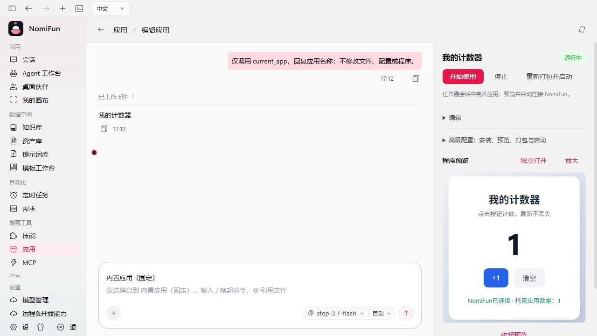

# 按用户手绘原型重实现应用工作区

日期：2026 年 10 月 11 日。代码位于当前工作区，未提交、推送或发布；用户原有作品、合法会话和无关修改均未作为测试对象。

用户最新[手绘原型](assets/app-workspace-product-wireframe.png)是本轮产品结构依据。图中红色省略说明和手工导入箭头是设计标注，不是产品文案。原型中的开发过程在产品里使用完整普通会话显示。后续用户允许调整内嵌预览交互，本轮地址恢复、大窗口预览与名称修正见[补充报告](2026-10-11-app-preview-fix.zh.md)。

最终视觉对照通过，见[设计验收](../../design-qa.md#application-workspace-reimplementation-qa)。

## 实际实现

- 应用首页提供创建、导入、搜索、标签分类、三列应用卡片及每页九项分页。卡片进入应用工作区，运行与修改操作集中在右侧详情。
- 创建、编辑、导入使用同一个应用工作区：左侧完整普通对话与工具过程，底部「内置应用」及模型选择；右侧名称、状态、操作、描述、手工编辑、高级命令和按需程序预览。Agent 在此入口使用系统应用模板，行为约束不显示为产品名称。后续预览修正见本轮补充报告；关闭预览不停止程序。
- 「内置应用」是正式 `app.developer` 官方模板，默认具备普通编程能力和十个托管动作。其他 Agent 可在工作台选入「NomiFun 应用开发」，详细指南按需读取，已有 Agent 和冻结 Session 不自动扩权。
- 创建先建立真实空应用及自有目录；首次发送才通过现役 Session owner 创建普通 Conversation。工作区就是该应用目录，重开严格核对 Session、模板、owner 和确切目录。没有专属创作 Session、第二份对话、交付资格或版本状态。
- 手工导入和配置不依赖 Agent 或模型。Agent 导入外部代码也使用当前应用 ID，不复制当前目录生成另一应用。原始文件保留，源码和产物分别识别，命令仍可覆盖。
- 人工文件替换与 Agent 提交双向暂停；未发送文字和附件在导入得到真实 owner 后迁到该应用的 UI 草稿。异步提交恢复时重新核对原 canonical authority，保留原幂等键；已开始 POST 的未知结果不自动重发。
- 连接继续使用后端运行环境中的 LocalTrust 与原 REST/MCP 链，没有前端 token、SDK、审批、发布、维护或业务数据库管理。

## 发现并修复的实际问题

1. 后台开发 Session 返回原始 `conversation_id/model` DTO，前端曾直接当作 UI Conversation，导致首次发送身份检查失败。现在复用现役 `fromApiConversation`，真实 HTTP wire 合同和首次浏览器发送均通过。
2. 固定模板被普通 Guid 当作一次性路由预选，导入 owner 成功后又替回导入页。产品入口不消费普通 Guid 路由意图；真实 Route、Guid、StrictMode 和延迟响应回归及浏览器复测通过。
3. 应用入口曾显示媒体场景，并可能读写普通媒体草稿。入口与既有聊天都明确关闭媒体草稿/场景，保持普通会话原行为；固定 Agent 不允许从应用页切换。
4. 文件预览的提前 return 置于部分 Hook 之前，打开或关闭时触发 React 错误。所有 Hook 现在保持顺序，真实面板生命周期回归及实际打开、关闭、再打开通过。
5. Windows 删除完成开发回合的应用时返回 OS32。原因是 Wave2 缓存强引用保留 Artifact/VCS 原生目录句柄。现在在现役 Session 准入围栏内正常释放精确开发 Runtime、确认结算并释放确切闲置工作区缓存。仍被调用持有的 owner、同目录其他 Session 活资源或未知效果返回 409，不关闭无关 Session，不修改任何 canonical 事实。
6. 没有生产 writer 的 `exclusive_session_ids` 和整会话删除分支已彻底移除。旧应用登记中的空数组仅安全读入且不再写回；非空或非法值拒绝读取，并保留原登记、文件和历史，不作归属转换。

## 真实闭环证据

[真实模型生成报告](assets/app-workspace-live-generation.json)记录 `step-3.7-flash` 在空应用目录从零生成计数器，并在同一应用、同一普通 Session 中完成后续修复：停止、修改当前源码、再次预览。检查真实 Node 语法、HTML 正文、受保护 NomiFun 请求、未认证 403、上游 503 传递及恢复。两阶段均由独立浏览器执行加一、刷新保留、清空和连接检查；最后确认后继 PID 消失、TCP 关闭及无代理新 HTTP 请求不可达。

该生成报告明确限定计数器链；其构建早于最后的空 `exclusive_session_ids` 字段和目录句柄清理，不将它冒称为最后删除修复的证明。首次浏览器超时及额外 Windows 删除失败均保留，未改写成成功。

[最新实际产品流程](assets/app-workspace-product-flow-browser.json)使用另一个最新编译、未预写应用或 Session 的隔离生产 Host：

- 从正式应用入口导入模型真实源码，保留未发送需求并进入确切应用页。
- 用真实模型发送该需求，固定 Agent 调用 `current_app`，完成普通回合；重开保留同一 Session。
- 在右侧填写描述、标签、预览和生产命令、URL 与 PORT，保存并重开；实际预览、使用、嵌入网页、放大缩回和刷新保留计数通过。
- 实际打开、关闭和再次打开自有目录文件预览。
- 通过 UI 同一生产 HTTP owner 删除，返回 200；受管 PID 消失、托管目录移除、列表归零。
- 删除前后会话投影和 canonical 事件页 JSON 字节相同，原 HTML 与后端源码 SHA-256 相同。数据库全字段保护另由下列 Rust 回归验证。

首页布局与分页使用生产 owner 创建的十个真实空应用记录；它们只用于卡片布局测试，不表示生成了多个可用程序。实测第一页九项、第二页一项、工具筛选五项、精确搜索一项，见[浏览器记录](assets/app-workspace-grid-browser.json)。

右侧密度修正后的[最后截图范围](assets/app-workspace-postcompact-browser.json)来自新的隔离 Host：导入已验证的真实模型源码，实际启动、连接并完成普通只读模型回合后拍摄；不冒称又从零生成了一次。最后[Host 生命周期](assets/app-workspace-ui-host-lifecycle.json)显式结束 204、runner exit 0，进程与监听消失、Provider/LocalTrust 各两次连续清扫通过。TempDir 物理路径没有独立留存核对，不猜测或扫描用户目录。

之前的[UI Host 超时失败](assets/app-workspace-ui-host-deadline.json)保留原 FAIL。其失效 Alert 截图不用于最终视觉验收；它不覆盖已经独立完成的原应用删除与字节保护结果。

## 验证

| 检查 | 实际结果 |
| --- | --- |
| Apps、普通 Guid/媒体草稿、初始消息、队列、暂停竞态和真实组件导航 | 共享回归组 105 tests / 630 assertions 通过；最终 Apps/Guid/文件预览定向组 67/371、暂停/原队列/协作嵌入组 24/114、最后紧凑信息编辑组 13/62 通过。各组部分重叠，不相加当作总覆盖量 |
| `app_workspace_api` | 6/6 通过：无模型手工路径、固定普通 Session、真实 Runtime 回合后删除、完整 canonical 字段保持、活动/未知效果拒绝和共享目录 Session 保护 |
| exact-root 缓存回归 | 1/1 通过；保留中的调用拒绝释放，其他目录不受影响 |
| `nomifun-app-hosting` | 23/23 通过；真实崩溃测试调用单独 subprocess fixture |
| `bun run check` | typecheck、880×600 桌面边界、i18n、主题、图标、CSS、安装器、进程/浏览器/UARC/Session/App Hosting 及脚本检查通过 |
| UI 生产构建、Windows Tauri Rust check | 通过；已有 chunk-size 和 feature/dead-code 警告未作为新功能成功证明 |
| API 清单、官方模板、工具和效果回执 | 新路由严格清单及生成物一致；七模板、十动作、工具因果/权限和未结算围栏定向回归通过 |

## 旧代码汰换与范围

旧插件平台/开发 crate、旧 JS Runtime、SDK/bootstrap/业务存储、Hook/Surface/专属创作与验收、旧路由、UI、Bridge、DTO、Manifest、生成合同及相关 fixtures 已退出。当前应用页和会话接缝统一到薄托管 owner。仅保留必要的 typed 旧 Session 只读历史识别；不恢复旧执行。共用 MCP、Agent kernel、ChannelPlugin 和 Tauri 原生插件未机械删除。

001–003 已发布迁移不改写，未知或部分 lineage 不猜测转换。本轮没有打开、迁移或删改真实用户数据库和作品。

## 具体限制

- 实测平台是 Windows 桌面 WebUI。Windows Tauri 编译及既有 Desktop HTTP/退出测试通过；未实操原生 Tauri 窗口、系统默认浏览器或 macOS/Linux GUI，未签名打包或发布。
- 跨电脑 WebUI 的 Host loopback 地址不会误指向客户端；没有自动网页反向代理。跨机使用需提供浏览器可达的应用地址，未做第二台机器 GUI 验收。
- 狭窄详情面板中的应用网页遵循应用自身布局，可滚动或放大；平台没有添加手机/平板布局。
- 运行状态证明受管进程存在；具体业务正确性仍需实际测试。真实模型样例不证明任意需求一次生成成功。
- 外部程序或其他同目录 Session 仍占用工作区时删除会明确失败并保留登记，等待占用结束后重试；不杀无关进程或删除共享会话凑成功。
- 生成和 UI 测试使用可显式结束的隔离 Host，最终清理测试服务，不把临时本机地址当成已发布产品。
