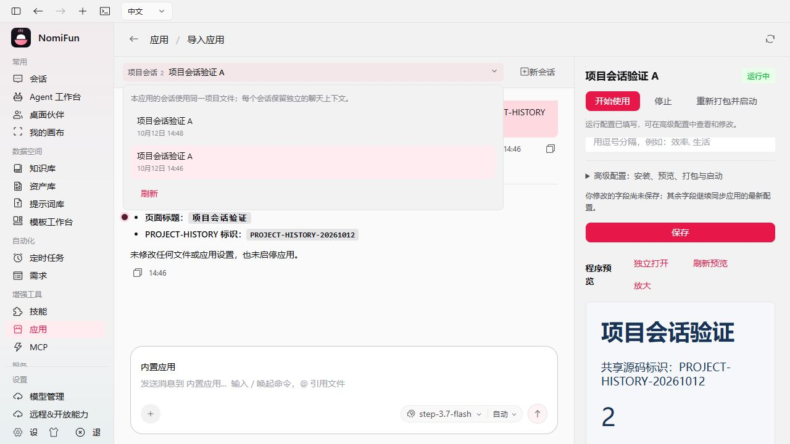
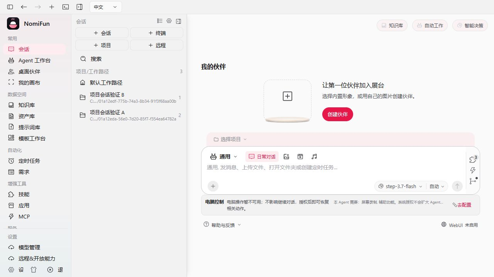

# 应用独立项目与多会话验收

日期：2026-10-12。对应用户本轮要求：**一个应用对应一个独立项目，项目下可以记录多个普通会话；不同应用不共用项目。**

## 实际变化

应用 ID 的自有托管目录就是该应用的独立项目根目录。相同外部源码导入为两个应用时，各自获得独立副本、运行设置和项目会话；命令的相对子目录不改变项目身份。

应用工作区新增「项目会话」历史与「新会话」入口，支持分页、归档显示及明确重开。切换只重新挂载聊天区域，保留右侧未保存设置和实际程序预览。普通会话列表按原工作区规则分组，并用当前应用名称显示项目；同名应用仍按独立路径区分，名称查询失败时回退路径展示。

历史使用既有 canonical Session 存储，按当前显式 workspace 身份、确切 owner 与普通用途派生；没有项目数据库、会话日志副本、App checkpoint 或第二套归属账本。安装级默认工作区占位参数不属于应用项目。其他 Agent 的本项目会话通过普通会话入口继续，不借应用入口替换冻结 binding。

`development_session_id` 只保存最近打开的导航引用。编辑器按明确选中的 Session 保持身份，轮询和另一窗口不能抢走当前选择。新草稿使用稳定 UUIDv7 创建 key；未知响应后保留同一 key，通过确切 canonical opening 重试。应用改名不导致重复创建，冲突参数拒绝；完整删除 Session 仍按原隐私合同清除 opening，不另留创建 key 账本。

新建显式项目会话使用按 owner/目录隔离的项目记忆身份，Agent 切换保持该身份。原有默认记忆 binding 不被迁移。记忆复用当前 Host 生命周期内的现役状态，**不跨 Host 重启持久化**；源码和 canonical 会话历史持久保存，新会话不自动拼接所有旧会话消息。

文件变更检查整个本应用项目，而不只检查最近导航会话。创建、fork、准入、warmup 和 binding 切换复用现有内存锁注册表的目录围栏。活动回合、其他 pending/unknown 效果、未完成原生清理以及同项目 `deleting` 会话仍阻止文件变更。默认会话保持原有目录创建合同。

Agent 导入核验确切 Session、Turn、Snapshot、工具因果与本次 pending Effect 收据，只有自身本次待结算效果可以放行；同时复用原生工作区写锁。拒绝按原 Effect 合同结算为执行前拒绝。删除只释放经正式应用入口创建的闲置 Runtime；无关同目录资源仍可阻止删除，合法历史不被改写或清除。旧单会话 resolver 已退役。

## 真实闭环

使用隔离的正式 AppServices/Host、实际 StepFun `step-3.7-flash` 和桌面 WebUI，手工导入同一源码为应用 A 与应用 B。

| 应用 | 项目目录 | 实际普通会话 | 真实结果 |
| --- | --- | --- | --- |
| A | 独立应用 ID 目录 | A1、A2 | 两次 `workspace.files/read` 均成功，各自普通 Turn completed |
| B | 另一个应用 ID 目录 | B1 | 读取自己的副本，普通 Turn completed |

三个 Session 各有 60 条 canonical 事件，实际工具调用与结果的 call ID、因果及成功状态逐项核验。三次输入标识只存在于各自会话，没有互混；只读操作没有写 Effect。源码相同不意味着项目共用。

应用 A 通过真实 Node HTTP 进程运行；在 iframe 内实际点击计数器从 0 到 2。创建 A2、再选回 A1、查看历史和改变桌面布局后，计数值仍为 2，右侧未保存说明仍保留。普通会话列表实际显示应用 A 的 2 个会话与应用 B 的 1 个会话，名称和目录对应各自项目。880×600 布局的 DOM 验证没有水平溢出；桌面边界检查通过，没有移动端案例。

独立采集在 GUI 操作完成后登录，Cookie 只保留于内存。停止前后逐 canonical 表的 SQL 类型与字段字节摘要完全一致，A 的 4 个文件、B 的 3 个文件及原来源 3 个文件摘要均不变。A 的实际 PID 22556 停止后为 null；B 原本已停止，没有重复操作。正式 Host finish 返回 204，正常 close 在 TempDir 析构前再次验证两个应用的 index.html 与 server.cjs 字节。测试监听与进程已退出。

机器证据：[app-project-live-20261012.json](assets/app-project-live-20261012.json)。测试源与报告不包含 Cookie、Provider key 或 LocalTrust 明文；现役 wrapper 在隔离 TempRoot 内执行两类凭据各两次连续检查。不声称扫描浏览器 profile。

## 验证结果

| 检查 | 结果 |
| --- | --- |
| canonical Session Store 全部 lib 测试 | 121 通过 |
| 项目围栏、冷启动默认会话、deleting 保护与真实 Kernel 记忆读写 | 11 通过 |
| 项目记忆身份、旧默认 binding 不迁移 | 1 通过 |
| 完成围栏交接 | 2 通过 |
| 项目 API、同源独立副本、Agent 切换、真实 Runtime→Kernel→AppTool 导入 | 6 通过；导入实际覆盖成功、活动目标拒绝、未知效果拒绝分别核验源码与收据 |
| 原应用工作区 API | 10 通过 |
| 普通会话能力选择 e2e | 11 通过，单线程 |
| Agent 数据重置 | 2 通过 |
| Apps、桥接、项目分组 UI | 91 通过，12 个文件、541 个断言 |
| typecheck、UI 生产构建、i18n、桌面 UI/Agent Session/App 托管边界、contract generator check | 通过 |

对应 Rust 测试共 164 项通过。编译期间修正了新增测试的贡献锁、DTO 导入及不确定效果夹具；没有削弱生产编译或 Effect 校验。Store 的旧全集比较错误地要求当前数据库保留 migration 001 中已经退役的非 Agent 表，已改为精确比较 AgentData 与 schema_metadata 的表、索引、触发器 SQL，并独立验证完整当前 migration lineage；不可变 baseline、已发布 migration 和保留域 manifest 均未改变。

会话选择的迟到响应竞争、首个新草稿在未知响应/导航轮询后更换 key 的问题均已修正并覆盖测试。实际界面也修正窄栏预览标题被操作按钮挤断的问题。

## 范围与限制

本轮 GUI 实操为 Windows 桌面 WebUI；未实操原生 Tauri、macOS/Linux 或远程电脑。项目记忆沿用 Host 内存合同，不等同持久会话历史。已有冻结会话的记忆范围保留原样。

任意自定义程序的网页地址不能全部自动推断；这次普通 Node 输入通过手工配置实际 HTTP 地址后运行。实际三回合验证为读取和会话隔离，不冒充任意应用生成或业务修改成功。此前生产重构的完整生成与运行证据见相应实施报告。

没有新增迁移、复制会话存储、恢复旧插件/SDK/兼容领域或引入版本、部署、发布、维护与业务数据库管理。既有用户贪吃蛇源码 SHA256 仍为 `bde848bcbc15286a1434d0154666cc5d58a70a4aa05808f7b3841a6f30f3b319`；没有启动或写入真实用户数据目录。保留原有无关工作，未提交、推送或发布。
